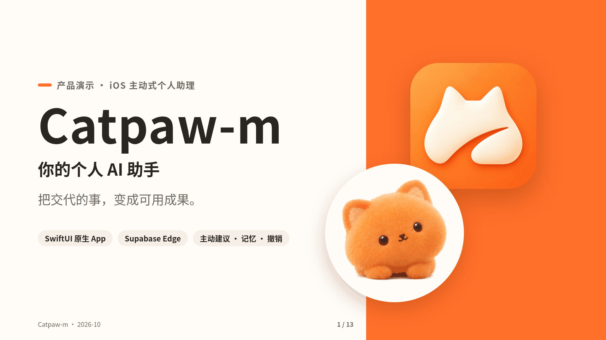
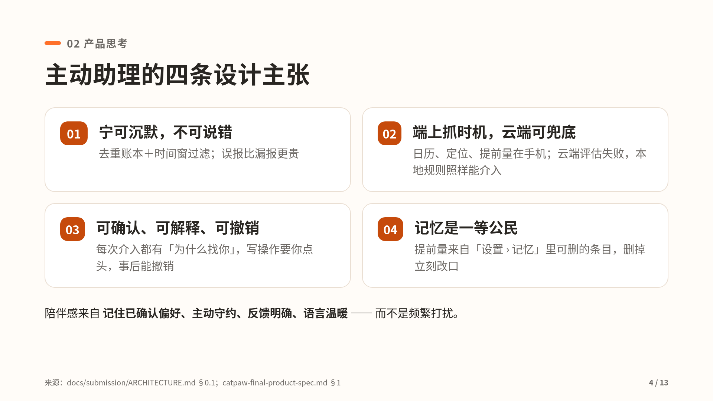
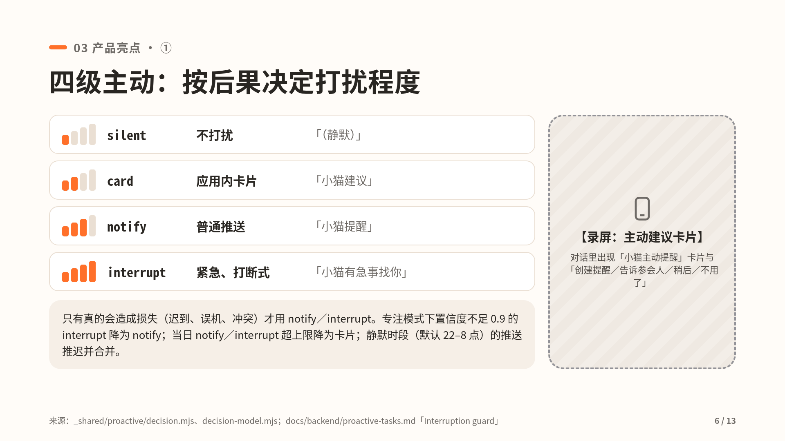
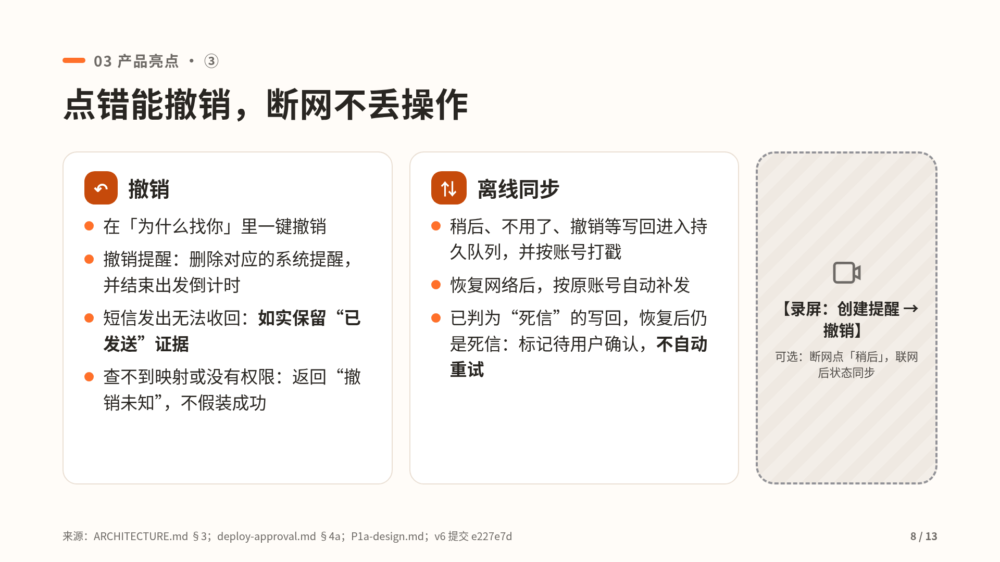
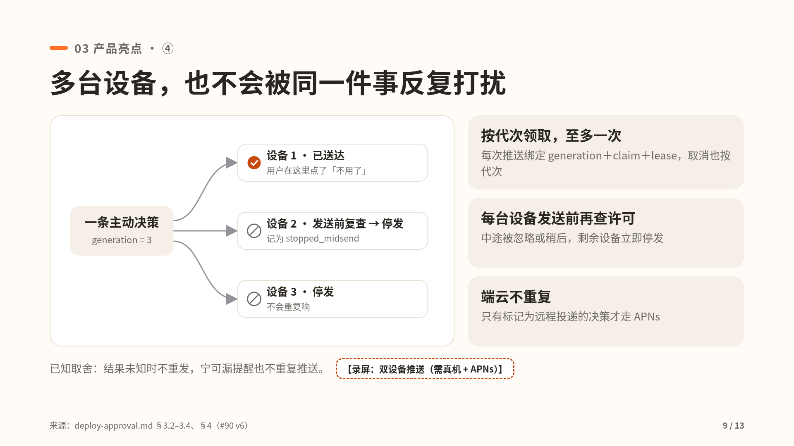
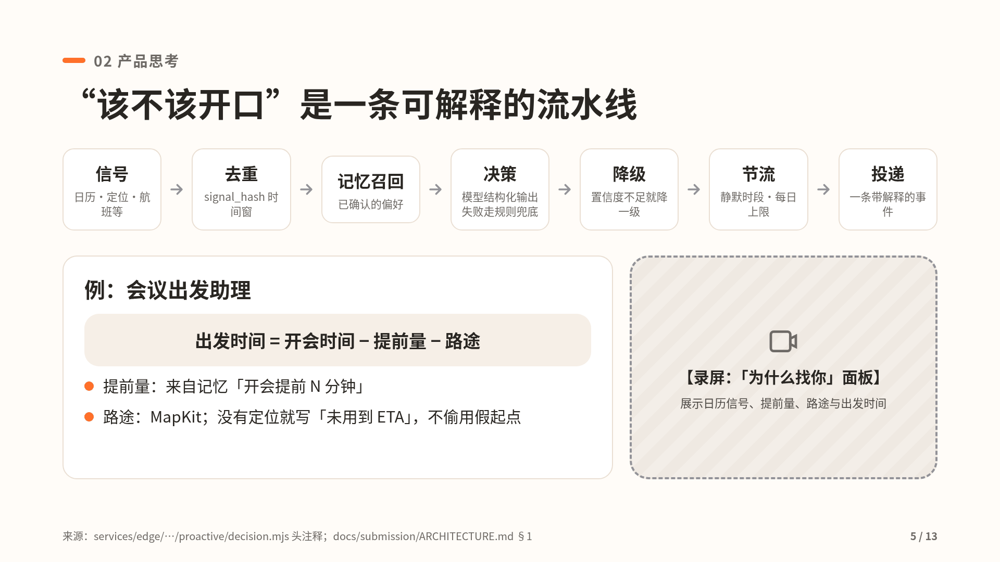
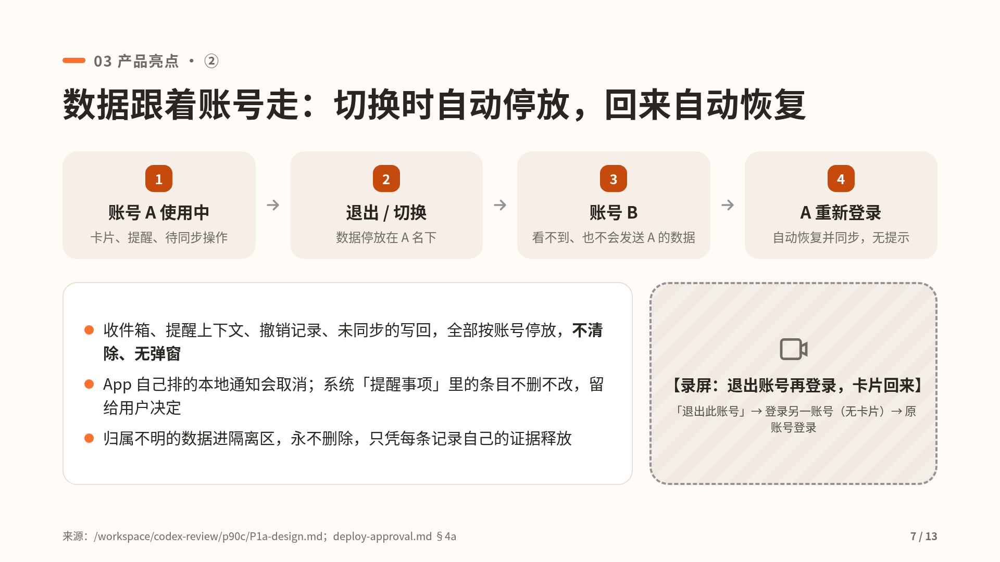

<a id="readme-top"></a>

<div align="center">

# mimi

**帮妈妈把孩子的零碎事情接住，把日常安排与长期成长连起来。**

理解交代 → 确认安排 → 跟进变化 → 记录事实 → 回顾调整。默认“今天”，AI 在原界面整理可编辑草稿；确认后才成为安排。衡量妈妈少操多少心，而不是聊了多少句。

[产品 Roadmap M1–M6](docs/product/mimi-roadmap.md) · [当前进度与验收](docs/status/master-plan.md) · [育儿交互合同](docs/design/family-companion/parenting-core.md) · [架构](docs/architecture.md) · [资产与来源](docs/architecture/mimi-assets-2026-10-24.md) · [存量 PR 审计](docs/architecture/mimi-pr-disposition-2026-10-24.md)

当前开发只推进 M1。本机保存、云同步、系统提醒和家长完成是不同事实。候选源码、已发布包与线上后端分别记录；构建通过不代表原生体验或线上验收通过。品牌显示为 mimi / 小咪，[内部安装、存储与协议身份](docs/internal-identifiers.md)保持兼容。


[](https://github.com/Yankj/mimi/releases/latest)




<sub>设计示意（演示幻灯片封面），非 App 实拍。</sub>

[产品官网](#产品官网) · [快速开始](#quick-start) · [下载与安装](#下载与安装) · [功能](#核心功能) · [演示](#演示) · [架构](#架构) · [文档索引](docs/README.md) · [详细架构](docs/architecture.md) · [贡献指南](CONTRIBUTING.md)

</div>

> [!NOTE]
> **历史发行快照（2026-10-18，非 M1 验收）**：iOS **v1.2.0**（2026-10-18）已发布，见 [Releases](https://github.com/Yankj/mimi/releases/latest)，下表所有能力都在 `main` 上；版本记录见 [CHANGELOG](CHANGELOG.md)。该快照记录的后端为 `catpaw-api` **v55**（#104）、`catpaw-proactive` **v10**（#101）。逐项进展以 [主计划](docs/status/master-plan.md) 为准。

<details>
<summary><b>目录</b></summary>

- [产品官网](#产品官网)
- [背景](#背景)
- [核心功能](#核心功能)
- [Quick Start](#quick-start)
- [下载与安装](#下载与安装)
- [使用](#使用)
- [演示](#演示)
- [架构](#架构)
- [目录结构](#目录结构)
- [配置参考](#配置参考)
- [开发与测试](#开发与测试)
- [Roadmap 与已知限制](#roadmap-与已知限制)
- [文档地图（Diátaxis）](#文档地图diátaxis)
- [Contributing](#contributing)
- [License](#license)
- [给 AI 助手的上下文](#给-ai-助手的上下文)

</details>

<!-- CATPAW-WEBSITE:START -->
## 产品官网

以下为独立营销站与历史演示入口，不构成当前育儿候选的能力验收。

**先你一步，把事办妥。** 家里的事，交给小咪记着。拍一张、说一句，它整理成待你确认的卡片；今天要办的一目了然，我们家的事它都记得，你点头之前什么都不改。

[浏览官网](https://mimi.heydusk.com/) · [观看产品视频](https://mimi.heydusk.com/#film) · [25 页产品介绍](https://mimi.heydusk.com/assets/catpaw-product-deck.pdf) · [安全与隐私](https://mimi.heydusk.com/trust.html) · [技术设计](https://mimi.heydusk.com/technology.html)

- **主动**：到点之前，先来找你。
- **有记忆**：记住偏好，也真正用上。
- **能执行**：写进日历，留下回执。
- **可信**：先问你，再动手。

官网源码位于公司站仓库 [Yankj/heydusk-site/apps/mimi](https://github.com/Yankj/heydusk-site/tree/feat/company-site/apps/mimi)，与 heydusk.com 同仓分目录部署；本仓库 [apps/website](apps/website) 仅保留迁出说明。演示素材保留 v1.1 版本；当前入口、状态与限制以 [能力清单](docs/product/capabilities/cat-capabilities.json) 和 [CHANGELOG](CHANGELOG.md) 为准。
<!-- CATPAW-WEBSITE:END -->

## 背景

孩子的课程、临时变化和成长观察往往散落在消息与记忆里。mimi 把一次交代变成可核对的安排，将实际发生的事留下来，再帮助妈妈回顾和调整。先把一件事办清楚，之后再逐阶段接入变化、成长回顾、家庭记忆、同步与可靠主动提醒。

本仓库维护一个 iOS App 和既有 Supabase 后端。旧聊天、设备动作、记忆和任务能力按需复用；官网独立维护，历史 App 与来源快照只读保存。

## 核心功能

本节保留通用助理发行线的能力与代码导航，不是育儿 M1–M6 的完成清单；新阶段验收以[主计划](docs/status/master-plan.md)为准。

“在哪里”一列：**main** = v1.1 之前已在 `main`；**v1.1.0** = 随 v1.1.0 发版（#98）进入 `main`；**线上 v53** = 已部署到生产的后端版本。路径相对 `apps/ios-conversation/Sources/`（iOS）或 `services/edge/supabase/functions/`（Edge）。

| 能力 | 说明 | 在哪里 | 主要代码 |
|---|---|---|---|
| 原生 Google / GitHub 登录 | Supabase OAuth（PKCE），回调 `catpawm://auth-callback`；侧栏顶部账号下拉：当前账号、切换/添加账户、退出登录；匿名试用可原地绑定 | v1.1.0 | `Domain/NativeOAuth.swift`、`Providers/NativeOAuthWebSession.swift`、`Features/NativeOAuthViews.swift` |
| 流式回复 | URLSession SSE，断线按原 turn 恢复；服务端按 512 字符 / 250 ms 批量落库 | main | `Features/ConversationSessionService.swift`、`Providers/NativeChatHTTPBackend.swift` |
| 实时逐字预览（live text） | 服务端 `text_preview` 帧约每 100 ms 一次，客户端带 `X-cat-Live-Text: 1` 才启用，旧版 App 不受影响 | 服务端 main（线上 v53）；iOS 端 v1.1.0 | `_shared/core/src/live-text.mjs`、`Features/Answer/AnswerPhaseModel.swift` |
| 上下文窗口管理 | 最近 40 条 / 80 kB 窗口按完整 turn 截断；超预算先省略旧工具结果、再缩窗口，最后返回 `413 conversation_too_long`；完整历史保留 | main（线上 v53） | `_shared/core/src/context-window.mjs` |
| 图片理解 | 相机 / 相册输入；视觉路由链 Gemini Flash-Lite → OpenRouter Gemma，`CATPAW_VISION_ROUTE=chain\|legacy` | main | `packages/ios-image-composer`、`_shared/core/src/vision-route-chain.mjs` |
| 语音输入 | 听写：iOS 26 用 SpeechAnalyzer，旧系统回退 SFSpeechRecognizer | main | `Voice/`、`Domain/DictationPolicy.swift` |
| 语音对话 | 免手动循环：听 → 发送 → 思考 → 朗读 → 继续听，支持插话打断、遇到审批卡片暂停；语音朗读回复默认开启 | v1.1.0 | `Domain/VoiceSession.swift`、`Features/Composer/ComposerDictation.swift` |
| 主动任务 | 端上规则 + 配额 + 「为什么找你」说明 + 撤销；Edge `catpaw-proactive` 负责决策与推送；含 Live Activity / Widget | main | `Features/Proactive/`、`catpaw-proactive/`、`App/catLiveActivityCoordinator.swift` |
| 设备集成 | EventKit（日历查询 / 创建、提醒事项）、Contacts（联系人搜索）、MapKit（附近地点 + 路程 ETA、打开地图），以及短信 / 邮件 / 电话 / 快捷指令跳转 | main | `Features/DeviceCalls/DeviceToolRouter.swift`、`Features/Nearby/NearbyPlaces.swift` |
| 人在回路 UI 卡片 | 审批卡片、任务计划、设备结果卡、Generative UI 内嵌组件（选择、确认、表单、列表、进度、地点、日程） | main | `Features/ConversationApprovalCardView.swift`、`Features/DeviceCards/`、`Features/GenerativeBlocks/` |
| 记忆 | 服务端 agent-memory：功能开关 + allowlist 准入，用户可关闭；`memory_forget` 需审批 | main（服务端） | `_shared/agent-memory/` |
| 记忆工具调用（iOS） | iOS 端审批工具白名单接纳 `memory_search/save/update`（自动）与 `memory_forget`（审批） | v1.1.0 | `Providers/NativeChatHTTPBackend.swift` |
| 吉祥物动画 | 毛绒猫姿态随对话状态切换（等待 / 思考 / 写作 / 执行 / 完成 / 出错） | main | `DesignSystem/catPlushMascot.swift` |
| 版本管理 | 设置 › 关于显示「版本 1.1.0 (build N) · 发布于 日期 时间」，轻点显示提交号、长按复制；构建号 = git 提交数，构建时自动写入；版本号只用 `Scripts/bump-version.sh` 修改，见 [CHANGELOG](CHANGELOG.md) 与 [iOS 版本规范](docs/development/ios-versioning.md) | v1.1.0 | `Domain/AppBuildInfo.swift`、`Features/ConversationFirstView.swift`（`AppVersionRow`） |
| 任务、成果、收件箱 | 计划生成 / 暂停 / 取消、报告阅读与编辑、待办汇总 | main | `Features/ConversationTaskPlan*`、`Features/ConversationArtifact*`、`Features/ConversationInbox*` |

<details>
<summary><b>主动能力设计示意（幻灯片）</b></summary>






<sub>设计示意，来自演示幻灯片，不是 App 实拍。</sub>

</details>

<p align="right">(<a href="#readme-top">返回顶部</a>)</p>

## Quick Start

> **教程（Tutorial）**：在模拟器里跑起来，不需要任何账号或密钥。

**前置条件**

- macOS + **Xcode 26**（iOS 26 SDK；App 部署目标 iOS 17）。无第三方 Swift 依赖，两个本地 package 已随仓库检入。
- 可选：Python 3（仓库检查脚本）、Deno（Edge 离线测试）。

**步骤**

```sh
git clone https://github.com/Yankj/mimi.git mimi
cd mimi
open apps/ios-conversation/cat.xcodeproj
```

1. 选择 scheme **`cat`**（Debug，使用人工 fixture），任选一个 iOS 17+ 模拟器。
2. `⌘R` 运行。未配置 Supabase / 模型时 App 走离线合成路径：可以浏览界面和组件，但**不会产生真实模型回答**。
3. 真实产品构建用 scheme **`DeviceTrial`**，需在本地提供公开配置与签名（见[配置参考](#配置参考)），仓库里这些值是空的。

不想自己编译时，可以直接装打包好的构建，见[下载与安装](#下载与安装)。

<p align="right">(<a href="#readme-top">返回顶部</a>)</p>

## 下载与安装

> **操作指南（How-to）**：安装已打包的构建。所有构建都在 [Releases](https://github.com/Yankj/mimi/releases/latest) 页面；仓库目前是私有的，需要有仓库访问权限才能下载。

> [!TIP]
> 最新版本：[mimi v1.2.0](https://github.com/Yankj/mimi/releases/tag/v1.2.0)（2026-10-18），文件为 `Catpaw-1.2.0-simulator.zip` 和 `Catpaw-1.2.0.ipa`（历史发行物，保留原名）。

| 方式 | 文件 | 适合 | 限制 |
|---|---|---|---|
| A. 模拟器 | `Catpaw-<版本>-simulator.zip` | 在 Mac 上快速体验 | 只能装在 iOS 模拟器上，不能装真机 |
| B. 真机（开发签名） | `Catpaw-<版本>.ipa` | 已登记的测试设备 | **只能装在开发者描述文件（provisioning profile）里登记过 UDID 的设备上** |
| C. 从源码构建 | — | 开发、评审 | 需要 Xcode 26 |

**A. 模拟器构建**

1. 从 Releases 下载 `Catpaw-<版本>-simulator.zip`，打开任意 iOS 17+ 模拟器（Xcode › Open Developer Tool › Simulator）。
2. 解压并安装，bundle id 从安装包自己的 `Info.plist` 读取：

```sh
unzip Catpaw-<版本>-simulator.zip -d catpaw-sim
APP=$(find catpaw-sim -maxdepth 2 -name '*.app' | head -1)
xcrun simctl install booted "$APP"
BUNDLE_ID=$(/usr/libexec/PlistBuddy -c 'Print :CFBundleIdentifier' "$APP/Info.plist")
xcrun simctl launch booted "$BUNDLE_ID"
```

也可以直接把解压出来的 `.app` 拖进模拟器窗口安装。仓库里的默认 bundle id 是 `com.example.CatpawM.ConversationFirst.Auth`（Debug / Release）和 `com.example.CatpawM.OpenMuseDemo`（DeviceTrial）；正式包可能在本地签名配置里改过，以 `Info.plist` 为准。

**B. 真机 ipa（开发签名）**

> [!WARNING]
> 这个 ipa 用开发证书签名，**只能安装在开发者描述文件里登记过的设备上**，其他设备会安装失败。如需加入测试设备，请把设备 UDID 发给维护者重新签名。面向公众的分发需要走 TestFlight 或 App Store，目前还没有。

1. 下载 `Catpaw-<版本>.ipa`，用数据线连接 iPhone 并信任这台电脑。
2. 安装（二选一）：
   - **Xcode**：Window › Devices and Simulators › 选中设备 › 「Installed Apps」下的「+」› 选 ipa。
   - **Apple Configurator**：选中设备 › 添加 › App › 选 ipa（也可以把 ipa 拖到设备上）。
3. iOS 16 及以上运行开发签名的 App 需要先打开 设置 › 隐私与安全性 › 开发者模式（按提示重启）。如提示未受信任的开发者，在 设置 › 通用 › VPN与设备管理 里信任该开发者。

**C. 从源码构建**

见 [Quick Start](#quick-start)；真机构建用 `DeviceTrial` scheme 并在本地提供签名与公开配置（见[配置参考](#配置参考)）。

**确认版本**

装好后打开 App 的 设置 › 关于，应显示「版本 X.Y.Z (build N) · 发布于 日期 时间」，和 Release 页面、[CHANGELOG](CHANGELOG.md) 里的版本一致。轻点这一行可以看到提交号。

<p align="right">(<a href="#readme-top">返回顶部</a>)</p>

## 使用

> **操作指南（How-to）**：典型对话与期望表现。离线评审模式对应 `run-simulator-review.sh` 的参数，可在无网络时复现界面。

| 场景 | 示例对话 | 期望表现 | 离线评审模式 |
|---|---|---|---|
| 基础对话 | “帮我想想周末怎么安排” | 流式回答，可停止与恢复 | `input` |
| 生成计划 | “把下周的读书计划拆成每天的任务” | 出现任务计划卡片，可逐项确认 | `plan` |
| 报告与编辑 | “整理一份竞品对比报告” → “第二节写短一点” | 生成成果，进入阅读 / 编辑 | `report` |
| 审批动作 | “周五下午 3 点提醒我交材料” | 弹出审批卡片；确认后写入系统日历 / 提醒事项 | `approval` |
| 任务控制 | “先暂停刚才那个任务” | 任务状态切换（暂停 / 取消） | `control` |
| 交互组件 | “帮我在这三个方案里选一个” | 回答内嵌选择 / 表单等结构化组件 | `calculator`（Generative UI 场景） |
| 附近与路程 | “附近有什么咖啡店，走过去要多久” | 请求定位后给出 3–5 个地点与 ETA | — |
| 看图 | 拍一张照片问“这是什么” | 图片经视觉路由链理解后回答 | — |

```sh
# 需要先按脚本说明构建好对应的模拟器包；脚本不会登录或调用模型
zsh apps/ios-conversation/Scripts/run-simulator-review.sh plan
```

<p align="right">(<a href="#readme-top">返回顶部</a>)</p>

## 演示

> App 实拍 GIF 与 3–5 分钟演示视频正在录制，完成后放在这里。

- 录屏分镜与讲稿：[docs/demo-script.md](docs/demo-script.md)
- 主动助理三个演示场景：会前主动提醒 +「为什么找你」、创建提醒 + 撤销、账号停放与恢复（详见分镜）。

<details>
<summary><b>场景配图（设计示意）</b></summary>




<sub>设计示意；虚线框为录屏贴片位，不是实拍画面。</sub>

</details>

<p align="right">(<a href="#readme-top">返回顶部</a>)</p>

## 架构

[架构总览](docs/architecture.md)统一说明育儿页面、账本、AI 整理、既有云服务和系统效果的关系。`apps/ios-conversation` 是唯一原生宿主；`services/edge/supabase/functions` 是唯一后端维护源。M1 的安排事实由账号隔离本机账本保存，AI 只产出候选；未来云同步需单独解决权威映射、迁移和冲突。

## 目录结构

```text
mimi/
├── apps/
│   ├── ios-conversation/        # ★ 当前唯一维护的 iOS App（cat.xcodeproj）
│   │   ├── Sources/             #   App · Domain · Features · Persistence · Providers · Voice · DesignSystem · Shared
│   │   ├── Tests/               #   XCTest / UITest 与可移植 runner
│   │   ├── Scripts/             #   可移植测试、源码检查、版本、模拟器评审脚本
│   │   ├── Configuration/       #   xcconfig（含 Version.xcconfig）、Info.plist、entitlements
│   │   ├── Resources/           #   资源与 UIStrings 本地化
│   │   └── Widgets/             #   Widget / Live Activity
│   ├── ios/                     # 冻结的 v1（只读历史）
│   ├── ios-openmuse-demo/       # 冻结的 r3（只读历史）
│   └── website/                 # 官网迁出说明；源码在 heydusk-site
├── packages/
│   ├── ios-navigation/          # 侧栏导航本地 Swift package
│   └── ios-image-composer/      # 图片输入本地 Swift package
├── services/
│   ├── edge/                    # ★ 后端维护源
│   │   ├── supabase/functions/  #   catpaw-api · catpaw-proactive · _shared
│   │   ├── supabase/migrations/ #   数据库迁移
│   │   ├── docs/                #   接口契约与部署清单
│   │   └── test/                #   Edge 离线测试
│   ├── facade/                  # 冻结的 native contract v1
│   └── offline/                 # 离线服务来源
├── scripts/                     # 仓库检查、敏感扫描、Edge 离线测试
├── docs/                        # 文档（索引见 docs/README.md）
├── qa/                          # 独立 QA 报告
├── design/ · research/          # 设计与研究输入
├── vendor/openmuse/             # 固定版本上游（MIT）
├── CHANGELOG.md                 # iOS 版本记录（Keep a Changelog + SemVer）
├── AGENTS.md                    # 人机共读的仓库约定
└── handoff.md                   # 接手说明
```

目录角色以 [`docs/development/repository-layout.json`](docs/development/repository-layout.json) 为准。

<p align="right">(<a href="#readme-top">返回顶部</a>)</p>

## 配置参考

> **参考（Reference）**：仓库不含任何凭据或生产配置；这里只列名称与用途。

<details>
<summary><b>Edge 环境变量（services/edge/supabase/functions/_shared/config.mjs）</b></summary>

| 名称 | 类型 | 用途 |
|---|---|---|
| `SUPABASE_URL` | 配置（必需） | Supabase 项目地址 |
| `CATPAW_PUBLISHABLE_KEY` | 配置（必需） | Supabase publishable key |
| `CATPAW_DATABASE_URL` | Secret（必需） | PostgreSQL 连接 |
| `CATPAW_PRIVATE_MODEL_KEY` | Secret（必需） | 模型路由访问密钥 |
| `CATPAW_TICK_HMAC_KEY` | Secret（必需） | 后台 tick 请求签名 |
| `CATPAW_MEMORY_GUARD_KEY` | Secret（必需） | 记忆数据保护 |
| `CATPAW_GEMINI_API_KEY` / `CATPAW_GROQ_API_KEY` | 可选 | 免费模型路由链的提供方密钥 |
| `CATPAW_MODEL_ROUTE_ORDER` | 可选 | 路由链顺序 |
| `CATPAW_VISION_ROUTE` | 可选 | `chain`（默认，有 Gemini 密钥时）或 `legacy` |
| `CATPAW_SSE_TEXT_INTERVAL_MS` | 可选 | live text 间隔，默认 100，限制在 80–120 |
| `CATPAW_PUBLIC_SOURCE_POLICY` | 可选 | 公开网页读取的来源策略 JSON |

完整列表见 `config.mjs` 与 [部署清单](services/edge/docs/deploy-checklist.md)；路由契约见 [model-routes-contract](services/edge/docs/model-routes-contract.md) 与 [vision-route-chain](services/edge/docs/vision-route-chain.md)。

</details>

<details>
<summary><b>iOS 配置（DeviceTrial.Info.plist / xcconfig）</b></summary>

| 键 | 用途 |
|---|---|
| `CatpawSupabaseProjectURL` | Supabase 项目地址 |
| `CatpawSupabasePublishableKey` | Supabase publishable key |
| `CatpawBackendOrigin` | 后端 API origin |
| `CatpawServerScopeID` | 服务端作用域标识 |
| `DEVELOPMENT_TEAM` / `PRODUCT_BUNDLE_IDENTIFIER` | 签名与包名，本地提供 |
| `MARKETING_VERSION` / `CURRENT_PROJECT_VERSION` | `Configuration/Version.xcconfig`；`MARKETING_VERSION` 只用 `Scripts/bump-version.sh major\|minor\|patch` 修改，真实构建号由「Stamp Build Info」阶段（`Scripts/app-version.py stamp`）按 git 提交数写入 |

权限：相机、麦克风、相册、语音识别、日历、提醒事项、通讯录、定位（使用期间）。

</details>

<details>
<summary><b>脚本环境变量</b></summary>

| 名称 | 用途 |
|---|---|
| `CATPAW_DENO_BIN` | Edge 离线测试使用的 Deno 路径 |
| `CATPAW_PUBLIC_NPM_CACHE` | 已有的公开依赖缓存目录 |
| `CATPAW_REVIEW_DEVICE` | 模拟器评审脚本的目标设备 |

</details>

<p align="right">(<a href="#readme-top">返回顶部</a>)</p>

## 开发与测试

```sh
# 仓库完整性与敏感扫描（提交前必跑）
python3 scripts/check-repository-layout.py
python3 scripts/check-repository.py
python3 scripts/scan-repository.py

# iOS：可移植测试（macOS swiftc，无需模拟器）、源码与本地化检查
zsh apps/ios-conversation/Scripts/test-conversation-portable.sh
zsh apps/ios-conversation/Scripts/check-source.sh
python3 apps/ios-conversation/Scripts/check-localization.py

# iOS：XCTest / UITest
xcodebuild test -project apps/ios-conversation/cat.xcodeproj -scheme cat \
  -destination 'platform=iOS Simulator,name=<你的模拟器>'

# Edge：离线测试（禁网络，只读已有依赖缓存）
CATPAW_DENO_BIN=<Deno路径> CATPAW_PUBLIC_NPM_CACHE=<公开cache目录> sh scripts/test-edge-offline.sh
```

- 分支：不在 `main` 直接开发，按 [分支规范](docs/development/branch-management.md) 用短分支；`.githooks` 提供本地守卫。
- 部署：Edge 函数与数据库迁移只在用户明确批准后部署，步骤见 [部署清单](services/edge/docs/deploy-checklist.md)。
- CI：GitHub Actions 当前因额度用尽暂停，PR 需附本地编译与测试记录。

<p align="right">(<a href="#readme-top">返回顶部</a>)</p>

## Roadmap 与已知限制

[用户确认的 M1–M6 Roadmap](docs/product/mimi-roadmap.md)是阶段范围唯一入口，[主计划](docs/status/master-plan.md)记录代码、自动测试、设备验证和线上验收。先关闭 M1 构建与主流程问题，再进入 M2；本机提醒前置到 M2，家庭同步与多人分工在 M5，真实试用在 M6。

M1 本机账本尚不代表云同步、系统提醒或图片/语音育儿提取。无后端配置只能运行明确的合成路径；原位 AI 的专用接口必须与服务版本匹配。历史发布与已知问题见[CHANGELOG](CHANGELOG.md)及各日期验收，不从旧版本待办推断今天状态。私有仓库服务器保护未被证实生效，本地 hooks 不覆盖 API/连接器操作。

## 文档地图（Diátaxis）

| 类型 | 适合 | 入口 |
|---|---|---|
| Tutorials 教程 | 第一次跑起来 | [Quick Start](#quick-start)、[接手说明](handoff.md)、[iOS 工程说明](apps/ios-conversation/README.md) |
| How-to 操作指南 | 完成具体任务 | [下载与安装](#下载与安装)、[使用](#使用)、[录屏分镜](docs/demo-script.md)、[Edge 离线验证](services/edge/README.md)、[部署清单](services/edge/docs/deploy-checklist.md)、[贡献指南](CONTRIBUTING.md) |
| Reference 参考 | 查准确信息 | [配置参考](#配置参考)、[CHANGELOG](CHANGELOG.md)、[iOS 版本规范](docs/development/ios-versioning.md)、[Edge 接口契约](services/edge/docs/)、[目录角色](docs/development/repository-layout.json) |
| Explanation 原理 | 理解为什么 | [架构总览](docs/architecture.md)、[架构索引](docs/architecture/README.md)、[研究索引](docs/research/README.md) |

完整索引见 [docs/README.md](docs/README.md)。

<p align="right">(<a href="#readme-top">返回顶部</a>)</p>

## Contributing

见 [CONTRIBUTING.md](CONTRIBUTING.md)：分支规范、提交前检查、敏感信息规则；PR 请使用 [PR 模板](.github/pull_request_template.md)，问题请用 [Issue 模板](.github/ISSUE_TEMPLATE/)。

## License

开源协议待定，仓库根目录暂无 LICENSE 文件。第三方声明见 [THIRD_PARTY_NOTICES.md](THIRD_PARTY_NOTICES.md)；`vendor/openmuse` 保留上游 MIT 原文。

<p align="right">(<a href="#readme-top">返回顶部</a>)</p>

## 给 AI 助手的上下文

- **技术栈**：Swift 5 / SwiftUI（部署目标 iOS 17，Xcode 26 编译）、SwiftData（CloudKit 关闭）、URLSession SSE、EventKit / Contacts / MapKit / Speech；后端 Supabase Edge Functions（Deno，`.ts`/`.mjs`）+ PostgreSQL。
- **维护入口**：iOS 只改 `apps/ios-conversation`；后端只改 `services/edge/supabase/functions`。`apps/ios`、`apps/ios-openmuse-demo`、`services/facade`、`services/edge/deployed-baselines`、`vendor` 为冻结快照。
- **分层**：`Views → *Service → Domain contracts`；`Providers` 封装网络、认证、系统框架；`Persistence` 封装 SwiftData。UI 不直接持有账号或执行副作用。
- **核心领域模型**：孩子、成长目标、安排草稿/确认/取消/完成、独立记录；既有 Conversation、TaskPlan、审批、DeviceEffect、Memory 等作为复用模块，助手任务完成不等于孩子完成。
- **约定**：结果未知标 unknown 并按原决定核对；合成结果不得冒充真实验收；不新增依赖或凭据；部署需用户批准；进度只写 [主计划](docs/status/master-plan.md)。
- 完整规则见 [AGENTS.md](AGENTS.md)。

<p align="right">(<a href="#readme-top">返回顶部</a>)</p>
