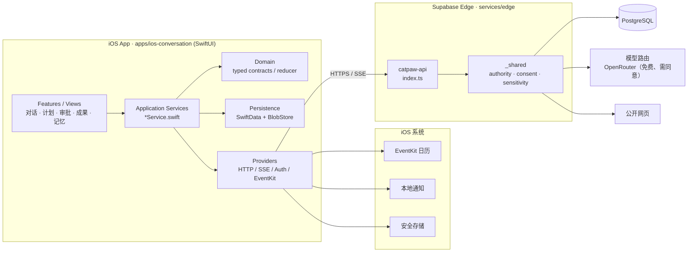
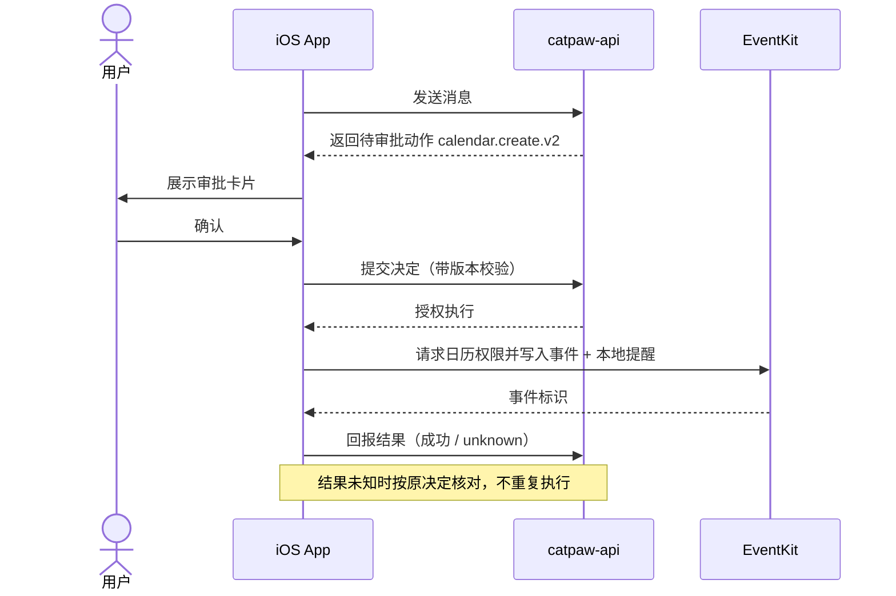
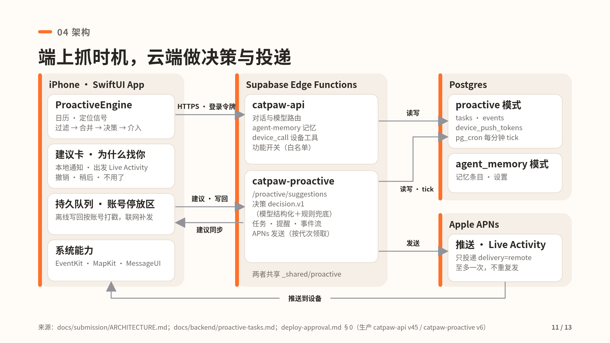

<a id="readme-top"></a>

<div align="center">

# CatPaw Mobile（catpaw-m）

**对话优先的主动式个人助理 iOS App：自然对话 → 可审批的计划与动作 → 可恢复的任务与成果，人始终在回路中。**


<sub>设计示意（演示幻灯片封面），非 App 实拍。</sub>

<!-- TODO(demo): App 实拍 GIF / 录屏待 Mac 录制 -->
`[ App 实拍 GIF：TODO（待 Mac 录制）]` · `[ 3–5 分钟演示视频链接：TODO ]` · [录屏脚本](docs/demo-script.md)

[快速开始](#quick-start) · [架构](#架构) · [文档索引](docs/README.md) · [详细架构](docs/architecture.md) · [主计划（唯一进度）](docs/status/master-plan.md) · [贡献指南](CONTRIBUTING.md)

</div>

> [!IMPORTANT]
> 项目处于 **重启整合阶段**，真实产品验收尚未通过。readiness、合成测试和安装成功都不等同于模型 / 主动任务可用；当前进展只维护在 [主计划](docs/status/master-plan.md)。

<details>
<summary><b>目录</b></summary>

- [背景与痛点](#背景与痛点)
- [核心功能](#核心功能)
- [Quick Start](#quick-start)
- [使用与演示脚本](#使用与演示脚本)
- [架构](#架构)
- [目录结构](#目录结构)
- [配置参考](#配置参考)
- [开发与测试](#开发与测试)
- [Roadmap 与已知限制](#roadmap-与已知限制)
- [Contributing](#contributing)
- [License](#license)
- [给 AI 助手的上下文](#给-ai-助手的上下文)

</details>

## 背景与痛点

传统助理 App 要么是“问一句答一句”的聊天框，要么是需要用户自己拆解步骤的工具集合。CatPaw Mobile 尝试做一个 **主动式** 助理：

- **从对话到行动**：用户用自然语言表达目标，助理产出可执行的计划（task plan）、报告（artifact）和设备动作（如写入系统日历并设置提醒），而不是只给文字建议。
- **人在回路（human-in-the-loop）**：任何会改变外部世界的动作（写日历、发起任务、修改成果）都先以审批卡片呈现，用户确认后才执行；结果未知时按原决定核对，不重复执行。
- **场景化交互组件（Generative UI）**：回答里可以嵌入选择、表格、计时 / 计数等结构化组件，用户直接点按完成交互，而不是继续打字。
- **可恢复与可追溯**：会话、任务和成果在本地 SwiftData 持久化，网络中断后按原 turn 恢复；记忆只在用户开启并确认后用于个性化。

本仓库同时是美团 CatPaw 面试大作业的交付仓：架构文档、可运行 Demo、README 与演示视频（TODO）。

<p align="right">(<a href="#readme-top">返回顶部</a>)</p>

## 核心功能

以下以 `main` 分支源码为准（`apps/ios-conversation/Sources`、`services/edge/supabase/functions`）。

| 能力 | 说明 | 主要代码 |
|---|---|---|
| 对话与流式回复 | URLSession SSE 流式输出，断线后按原 turn GET 恢复 | `Features/ConversationSessionService.swift`、`Providers/NativeChatHTTPBackend.swift` |
| 任务计划与控制 | 生成计划、暂停 / 取消任务，后台 follow-up 队列 | `Features/ConversationTaskPlan*`、`ConversationTaskControl*`、`ConversationFollowupQueueService.swift` |
| 审批动作 | 动作以审批卡片呈现，确认后才提交；过期 / 冲突时拒绝记录决定 | `Features/ConversationTaskAction*`、`Domain/ConversationTaskActions.swift` |
| 系统日历 + 本地提醒（EventKit） | `calendar.create.v2`：在用户同意后写入可修改的系统日历，并附带本地通知提醒；无法确认时标为 unknown，不盲删 | `Providers/NativeCalendarEffectExecutor.swift`、`Features/ConversationDeviceEffect*` |
| 成果（Artifact） | 报告阅读、编辑、引用来源、在成果上继续对话 | `Features/ConversationArtifact*` |
| 收件箱 | 汇总需要用户处理的事项 | `Features/ConversationInbox*`、Edge `/catpaw/inbox/` |
| 记忆 | 用户开启并确认后才用于个性化，可查看来源 | `Features/ConversationMemory*`、`Providers/NativeMemory*` |
| Generative UI | 回答内嵌选择、表格等结构化组件 | `Features/ConversationGenerativeUI*` |
| 语音与图片输入 | 语音识别 / 朗读、相机与相册图片输入 | `Voice/`、`Features/NativeMediaPicker.swift`、`packages/ios-image-composer` |
| 账号 | Supabase 匿名 / 登录会话，凭据存安全存储 | `Providers/NativeAuth*`、`Features/NativeLoginView.swift` |
| 公共网页研究 | Edge 端按审查过的来源策略读取公开网页 | `_shared/public-web-reader.mjs` |

<details>
<summary><b>主动能力设计示意（#90 分支，未合入 main）</b></summary>


<sub>设计示意，来自演示幻灯片；所述能力在 #90 分支上，#90 服务端尚未部署。</sub>

</details>

**在途、尚未合入 `main`**（以对应 PR 为准，合入后再更新本表）：设备工具调用安全闸门（#89）、主动推送（#90）、记忆隐私与开关（#91）。附近美食、路线、Contacts / MapKit 集成在 `main` 源码中未找到，未列为现有功能。

<p align="right">(<a href="#readme-top">返回顶部</a>)</p>

## Quick Start

目标：3 分钟内在模拟器里看到 App（离线 fixture 模式，不需要任何账号或密钥）。

**前置条件**

- macOS + Xcode（支持 iOS 17 SDK）；无第三方 Swift 依赖，两个本地 package 已随仓库检入
- 可选：Python 3（仓库检查脚本）、Deno（Edge 离线测试）

**步骤**

```sh
git clone https://github.com/Yankj/catpaw-m.git
cd catpaw-m
open apps/ios-conversation/CatpawM.xcodeproj
```

1. 选择 scheme **`CatpawM`**（Debug 使用人工 fixture），选择任一 iOS 17+ 模拟器。
2. `⌘R` 运行。未配置 Supabase / 模型时 App 走离线合成路径：可以浏览界面和组件，但 **不会产生真实模型回答**。
3. 真实产品构建使用 scheme **`DeviceTrial`**，需要在本地提供公开配置与签名（见[配置参考](#配置参考)），仓库内这些值为空。

> [!NOTE]
> SwiftUI 宏、XCTest 和 Simulator 可能需要主机允许相应进程。
>
> **ipa 下载**：仓库目前没有 GitHub Release / ipa 发布流程。TODO：如需提供，需用户决定发布方式与签名方案。

<p align="right">(<a href="#readme-top">返回顶部</a>)</p>

## 使用与演示脚本

> 演示视频：TODO（3–5 分钟，链接待补）。以下脚本对应仓库中已有的离线评审场景（`run-simulator-review.sh` 的模式），可在无网络时复现界面。

| 场景 | 示例对话 | 期望表现 | 离线评审模式 |
|---|---|---|---|
| 基础对话 | （示例）“帮我想想周末怎么安排” | 流式回答，可中断与恢复 | `input` |
| 生成计划 | “把下周的读书计划拆成每天的任务” | 出现任务计划卡片，可逐项确认 | `plan` |
| 报告与编辑 | “整理一份竞品对比报告” → “第二节写短一点” | 生成成果，进入阅读 / 编辑 | `report` |
| 审批动作 | “周五下午 3 点提醒我交材料” | 弹出审批卡片；确认后写入系统日历并设本地提醒 | `approval` |
| 任务控制 | “先暂停刚才那个任务” | 任务状态切换（暂停 / 取消） | `control` |
| 交互组件 | “帮我算一下这几项的总价” | 回答内嵌结构化组件 | `calculator` |

```sh
# 需要先按脚本说明构建好对应的 Simulator 包；脚本不会登录或调用模型
zsh apps/ios-conversation/Scripts/run-simulator-review.sh plan
```

### 主动助理演示场景（#90）

> [!WARNING]
> 以下 3 个场景基于 **#90 主动推送分支，尚未合入 `main`**，#90 服务端也尚未部署。完整分镜见 [docs/demo-script.md](docs/demo-script.md)；App 实拍录屏 TODO（待 Mac 录制）。

| 场景 | 操作 | 期望表现 |
|---|---|---|
| **A 会前主动提醒 +「为什么找你」**（S4） | 「设置 › 调试 › 主动信号模拟」写入记忆「开会提前 15 分钟」→ 注入望京 SOHO 的会 → 点卡片上的「为什么找你」 | 出现「小猫主动提醒」卡片；面板展示日历信号、提前量、路途与出发时间（出发 = 开会 − 提前量 − 路途）；无定位时如实显示「未用到 ETA」 |
| **B 创建提醒 + 撤销**（S6） | 卡片上点「创建提醒」并授权 → 在「为什么找你」点「撤销」 | 系统提醒事项中新增提醒；撤销后提醒删除、出发倒计时结束。不演示「告诉参会人」发送 |
| **C 账号停放与恢复**（S7） | 账号 A 有卡片 →「退出此账号」→ 登录 B → 退出 B 再登录 A | B 下看不到 A 的卡片；A 重新登录后卡片自动回来，全程无弹窗。外部提醒的保留 / 删除决策界面属 #89，尚未完成 |

<details>
<summary><b>场景配图（设计示意）</b></summary>


<sub>设计示意；虚线框为录屏贴片位，不是实拍画面。</sub>

</details>

<p align="right">(<a href="#readme-top">返回顶部</a>)</p>

## 架构



**关键时序：设备动作经审批后执行**（以日历写入为例）



**核心概念**：UI 只通过 typed contract 调用应用服务；组件不持有账号、HTTP 准入或任务执行权。持久化与副作用的授权留在后端；展示层与流结束不能授予权限或宣告完成。合成（fixture）结果与真实模型、云端、设备验证严格区分。

<details>
<summary><b>含主动推送的目标架构（#90 设计示意）</b></summary>



<sub>设计示意：图中 catpaw-proactive、APNs、proactive 模式等属于 #90 分支，尚未合入 main；上方 Mermaid 图描述 main 现状。</sub>

</details>

详细说明见 [docs/architecture.md](docs/architecture.md)。

<p align="right">(<a href="#readme-top">返回顶部</a>)</p>

## 目录结构

```text
catpaw-m/
├── apps/
│   ├── ios-conversation/     # ★ 当前唯一维护的 iOS App（CatpawM.xcodeproj）
│   │   ├── Sources/          #   App · Domain · Features · Persistence · Providers · Voice · DesignSystem
│   │   ├── Tests/            #   XCTest / UITest 与可移植 runner
│   │   ├── Scripts/          #   可移植测试、源码检查、模拟器评审脚本
│   │   ├── Configuration/    #   xcconfig、Info.plist、entitlements（配置值留空）
│   │   └── Resources/
│   ├── ios/                  # 冻结的 v1（只读历史）
│   └── ios-openmuse-demo/    # 冻结的 r3（只读历史）
├── packages/
│   ├── ios-navigation/       # 侧栏导航本地 Swift package
│   └── ios-image-composer/   # 图片输入本地 Swift package
├── services/
│   ├── edge/                 # ★ 后端维护源：supabase/functions/{catpaw-api,_shared}、test/
│   ├── facade/               # 冻结的 native contract v1
│   └── offline/              # 离线服务来源
├── scripts/                  # 仓库检查、敏感扫描、Edge 离线测试
├── docs/                     # 规格、架构、验收、状态（见 docs/README.md）
├── qa/                       # 独立 QA 报告（带固定输入的历史证据）
├── design/ · research/       # 保留的设计 / 研究源输入
├── vendor/openmuse/          # 固定版本上游（MIT）
├── AGENTS.md                 # 人机共读的仓库约定
└── handoff.md                # 接手说明
```

目录角色以 [`docs/development/repository-layout.json`](docs/development/repository-layout.json) 为准。

<p align="right">(<a href="#readme-top">返回顶部</a>)</p>

## 配置参考

仓库不包含任何凭据或生产配置；以下只列名称与用途。

<details>
<summary><b>Edge 环境变量（services/edge/supabase/functions/_shared/config.mjs）</b></summary>

| 名称 | 类型 | 用途 |
|---|---|---|
| `SUPABASE_URL` | 配置（必需） | Supabase 项目地址 |
| `CATPAW_PUBLISHABLE_KEY` | 配置（必需） | Supabase publishable key，用于认证 |
| `CATPAW_DATABASE_URL` | Secret（必需） | PostgreSQL 连接 |
| `CATPAW_PRIVATE_MODEL_KEY` | Secret（必需） | 模型路由访问密钥 |
| `CATPAW_TICK_HMAC_KEY` | Secret（必需） | 后台 tick 请求签名 |
| `CATPAW_MEMORY_GUARD_KEY` | Secret（必需） | 记忆数据保护 |
| `CATPAW_PUBLIC_SOURCE_POLICY` | 可选 | 公开网页读取的来源策略 JSON（拒绝重复键） |

模型路由固定在 `config.mjs` 中（OpenRouter 免费路由，`allow_fallbacks: false`、`data_collection: deny`）；更换提供方需用户确认。

</details>

<details>
<summary><b>iOS 配置（DeviceTrial.Info.plist / xcconfig）</b></summary>

| 键 | 用途 |
|---|---|
| `CatpawSupabaseProjectURL` | Supabase 项目地址 |
| `CatpawSupabasePublishableKey` | Supabase publishable key |
| `CatpawBackendOrigin` | 后端 API origin |
| `CatpawServerScopeID` | 服务端作用域标识 |
| `DEVELOPMENT_TEAM` / `PRODUCT_BUNDLE_IDENTIFIER` | 签名与包名，本地提供 |
| `MARKETING_VERSION` / `CURRENT_PROJECT_VERSION` | `Configuration/Version.xcconfig`，用 `Scripts/app-version.py bump` 修改 |

权限说明：相机、麦克风、相册、语音识别、日历完全访问。

</details>

<details>
<summary><b>脚本环境变量</b></summary>

| 名称 | 用途 |
|---|---|
| `CATPAW_DENO_BIN` | Edge 离线测试使用的 Deno 路径 |
| `CATPAW_PUBLIC_NPM_CACHE` | 已有的公开依赖缓存目录 |
| `CATPAW_REVIEW_DEVICE` | 模拟器评审脚本的目标设备 |

</details>

<p align="right">(<a href="#readme-top">返回顶部</a>)</p>

## 开发与测试

```sh
# 仓库完整性与敏感扫描（提交前必跑）
python3 scripts/check-repository-layout.py
python3 scripts/check-repository.py
python3 scripts/check-deployed-source.py
python3 scripts/scan-repository.py
python3 scripts/check-agent-foundation-plan.py

# iOS：可移植测试（macOS swiftc，无需模拟器）与源码检查
zsh apps/ios-conversation/Scripts/test-conversation-portable.sh
zsh apps/ios-conversation/Scripts/test-conversation-queue.sh
zsh apps/ios-conversation/Scripts/check-source.sh
#   其余 test-*-portable.sh 按模块拆分，见 Scripts/

# iOS：XCTest / UITest
xcodebuild test -project apps/ios-conversation/CatpawM.xcodeproj -scheme CatpawM \
  -destination 'platform=iOS Simulator,name=<你的模拟器>'

# Edge：离线测试（禁网络，只读已有依赖缓存）
CATPAW_DENO_BIN=<Deno路径> CATPAW_PUBLIC_NPM_CACHE=<公开cache目录> sh scripts/test-edge-offline.sh
```

- 分支：不在 `main` 直接开发，使用 [分支规范](docs/development/branch-management.md) 中的短分支；`.githooks` 提供本地 CLI 守卫。
- 测试计数需写明来源、源码 hash 与实际运行层（fixture / 合成 / 真实模型 / 云端）。
- 发布：版本号用 `Scripts/app-version.py bump`；部署与装机需用户明确批准，仓库没有自动发布流程（TODO：Release / ipa 流程待用户决定）。

<p align="right">(<a href="#readme-top">返回顶部</a>)</p>

## Roadmap 与已知限制

- [ ] 合入 #89 设备调用安全闸门、#90 主动推送、#91 记忆隐私（评审中）
- [ ] 通过真实产品验收（AF-1 Goal，见 [goal](docs/planning/AF-1/goal.md) 与 [验收标准](docs/acceptance/agent-foundation-acceptance.md)）
- [ ] App 实拍录屏 / GIF 与演示视频（TODO，待 Mac 录制；脚本见 [demo-script](docs/demo-script.md)）
- [ ] Release / ipa 分发流程（TODO，待决定）
- [ ] 云电脑托管：仅为[提案](docs/architecture/cloud-computer-proposal.md)，确认零额外成本资源前不实施

已知限制：无配置时只能跑离线合成路径，不产生真实回答；本地 Edge 树没有独立 tick 入口（线上 tick 见 `services/edge/deployed-baselines`）；GitHub 服务端分支保护在当前私有仓库计划下未生效。

<p align="right">(<a href="#readme-top">返回顶部</a>)</p>

## Contributing

见 [CONTRIBUTING.md](CONTRIBUTING.md)：分支规范、提交前检查、敏感信息规则与 PR 模板。

## License

**TODO：开源协议待用户决定**，仓库根目录目前没有 LICENSE 文件。第三方声明见 [THIRD_PARTY_NOTICES.md](THIRD_PARTY_NOTICES.md)；`vendor/openmuse` 保留上游 MIT 原文。

<p align="right">(<a href="#readme-top">返回顶部</a>)</p>

## 给 AI 助手的上下文

- **技术栈**：Swift 5 / SwiftUI（iOS 17+）、SwiftData（CloudKit 关闭）、URLSession SSE、EventKit；后端 Supabase Edge Functions（Deno, `.ts`/`.mjs`）+ PostgreSQL。
- **维护入口**：iOS 只改 `apps/ios-conversation`；后端只改 `services/edge/supabase/functions`。`apps/ios`、`apps/ios-openmuse-demo`、`services/facade`、`deployed-baselines`、`vendor` 为冻结 / 来源快照。
- **分层**：`Views → *Service → Domain contracts`；`Providers` 封装网络、认证、系统框架；`Persistence` 封装 SwiftData。UI 不直接持有账号或执行副作用。
- **核心领域模型**：Conversation / Turn、TaskPlan、TaskAction（审批）、TaskControl、DeviceEffect（`calendar` / `notification` 子效果）、Artifact、Inbox、Memory、GenerativeUI 组件。
- **约定**：结果未知时标 unknown 并按原决定核对；合成结果不得冒充真实验收；不新增依赖或凭据；进度只写 [主计划](docs/status/master-plan.md)。
- 完整规则见 [AGENTS.md](AGENTS.md)。

<p align="right">(<a href="#readme-top">返回顶部</a>)</p>
