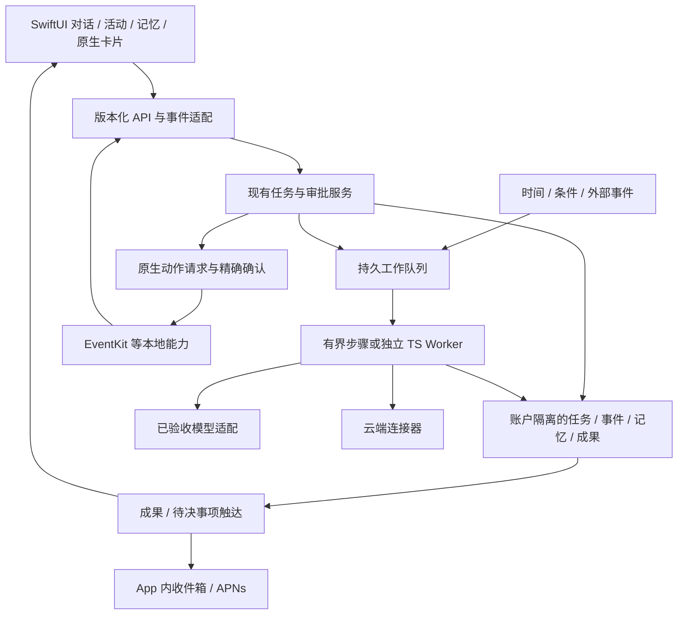

# cat 复盘与重启方案

日期：2026-10-13（Asia/Shanghai）。这是本轮只读核查形成的带日期评审稿，不替代工程仓库 `docs/status/master-plan.md` 的实时进展。产品尚未完成验收，选型建议不代表已迁移或部署。

## 1. 本轮已经明确的目标

用户已确认：**先做通用 Agent 底座，再扩展多个场景；体验优先、Swift 优先，局部可以使用 TypeScript 或其他技术。真实模型先验证现有路由，失败后再讨论切换。**

建议产品承诺：用户用自然语言持续委托工作；助理能对话、规划、调用工具、在用户离开后继续已受理的云端工作，按时间或变化跟进，并带着结果或明确决策回来。用户能修改目标、处理审批、查看成果、纠正记忆、停止跟进。

“通用”由可组合的目标、工具、运行、记忆、触发与 UI 契约证明。验收使用不同任务检验这些模块，不把业务剧情硬编码进底座。对标 Dot/Muse 的产品能力，不承诺复刻其全部模型能力、服务基础设施或任意跨 App 控制。

当前边界：SwiftUI 是主要交互层；云端语言按模块适配选择。React Native 和 Web 参考工程不等于 Swift 工程，局部 Web 内容也需说明宿主、权限、状态和交互边界。

## 2. 已核实的现状

### 版本与交付

详细时间戳、完整 SHA、分支与改动列表见[本轮基线 JSON](../docs/status/restart-import-candidate-2026-10-13.json)。这是瞬时快照，不能代表正在工作的副本之后的状态。

| 对象 | 本轮核查结果 | 证据边界 |
| --- | --- | --- |
| 当前聊天工作区 | `用户指定维护目录` 只有 design/research 材料 | 不是原生工程主仓 |
| 本地主仓 | `旧本地主仓`，`integration/local-fixed-directory`，`86ea209`，核查时干净 | README 指定 `apps/ios-conversation` 为主客户端；历史样机保持冻结 |
| 原生集成副本 | `ios-integrated`，`582e4e4` | 核查期间有新改动，基线记录时 11 个文件未提交；不能用工作区现状归因已装 App |
| GitHub | connector 确认 private，默认分支 `prepare/local-assets`；main=`78d9002` | shell 因 DNS 失败；远端结论来自已成功的 GitHub connector 查询 |
| GitHub 分支 | `feat/proactive-goal-kernel`、`integration/local-fixed-directory`、`main`、`prepare/local-assets` | 未找到原生集成分支；不能把本地新源码视为已推送 |
| 手机 | 镜像诊断直接显示 `0.3.0 (15)`，服务 OpenRouter | build15 的安装交接记录指向代码 `4750142`；本轮没有重建/安装或二进制哈希比对 |
| 手机聊天体验 | 两条待发消息同时显示在聊天和展开队列，大块队列占据输入附近空间；设置显示“待验证” | 是界面观察；不能据此认定重复 provider 发送 |
| 服务端 | 已有 vendored OpenMuse TaskWorker，自研 chat/auth/store/model，Supabase Edge 有界 tick | 不等于完整 CopilotKit SDK/Intelligence 已接入；本轮未审计线上部署 |
| 历史验收 | 主计划明确 R1 产品 FAIL；build15 报告仍把真实图片链路列为 NOT_RUN | 合成/loopback/编译通过各有价值，但不扩大为当前用户验收 |

版本证据：[主仓 README](旧本地主仓/README.md)、[主交付计划](旧本地主仓/docs/status/master-plan.md)、[build15 安装记录](旧本地工作目录/ios-integrated/docs/acceptance/ios-build15-install-20261012.md)、[旧管理快照](旧本地工作目录/delivery-management/docs/status/delivery-board.md)。旧管理快照仍写 HEAD=`10b43b0`，本轮直接 Git 读取已是 `582e4e4`；不把旧快照改写成新事实。

### 具体问题与归因边界

1. **模型状态显示缺少成功路径。** 对安装记录指向的冻结代码 `4750142`，`NativeChatHTTPBackend.connection()` 在 readiness 成功后固定返回 `providerUnverified`（第 66–68 行）。所以“待验证”不是模型失败证据。未提交的新补丁已经尝试记录已持久化完整回复，但本轮未验证这些改动，不能宣布已修好。
2. **许可缺少稳定的回到决策入口。** 冻结版 `ConversationFirstView` 用 `pendingModelConsent` alert 展示许可（第 112–114 行），消息状态只有“等待许可”文案；没有对应消息上的重新打开按钮。弹窗、页面与前后台状态一旦不一致，用户难以继续。最新工作区正在修改这一点；需按新源码独立验收。
3. **队列状态被重复呈现。** 同一待发意图既作为用户气泡，又进入常驻大队列；这是信息结构和空间占用问题。实际是否重复发送必须看原 turn/operation/provider 记录。
4. **长任务的执行与成果未形成可用闭环。** 历史主计划记录自然委派受理成功，但任务停在 running、没有 artifact；文档定位了预算与 lease guard 失败。该记录是历史事实，不可未经线上复核当成当前所有任务的根因。
5. **原题的原生能力链在当前入口缺少接线证据。** 对主仓及原生集成副本主客户端/独立 packages 的代码检索，没有发现 EventKit、UserNotifications、BGTaskScheduler 接线；不能把历史样机或后续候选当成当前可用本地能力。

### 本轮已执行的真实 App 路径

在 build15 正常既有登录中创建一个新测试会话，只输入人工构造问题 `Compute 17 * 19 ... End with CP1013-Q7M4. Do not use tools.`。显式 Send 后有本地回显；稍后弹出 OpenRouter/Novita 的此对话许可。点击“允许此对话”后持续显示“等待许可”，未观察到回答，随后许可弹窗再次出现。选择“暂不允许”收住这条失败试验，不重发测试，不推进原有两条队列。

**结果：许可到发送的用户路径 FAIL；模型可用性仍 UNVERIFIED。** 没有取得 provider 记录、首 token、usage 或终态，不把这次失败归因于模型。冻结 `4750142` 的 `allowPendingModelConsent` 第 281 行依赖弹窗绑定 `pendingModelConsent?.routeHash`，这是优先检查的早退条件；本轮没有回调 instrumentation/服务端日志，不能声称已经证明具体 callback 时序。应将待审批业务数据与弹窗展示状态分开，检查现有未提交的 `modelConsentReview` 修复并在同版上复验。

详细记录见[真实 App 验收尝试](../docs/acceptance/restart-permission-2026-10-13.md)。这次尝试发生在最初基线快照之后；初始快照的“本轮未调用”范围不能扩展到后续测试。

源码核对：本轮以 Git `show 4750142:<path>` 读取冻结内容，路径为 [NativeChatHTTPBackend.swift](../apps/ios-conversation/Sources/Providers/NativeChatHTTPBackend.swift) 与 [ConversationFirstView.swift](../apps/ios-conversation/Sources/Features/ConversationFirstView.swift)。链接打开的是当前工作区，可能已变化，应以 SHA 为准。

## 3. 过程复盘：Plan 与 Execute 分别不足在哪里

本轮可读到 10 月 10 日产品讨论、现有设计、工程主计划、来源清单和验收报告；旧 dot 协调线程 ID 未能通过本机 `read_thread` 取回。因此下表是有文档支持的流程判断，不是完整聊天审计或精确工时归因。

| 发现 | 依据 | 带来的成本 | 重启时的纠正 |
| --- | --- | --- | --- |
| 调研身份没有尽早固定 | 旧 OpenDot 报告暂定 `composio-community/open-dot`，这次明确为 `CopilotKit/OpenDots` | 候选能力、依赖与许可判断不能沿用 | 每个参考项目固定仓库、SHA、实际栈和已实现范围 |
| 产品范围变化未同步到完整验收 | 原设计是单场景、一周原生 Demo；后续主线变成连续多模态、云端持久任务和多个副本 | 原始主动/记忆/本地写入/通知链与新产品目标并行，资源分散 | 采用本轮已确认的通用底座目标；旧 Demo 变为一条验收用例 |
| 关键依赖验证落后于功能建设 | 原设计 Day1 要真实模型、系统能力和真机；用户仍没走到模型验收 | 后续 UI 与状态很难区分 provider、授权、执行器还是客户端的问题 | 第一门槛是现有真实 App 路由的完整回复；失败先定位一段链 |
| 拆分更多围绕模块，缺少同版用户路径 | 独立 composer/navigation、后端 P0、QA 与装机分别记账 | 单项完成与最终手机可用相隔多次整合 | 任务切片按“用户输入→执行→结果→恢复”定义，每片有同版真机证据 |
| 运行方式关键决定长期处于 Proposed | ADR-005 的常驻 worker / Edge 分片 / 其他框架均未确定 | 超时、重新调度、任务授权与恢复需要反复适配 | 明确一个任务执行权威和调度责任；用恢复试验决定托管方式 |
| 交付版本没有收敛到一个入口 | main、主仓、集成副本、签名包、手机各有不同身份 | 用户无法确定测试的是哪个源码与 API | 一个 release manifest 绑定 source、API、构建、包和验收 |
| 工程保护逻辑直接暴露到日常交互 | 等待许可、大队列、手动读原请求、readiness 等界面 | 用户替系统协调发送与恢复状态 | 等待有明确按钮、状态自动续接，技术信息下沉诊断页 |
| 反馈没有提前成为放行条件 | 主计划保留产品 FAIL，但大量测试已经完成，基础体验仍阻塞 | 测试能保护正确性，无法单独验证用户是否能顺畅完成工作 | 编译/合成/真实服务/真机体验分别标注；以用户任务通过放行 |

结论：**前期不是没有计划，也不是没有执行；依赖顺序、范围调整、模块整合与用户验收没有形成一个持续收敛的交付回路。** 再增加文档或再换一个框架都不足以单独解决。

## 4. 三个开源项目怎么用

完整源码矩阵、固定提交与许可证见[开源核验报告](../research/openmuse-opendots-copilotkit-assessment-2026-10-13.md)。本次没有运行参考工程，静态实现不替代实际模型与连接器验收。

| 项目 | 本轮选型结论 | 适合吸收 | 不宜直接推定 |
| --- | --- | --- | --- |
| OpenMuse | 个人 Agent 与任务执行的主要参考；逐项补齐已抽取模块 | 任务生命周期、计划、checkpoint/lease、审批/unknown、monitor 去重退避、产物、记忆与回前台刷新 | Expo/RN mobile 不是 Swift 工程；模板聊天依赖独立 Intelligence 服务 |
| CopilotKit/OpenDots | 工作组织与交互细节参考，按模块吸收 | Specialist 的工具边界、Spaces/Pages revision、可重开审批卡、工具权限、语音与 compute 分离 | React/Vite Web 工程不是原生 iOS；简单重复任务不是完整长期目标引擎 |
| CopilotKit | 服务端运行时或事件协议的候选，收益须先 spike | 流式文本/工具/状态、HITL 状态、受控生成 UI 模式 | React hooks 不能直接用于 SwiftUI；框架不会补齐云调度、记忆、连接器或 APNs |

OpenMuse RN 栈证据：[mobile/package.json](https://github.com/CopilotKit/openmuse/blob/1ac68f3909f2478ab6280883f1ab5ea65eb5719d/apps/mobile/package.json)。OpenDots Web 栈证据：[package.json](https://github.com/CopilotKit/OpenDots/blob/625452e06cde74cb25b0ce319e2c1be0488f5a5f/package.json)。CopilotKit core/RN 的类型与 React 依赖见[core manifest](https://github.com/CopilotKit/CopilotKit/blob/7e97c05d5eef004c92f75c39be06690f8a9d3899/packages/core/package.json)、[RN manifest](https://github.com/CopilotKit/CopilotKit/blob/7e97c05d5eef004c92f75c39be06690f8a9d3899/packages/react-native/package.json)。

当前建议：**保留 Swift 客户端和已有数据身份，先补通真实链路；对任务运行层做有边界的模块替换或补齐。** 不全量混合三个框架。是否把有界 Edge tick 调整为独立 Node/TS worker，要用 G2 的恢复试验决定；常驻 worker 是优先评估候选，不是本轮已经实施的迁移。

CopilotKit OSS 有 SSE/自配 runner 路线；两个应用模板对 Intelligence 的依赖不等于框架整体强制依赖。Swift 前端可通过版本固定的服务端事件适配器实现；当前官方源码没有原生 Swift SDK，AG-UI Swift SDK [issue #494](https://github.com/ag-ui-protocol/ag-ui/issues/494) 仍开放。SDK 缺口不阻止 Swift 解析 SSE，但要承担事件/取消/恢复适配的工程成本。

## 5. 通用底座的能力范围与交互约束

| 能力 | 首版需要交付的行为 | 核心细节 |
| --- | --- | --- |
| 持续对话 | 自然语言、图片、连续追问、历史、取消与恢复 | 本地回显独立于网络；未发送、已受理、streaming、完成、失败、未知分别明确；仅主发送动作常驻 |
| Plan and Execute | 对短问题直接回答；对需执行的工作保存目标、计划、步骤、证据和结果 | 可继续补充、更改优先级；“回复完成”与“任务完成”分开；等待必须有解决入口 |
| 持久任务 | 离开 App 后已受理云任务继续，重开看同一任务 | 服务端工作队列、租约、checkpoint、停止/恢复、结果未知核对；手机本地待发队列需标清尚未受理 |
| 主动性 | 时间或明确条件驱动检查，变化时携结果/待决问题返回 | 触发依据、结束条件、去重、失败退避、静默时段、频率与预算；无变化不生成重复通知 |
| 记忆 | 自然表达保存，能查来源、更正和删除，影响下一任务 | 明确记忆与候选分开；作用域/版本/时效；删除后新任务不使用旧值 |
| 工具/连接器 | 接入可描述的读取、云端写入、设备本地写入能力 | schema、运行位置、权限、预览、执行、回执、幂等/核对、撤销能力；Deep Link 不作为执行回执 |
| 智能 UI | 需要决定时出现可操作原生卡；成果可查看/继续修改 | 先支持选择、表单、计划进度、审批、产物、对比六类；绑定 tool/action ID 和参数版本 |
| 工作组织 | 主对话＋活动/任务＋成果＋记忆＋连接与设置 | 一个对象跨入口引用同一版本；审批能从消息与任务重开；队列折叠为轻量入口 |
| 通知与系统能力 | 至少一种真实 App 外入口和一种确认后的本地写操作 | 本地已知时间用系统通知；云端变化触达单独 APNs 接线；权限拒绝有可用降级 |

Dot 的参考价值是持续责任、工作接续与必要时请用户决定；这是由官方说明支持的产品模式，不代表可以复刻其内部系统。[Tasks and memory](https://learn.chatgpt.com/docs/dots/tasks-and-memory)、[Control your dot](https://learn.chatgpt.com/docs/dots/controls)。

本轮手机实见：ChatGPT 侧栏把“你的 dot、定时任务、空间、Codex”分为明确入口；dot 主对话的输入区很简洁，电话在顶部；点击名称可查看云端/个人电脑以及暂停入口。未触发其任务、修改设置或调用语音。对照 cat，可以优先简化输入区，并把执行环境与控制收在次级入口。dot 最近对话也显示用户要求保存成果、写 handoff 后暂停旧工作；这解释了本轮原生副本尚有外部改动，但 handoff 完成与具体源码仍需实际文件验证。

## 6. 建议架构：每种事实只有一个权威

复用、修订既有 Goal/Task/Run/Approval/Artifact/Memory，建立 Trigger/Effect/Notification 的映射，不在客户端新增独立业务执行状态机。UI 是持久事实的投影；模型不能仅凭文本将任务置为成功。工具副作用需要真实回执；不确定结果先核对，无法确认时呈现未知而不是自动重复。

设备动作不能被云端常驻 worker 假定随时执行。设备不可用时进入明确的等待；已授权云端工具与设备本地能力分别执行。App 前台返回时核对原 task/turn，而非新建同目标请求。

托管选择要区分平台限制和当前代码限制：当前 tick 的最多 30 秒是工程配置，不是 Supabase 平台所有请求的统一上限。官方 Edge worker 本身仍有 wall-clock/CPU 限制，`waitUntil` 不消除这些限制。[Edge limits](https://supabase.com/docs/guides/functions/limits)、[Background tasks](https://supabase.com/docs/guides/functions/background-tasks)。长任务应靠持久队列和可恢复步骤，或独立 worker；延长 timeout 不能替代这些机制。

## 7. 重启执行：按门槛交付，每次一条同版真实路径

下列顺序是新规划。未标 PASS 的都没有在本轮执行；阶段估算只能在 G1 取得真实耗时和失败原因后校准，不沿用旧一周承诺。

| 门槛 | 要做的具体工作 | 可审阅产物 / 退出条件 | 依赖 |
| --- | --- | --- | --- |
| G0 版本基线 | 确定一个集成 owner 与运行副本；收齐当前未提交改动来源；保存旧 build15/历史数据；生成 release manifest | source SHA、API 部署身份、构建配置、包 hash、安装版本和验收记录可对齐；冻结不表示验收通过 | 本轮快照已完成，发布映射未齐 |
| G1 真实对话 | 先按现有路由，用新测试会话和人工构造非敏感输入；读取并完成现有许可流程；再验证真实流式、保存、追问和重开 | 本轮真实 App 尝试 FAIL：同意后等待、许可重现，没有模型回答；先修许可到发送路径，再取得完整回复/保存/恢复 | 可操作手机、正常既有登录；现有路由先验 |
| G1b 多模态/工具探针 | 人工构造图片，不带私密材料；一个读工具和一个参数明确的写工具 | 模型看到真实像素/正确工具参数；审批可重开；单次执行与可核对回执 | G1 已通过；工具授权与执行环境具备 |
| G2 持久执行核验 | 对现有任务层做同一任务中断/重启/租约接管/等待输入/审批/取消实验；同时评估 Edge 分步 vs TS worker | App 退出和执行器重启仍能恢复；原 ID/成果不丢、不重复外部副作用；形成 Accepted 托管决策 | G1；真实数据库；批准的测试部署 |
| G3 通用能力组合 | 接记忆 CRUD/context、一个时间触发和一个条件触发、活动/成果回流；一个真实本地写操作与 App 外入口 | 同底座通过“研究交付”“变化跟进”“本地日程动作”三类路径；无变化静默/删除记忆/拒绝权限可验 | G2；系统能力按需授权 |
| G4 智能 UI 与体验 | 固定六类原生卡 schema 和动作契约；对队列/审批/侧栏/流式阅读进行真机修整；做 CopilotKit spike 决定是否采用 | 卡片点击推进真实操作；重开保持版本；unsupported card 有文本降级；中英文/大字号/前后台可用 | 可复用 G1–G3 的真实状态 |
| G5 完整交付 | 将通过的同版源码、构建、包、后端及用户证据收齐；更新主计划/README；录制连续流程 | 用户能从正常入口完成三条路径；问题与限制明确；源码可重建，GitHub 对应版本可核对 | 上述门槛全过；发布决策另按具体动作处理 |

CopilotKit spike 的最小试验：自配模型 runner → SSE 文本/工具事件 → Swift 解析 → 一张真实工具卡 → 持久审批后恢复。先固定版本，不同时切 provider、auth、store、UI 和 worker。用事件完整性、适配代码量、恢复行为和端到端耗时决定价值；不能凭 SDK 安装成功就采用。

G1 失败处置：许可失败先修许可；没有 provider 调度先查 admission；provider 失败保留状态/响应码再讨论模型；token 已到而 UI 卡顿查客户端渲染；完整回复没落盘查协议与存储。发送结果未知只读原 turn，避免用“再发一次”制造第二个实验。

## 8. 可执行验收用例

| ID | 路径 | 必须观察到的结果 |
| --- | --- | --- |
| A01 | 普通问答＋追问 | 第一句完成后第二句继承上下文；来源是实际 provider；回复保存并可重开 |
| A02 | 回复中离开 App 5s/30s，再回来 | 原 turn 接续；无第二次 POST；文本无跳回/重复；终态可查 |
| A03 | 人工构造图片＋文字追问 | 确认的同一图片进入支持视觉的模型；盲像素判断正确；后续上下文一致 |
| A04 | 持续委托生成研究成果 | 计划、实际步骤和产物关联；任务完成有成果；离开/重开后仍能打开同版本 |
| A05 | 工具审批关闭弹窗、切页、重启 | 都能从稳定卡片找回；参数变化旧审批不可执行；一次批准产生一次可核对动作 |
| A06 | 外部写成功后模拟回执中断 | 不自动再次写；核对同一外部对象；unknown 与完成清晰区分 |
| A07 | 明确保存/更正/删除记忆 | 新任务分别使用新值、不使用已删除值；显示此次使用的来源 |
| A08 | 定时与公开测试数据变化触发 | 无用户提问发起；重复信号只更新同一事项；无变化不打扰；暂停/结束停止后续 |
| A09 | 真实 EventKit 写入与通知返回 | 用户确认后系统里存在对象；拒绝权限无副作用；App 外入口回同一事项 |
| A10 | Worker 重启或 lease 接管 | 任务状态与成果一致；旧 worker 不继续提交；等待/取消能正确收尾 |
| A11 | 布局与输入 | 小屏、键盘、长中文、最大字号、真实中文 IME：输入、审批主动作可见可点；队列不吞掉主会话空间 |
| A12 | 交付来源 | 正常 App 显示版本；测试绑定 source/API/package；GitHub 的可构建版本与包一致 |

体验指标以实际数据记录：本地输入回显、首字等待、流式帧/阅读锚点、完成时长、恢复耗时、主动提醒有效性、重复副作用、用户操作次数。初始目标可设本地回显 p95≤150ms；模型首字以所选路由实测定义，不给未经测量的保证。模拟器布局回调不是物理手机实际呈现帧。

## 9. 开发协调规则

一个集成 owner 负责同版放行；模块工作可以独立，但每片开始前固定输入 SHA 和合同，每片结束交源码与真实路径证据。禁止在未整合的独立组件通过后把整机任务关闭。日常看板只记录主仓 master-plan，研究报告保留为带日期的输入。

前台聊天体验、持久执行、智能 UI 三条可以在合同固定后并行；同一工作副本、同一模拟器、同一手机操作需要明确占用。当前原生副本存在外部改动，本轮没有覆盖、回滚、提交或推送这些内容，也没有操作旧任务或部署。

每个新版本至少记录 `sourceCommit / dirtySourceManifest / apiDeployment / protocolVersion / appBuild / packageHash / testCases / evidenceKind / knownFailures`。如构建来自脏工作区，必须明确文件哈希，不能仅记录 HEAD。

本轮完成的是现状复核、开源选型、重启评审稿和 G1 首次真实 App 尝试。真实模型与通用产品验收仍未通过；下一步接收旧工作的 handoff、固定候选源，处理许可回调与稳定重开入口，再复验现有路由。不把规划稿或已经复现失败当成最终 App 交付。

发布说明：原始机器基线与真实App尝试JSON保留在本机research中，GitHub只发布经过整理的来源清单与验收说明；本文是本轮复盘的日期快照，当前状态以新主计划为准。
