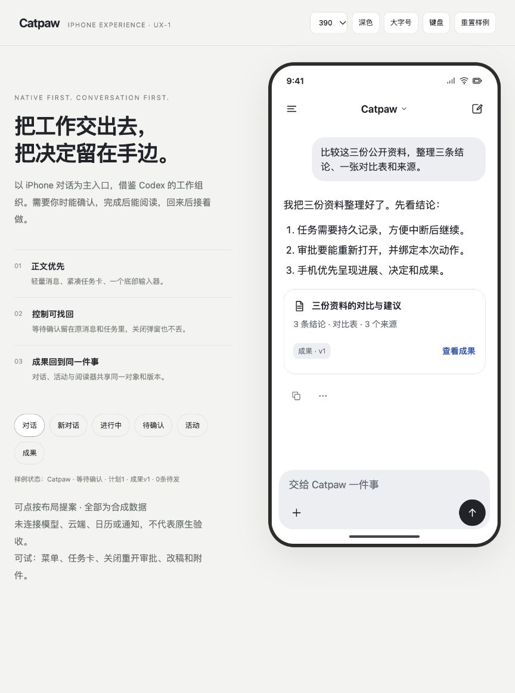
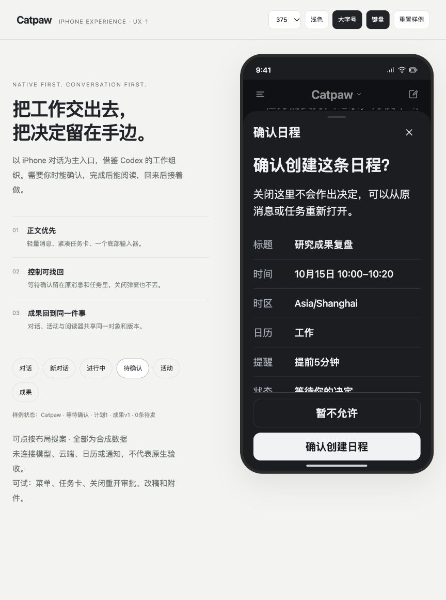

# UX-1布局提案浏览器审阅

2026-10-13。对象为[自包含HTML提案](../design/prototypes/catpaw-ios-ux/index.html)，不是原生App。源码SHA、样例检查与图片SHA见[RESULT.json](evidence/ios-ux-proposal-20261013/RESULT.json)；原始运行输出留在忽略build目录。浏览器原JPEG保持原字节；两图仅标准JFIF头，无EXIF/XMP/注释。人工核对全部为合成内容后，在仓库扫描例外中按精确路径/SHA登记这两项二进制资产；任一字节变化需重审。本记录只说明布局提案检查，不关闭AF-GD、AF-U或AF-A。

在Codex应用内浏览器实际点按核对了：主对话呈现；新会话返回原草稿；审批关闭重开；375设计宽度/深色/1.35倍字号/键盘占位下决定按钮可达且正文可滚动；两条队列折叠、展开和暂停；成果改稿保留既有草稿并引用原版本；记忆更正显示新内容/版本；侧栏搜索无结果反馈。最终进行中样例的任务状态/步骤一致，未观察到浏览器控制台错误。

这些数据、消息和日程全部人工编造，操作只在页面内存发生。检查期间发现并修正：新会话原草稿未保存、改稿提前增加版本、记忆编辑未显示新内容、运行中任务标签不一致。行为变更按受影响动作复核；最后尺寸/队列触控和状态改动另核对。

| 主对话 · 390设计宽度 / 浅色 | 审批 · 375设计宽度 / 深色 / 字号放大 |
|---|---|
|  |  |

原生键盘/IME、SwiftUI布局、安全区、真实触控/侧滑、最大辅助字号、VoiceOver/Reduce Motion、实际流式与后台恢复，以及模型/云端/SQL/系统日程/通知均未验证。430宽度与完整失败状态矩阵没有在本批浏览器检查；原生要求仍按[12项UX合同](ios-codex-experience-acceptance.md)执行。此处宽度是CSS提案单位，不能作为iOS设备测量。

前期ChatGPT/dot会话观察与cat旧包原图的作用见[参考对照](../design/ios-codex-reference-review-2026-10-13.md)。上图是新提案，不是竞品或旧包截图。
