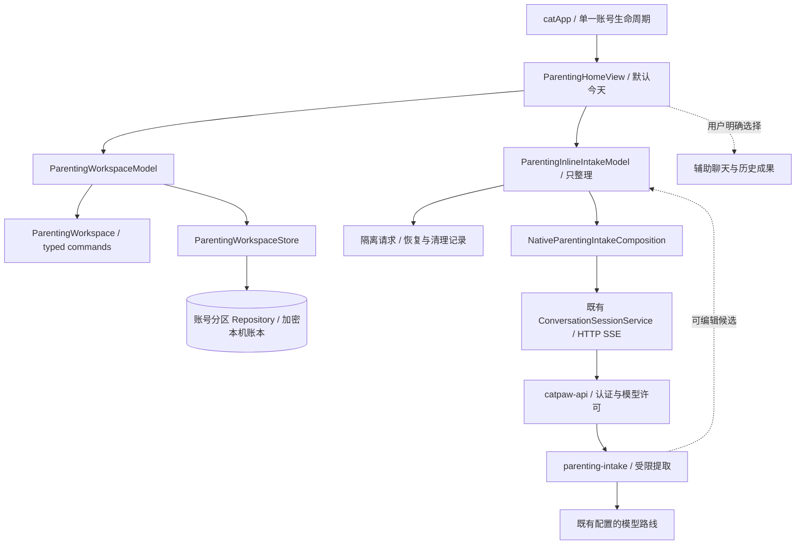

# mimi 架构总览

[产品 Roadmap](product/mimi-roadmap.md) · [文档索引](README.md) · [目录角色](development/repository-layout.json) · [资产审计](architecture/mimi-assets-2026-10-24.md)

本文描述 M1 育儿候选及其复用边界；候选、main、安装包与部署身份和验收状态仅见[主计划](status/master-plan.md)。2026-10-24 整理基线为 main `4ec8118`、PR #123 `974dbb1`：main 仍是对话入口，候选才接入“今天”。下图表示源码关系，不声明已合并、已部署或已验收。

## 一次交代如何成为安排

输入原话并选择孩子后，模型只整理本次最少输入，不能确认安排、产生设备动作或把推断存成家庭事实。候选回到原表单编辑；保存后成为待确认草稿，明确确认后成为安排。家长标记完成时，领域转换原子生成独立完成记录。取消、已完成、草稿分别限制后续操作。

`ParentingWorkspaceStore` 复用现有 Repository 的账号分区，负责加密读写、revision CAS、operationID 去重与 epoch 屏障。Model 只在持久成功后发布新快照；损坏、账号变化或保存失败不得变成空账本或成功提示。未保存普通表单的恢复边界与 AI 请求恢复边界不同，不用内存状态冒充落盘。

## 事实与写入权威

| 对象 | M1 的权威与入口 | 后续阶段的边界 |
|---|---|---|
| 孩子、轻目标、安排、家长记录 | 本机 `ParentingWorkspace` / Store；由用户命令改变 | M3 完善目标生命周期和实际发生时间；M5 才冻结云映射与兼容迁移 |
| AI 候选、等待与恢复 | 独立 intake 请求和临时 journal，沿既有认证、路由许可与 SSE | 未确认不改账本；未知结果按原请求核对；清理失败不得假报删除成功 |
| 云端 Agent task / action / artifact | 既有 scoped backend 的事务、版本、许可与回执 | 助手完成报告不表示家长安排已完成，不接管育儿账本 |
| `catpaw.family.v1` 的 household / capture / memory 等 | `_shared/family` 的既有 Postgres 合同 | 尚未接成 M1 原生云同步；不直接打开 flag 或把 #120 客户端与本机账本双写 |
| 系统提醒 / 日历与送达回执 | 既有设备 Provider 和授权边界 | M2 前置本机提醒，分别验证权限、时区、取消和结果；M5 再扩可靠跨设备通知 |
| 长期家庭事实与派生摘要 | 不由 M1 intake 自动生成或复用 | M4 先确认主体、来源、有效期、更正和删除；不得默认附全家档案 |

`planned` 表示本机安排已确认；`completed` 表示家长记录实际完成。两者均不证明已同步、已设置提醒、已派发或已送达。

## 分层与复用

| 层 | 路径 / 主要入口 | 负责内容 |
|---|---|---|
| App | `Sources/App/catApp.swift`、`NativeAuthApplicationModel` | 单一宿主、组合、账号切换与生命周期 |
| Features | `Sources/Features/Parenting`、既有 `*Service` | 页面状态、用例编排、确认、失败恢复；View 不直接调用 HTTP 或系统写入 |
| Domain | `Sources/Domain/Parenting*` 与既有 typed contracts | 对象、纯转换、输入/回复验证；不依赖 SwiftUI/UIKit |
| Persistence | `Sources/Persistence/Parenting*`、Repository / SwiftData | 加密账本、账号与路径代次、CAS、去重、恢复与清理 |
| Providers | `Sources/Providers`、既有设备适配器 | HTTP/SSE/Auth/Keychain 与系统框架；不自行决定授权 |
| Edge | `services/edge/supabase/functions` | `catpaw-api`、`catpaw-proactive`、共享认证、提取、任务、记忆和 family 模块 |
| Swift packages | `packages/ios-navigation`、`packages/ios-image-composer` | 已接入的界面组件；不能拥有模型、账号或执行权威 |

对话辅助链继续使用既有窗口、持久事件和实时预览实现；请求断线按原 turn/sequence 恢复，流结束不授予权限。设备动作沿审批 → 版本核对 → 执行 → 回读/回报；未知结果按原决定核对，不悄悄重发。既有模型路线、安装 ID、Keychain、存储键和 wire 身份见[内部标识](internal-identifiers.md)，不因展示品牌或模块命名改变。

## 资产与重构顺序

唯一原生维护根为 `apps/ios-conversation`，唯一后端维护根为 `services/edge/supabase/functions`。`catpaw-tick` 的部署快照不等于维护入口；不能从快照存在推断源码已齐版。官网位于独立 `Yankj/heydusk-site/apps/mimi`，本仓 `apps/website` 只留迁出说明。

冻结 App、facade/offline、上游 MIT/受控 patch、历史截图和部署来源按原身份保留。公开设计/研究维护在 docs；私有截图和运行输出在 ignored build/local-audit。具体文件与 hash 异常见[资产审计](architecture/mimi-assets-2026-10-24.md)，存量分支取用关系见[PR 审计](architecture/mimi-pr-disposition-2026-10-24.md)。

先修 M1 构建和恢复路径，再按真实职责拆分大型 View、Auth 或 HTTP 文件；同一片更新 Xcode 引用并运行宿主验证。不增加第二个 App 壳、第二套任务状态机或空 package，不为目录整齐搬动来源快照。M2–M6 的实现按 Roadmap 顺序推进，不用结构整理替代产品验收。
