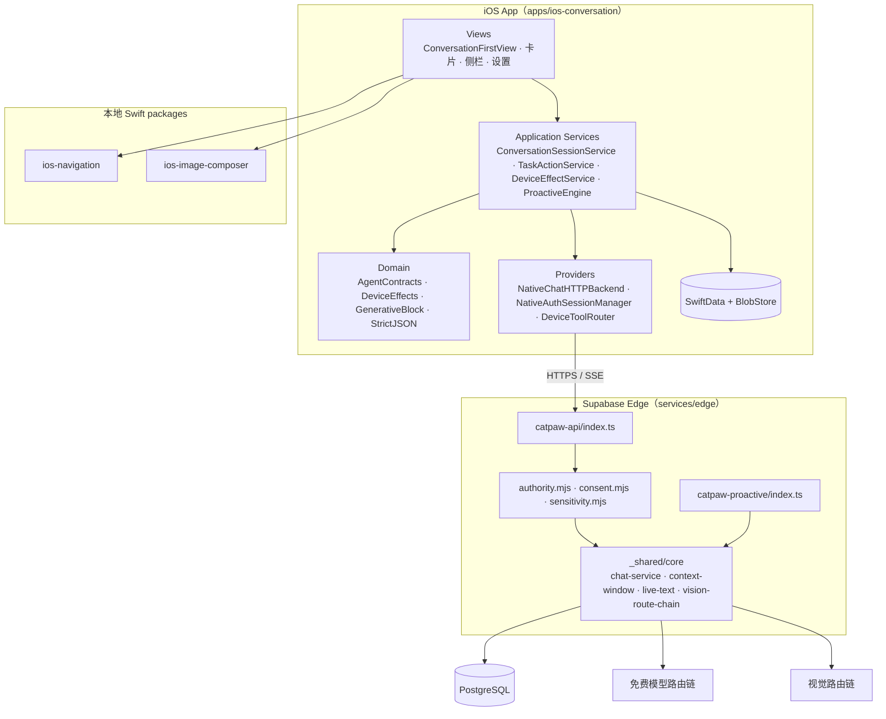
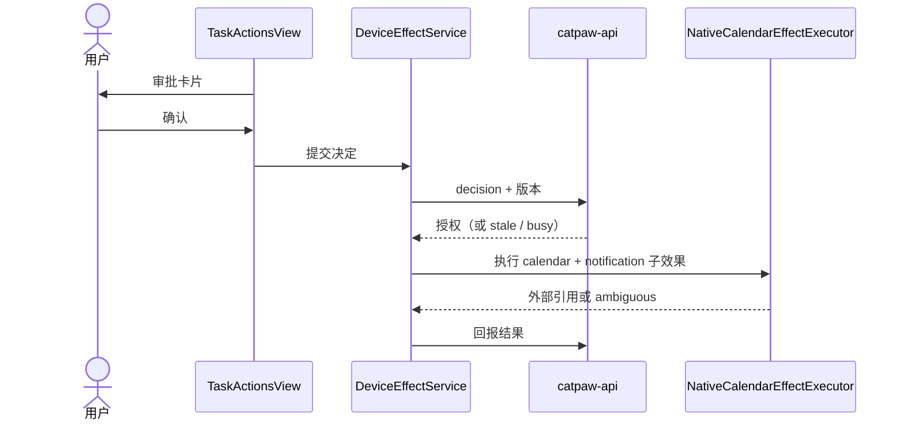

# 架构总览

[← 返回 README](../README.md) · [文档索引](README.md) · 详细审查：[2026-10-15 代码与分支复核](architecture/repository-review-2026-10-15.md)

本文是 Diátaxis 的 Explanation 文档，描述 `main` 分支上的系统结构。进度和验收状态不在此维护，见 [主计划](status/master-plan.md)。

## 系统边界

## 对话链路要点（catpaw-api v53）

- **流式与落库**：`text-batcher.mjs` 按 512 字符 / 250 ms 批量落库并推送持久化事件；断线后按原 turn 与最后 sequence 恢复。
- **实时预览**：客户端带 `X-cat-Live-Text: 1` 时，`live-text.mjs` 在两次落库之间约每 100 ms 推一次 `text_preview`（不入库，sequence 等于最后一次持久化事件）；旧客户端收到的帧不变。
- **上下文窗口**：`context-window.mjs` 只在真实用户 turn 处截断，窗口最多 40 条 / 80 kB；超预算依次省略旧工具结果、缩小窗口、返回 `413 conversation_too_long`；完整历史保留，窗口前缀用哈希冻结，冲突返回 `409 model_history_conflict`。
- **图片**：`vision-route-chain.mjs` 按 `CATPAW_VISION_ROUTE`（`chain` / `legacy`）选择视觉路由，链路内逐级回退。

## 分层职责

| 层 | 目录 | 职责 | 不允许 |
|---|---|---|---|
| Views | `Sources/Features/*View.swift` | 展示、收集用户决定 | 持有账号、发 HTTP、执行副作用 |
| Services | `Sources/Features/*Service.swift` | 编排用例、状态机、重试与恢复 | 绕过 Domain 合同 |
| Domain | `Sources/Domain` | typed contract、严格 JSON、reducer | 依赖 UI 或系统框架 |
| Providers | `Sources/Providers`、`Sources/Features/DeviceCalls` | 网络、SSE、认证与安全存储、EventKit / Contacts / MapKit | 自行决定授权 |
| Persistence | `Sources/Persistence` | SwiftData（CloudKit 关闭）、Blob | — |
| Edge | `services/edge/supabase/functions` | 准入、授权、同意、模型调用、持久化 | — |

## 关键原则

1. **授权在后端**：展示层和流结束都不能授予权限或宣告完成。
2. **人在回路**：外部副作用（如 `calendar.create.v2`）先审批，再在注册设备执行；`unknown_recovery: original_only`，结果未知时只按原决定核对。
3. **模型路由经同意**：`config.mjs` 中的路由与发送字段需用户同意，路由变更会改变 route hash；认证令牌等字段不发送给模型。
4. **证据分层**：fixture、本地合成 façade、真实模型、云服务四层结果严格区分。

## 设备动作时序

## 相关文档

- [ADR-005 运行时复用与托管](architecture/adr-005-runtime-reuse-and-hosting.md)
- [后端原生契约交接](../services/edge/docs/NATIVE-HANDOFF.md)
- [目录角色](development/repository-layout.json)
