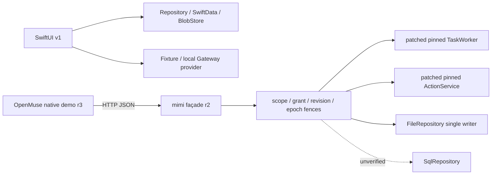

# 架构与决策

当前入口：[mimi 架构总览](../architecture.md)、[M1–M6 Roadmap](../product/mimi-roadmap.md)、[资产审计](mimi-assets-2026-10-24.md)、[存量 PR 审计](mimi-pr-disposition-2026-10-24.md)。下列 AF/FINAL、v1/r2/r3 和旧审查按其日期及复用模块解释，不另设当前产品方向。

新增[项目目录/依赖/分支审查](repository-review-2026-10-13.md)与[机器目录角色](../development/repository-layout.json)，包括整合优先级、两个未合入候选和已应用的基础规则。

**当前进展只见 [主交付计划](../status/master-plan.md)。** 新主线为自然对话与服务端持久任务；本仓库现有v1/r2/r3实现作为历史基线，不等于以下目标已部署。

当前架构决策入口为 [AF-1规格](../product/agent-foundation-spec.md)、[ADR-005](adr-005-runtime-reuse-and-hosting.md)及[云电脑待确认方案](cloud-computer-proposal.md)。旧整体设计、记忆brief和v1/r2/r3关系保留作历史输入，集中见 [归档索引](../archive/README.md)。

历史设计输入与 v1/r2/r3 实现边界

- [服务端优先整体设计全文](server-first-delivery-design.md)：协调提供的拟实施架构/交付闸门原文，API＋worker＋一个Postgres，持久状态为单权威。建议/v1接口与当前chat wire需对齐。
- [记忆架构brief v1全文](memory-brief-v1.md)：建议字段/接口、来源与删除边界及A–L矩阵；待现有Store适配与migration。其M0/M1/M2是记忆子阶段。

两份输入全文保留其起草时“尚未检查仓库”等声明；后续只读观察和当前验收以主计划C01–C07为准，不在输入原文另更新进度。Postgres、事件回放、MemoryRepository、云运行和推送不能由设计图推定已实现。

## 历史v1/r2/r3实现边界

v1 UI 写同一 Repository；成功事件只能在持久化事务成功后发出，失败保留草稿和旧 scope。provider 请求冻结模型/项目/安全/技能 revision，重试使用原 operation 身份与请求，旧 attempt 的迟到结果拒绝发布。内容文件按 hash 校验，成果版本不可覆盖。SwiftData driver 的当前实现以交付源码和已跑原生测试为准；Foundation 检查不代表 SwiftData 宏或执行器验证。

历史façade Task/ActionProposal 是r2执行/审批权威；小咪表保存冻结工作约定、稳定业务 Run、operation 关联、不可变成果版本与核验投影。业务 Run、Task、Worker lease attempt 与 AG-UI run 分别有身份。断连停止观察，不据此取消服务任务；404/回执丢失不自动重发。目标PG领域事务将成为持久单权威，OpenMuse为执行adapter；当前内存/FileStore不能称已具备该目标。

| 决策 | 原因与影响 | 当前限制 |
|---|---|---|
| [ADR-001 数据与执行权威](adr-001-state-authority.md) | UI/DTO 不能用流终态或卡片授权执行 | façade 仅合成 handler |
| [ADR-002 固定上游与 patch](adr-002-upstream-pinning.md) | 复用可核验 Worker/ActionService，精确保存差异 | 完整 SDK/模型组合未验 |
| [ADR-003 版本与授权](adr-003-version-authorization.md) | revision/epoch/lease、审批摘要防迟到和错版本 | 真实 SQL 并发仍待验 |
| [ADR-004 版本与证据维护](adr-004-release-evidence.md) | v1/r2/r3分层，冻结源码后精确整合 | r3已导入，真实服务仍未验 |

## 运行时研究与待评审选型

[现状快照](runtime-state-2026-10-12.md)保留当时固定目录、旧手机包与未部署边界。当前为vendored OpenMuse TaskWorker＋自研chat/auth/store/model适配。[ADR-005](adr-005-runtime-reuse-and-hosting.md)保留SwiftUI＋Supabase，已加入[四仓源码决策增量](../research/copilotkit-four-repo-decision-update-2026-10-13.md)的模块选择；worker运行方式和框架迁移仍Proposed。用户已明确CopilotKit/OpenDots，早期同名候选评估仅留历史；[研究索引](../research/README.md)区分来源与限制。实时进展仍只见主计划。
