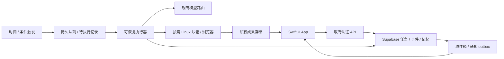

# 主动 Agent 执行器与云电脑提案

状态：分阶段方向已确认，具体托管实施仍Proposed，2026-10-13。新增计算预算为0；先用现有Supabase完善底座，以后再考虑托管执行器与沙箱。用途已确定：第一阶段网页调研＋文件处理，不登录第三方账户。本文供讨论确认，不创建账户、不购买资源、不部署执行器/沙箱，也不变更现有模型。

## 建议方案

保留 Supabase 做身份、任务、事件、记忆、成果与通知 outbox；用持久调度驱动可恢复步骤。需要长任务时增加一个小型 TS worker；需要浏览器/代码/文件操作时，worker 按需申请隔离 Linux 环境。空闲时暂停/释放环境，任务责任和 checkpoint 保存在数据库。

“一直负责某项工作”不要求浏览器一直开着。到期唤醒、领取任务、检查变化、执行有限步骤、保存checkpoint并休眠即可持续跟进。浏览器不是任务状态权威；暂停沙箱时里面的进程也不会继续工作。

模型负责计划和选择动作；worker 负责授权、预算、lease、工具、恢复和成果提交；沙箱提供终端、文件和浏览器。完整电脑画面可以作为后续可视入口。第一阶段用浏览器自动化＋文件工具即可减少截图推理成本；是否使用视觉点击模型要另做现有模型能力测试。

## 三个可选实施范围

| 选项 | 能做什么 | 额外准备与取舍 |
|---|---|---|
| A：先用Supabase分步执行 | 已知时间、公开URL/API读取、轻量文本处理、任务/记忆/成果回流 | 可先使用现有服务；Cron/队列/授权恢复仍要接线和验收。Edge不适合把整个桌面/长CPU任务塞入一次函数 |
| B：小型worker＋托管沙箱（推荐目标） | A＋网页浏览、下载、文件生成、代码/数据处理；后续可有电脑画面 | 需一个worker托管账户及沙箱账户；运维较少、隔离/生命周期现成，按用量付费。具体供应商待比较实测与区域后确认 |
| C：自管VM＋worker＋隔离环境 | 能自行控制区域、磁盘、浏览器和部署 | 需云主机、网络、镜像、备份、监控与更新；共享Docker不能作为未来多用户任意代码执行的完整隔离保证，不能让agent拥有宿主权限 |

用户已选A先推进；新增计算预算为0，不购买/开通新收费计算资源。B只保留架构接口，未来确认可持续零新增费用来源或调整预算后再做小实验。A不是完整dot云电脑；B也不等同复刻dot内部系统。

## 官方能力与实际限制

Supabase Edge当前官方限制为256MB内存、每请求CPU2s、worker wall-clock免费150s/付费400s；当前Catpaw tick的30s是本地工程限制。`waitUntil`不能把函数变成无限进程。[Edge限制](https://supabase.com/docs/guides/functions/limits)。Supabase Cron可以调用SQL/HTTP，Queues提供持久消息；可见性窗口的投递保证不能替代外部写入幂等与unknown核对。[Cron](https://supabase.com/docs/guides/cron)、[Queues](https://supabase.com/docs/guides/queues)。

托管worker候选Render提供后台worker进程，负责消费队列；不要求迁移Supabase数据库。[Render worker](https://render.com/docs/background-workers)。沙箱候选E2B提供按需Linux环境、文件/终端与pause/resume，Desktop支持截图/点击和VNC。[E2B](https://docs.e2b.dev/)、[Desktop](https://docs.e2b.dev/use-cases/computer-use)。这些是研究候选，未创建账户或测试。

当前E2B Hobby基础价$0/月但运行算力按秒计费，连续运行上限1小时；Pro基础价$150/月再加使用量。个人原型优先评估Hobby按需使用，不为“24小时负责”直接购买Pro。[官方计费](https://docs.e2b.dev/billing)。暂停可以保存状态，不保证网站会话/网络连接无限有效；文件成果应独立保存到权威存储。

## 用户需要准备什么

现在继续开发需要：现有Supabase项目可读诊断/测试环境、已配置模型路由、后续具体新手机包的安装确认。先复用已有配置，不在聊天贴密钥。

已确认新增计算预算为0。沿用现有Supabase与既有模型路由，达到已有额度/预算限制时停止或等待，不自动升级套餐、开付费fallback或新云服务。区域尚未新增选择，优先复用现有项目区域。免费基础价或一次性试用额度不能作为长期零成本保证；新增服务要先核可持续性并再确认。

未来确认B及其资金/免费资源来源后才需要：worker托管账号、沙箱账号/API权限、受控测试域名/公开网页、私有成果bucket及保留期限。既有模型文本/工具/视觉能力先实测，不能推定一个模型API支持所有电脑操作。云端主动变化通知需要Apple推送能力与APNs链路，独立于云电脑；已知时间的本地提醒可先开发。

首阶段不需要第三方网站用户名/密码、个人电脑远程权限、新邮箱、长期开机Mac或GPU主机。未来账户登录与对外写入需另外设计权限、session保存、审批准则与退出/清除入口。

## 工程准备和验收顺序

先修真实对话/许可并收齐同版证据；完成Task/Approval/Effect/Artifact、记忆与活动UI；定义执行环境适配端口，不安装新供应商SDK。托管决策确认后以同一个任务试验：公开网页→文件成果→App读取→中断/重启→暂停/取消→费用核验。

worker只领取账户作用域内的任务；环境按用户/任务隔离；供应商凭据只在执行器侧，沙箱不持有Supabase service-role。由短期授权通道提交成果；浏览内容不能扩大工具权限。外部请求和文件都有大小/超时限制。网络范围、secret注入、删除与故障核对是实施验收项，不用“有一台电脑”代替。

已确认：A先推进，后续可接托管执行器/沙箱，新增计算预算0，不登录第三方账户。仍待确认：可持续托管资源来源、区域及供应商；目前不部署B。AF-C01–03通过后再把云电脑能力加入产品放行范围。
