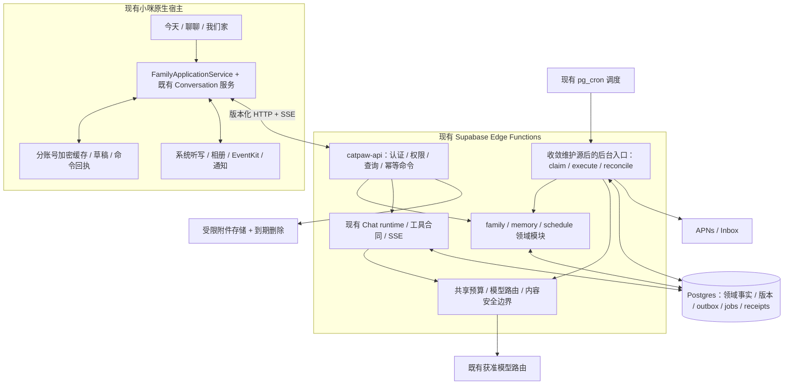

# 小咪家庭陪伴场景改造技术方案

版本：提案 v1.0 · 2026-10-22 · 供产品、设计与工程评审

本文只提出改造方案，未修改应用源码、部署或调用真实模型。用户后续授权将方案资产在专用 docs 分支提交并同步 GitHub，具体归档状态见索引。全部家庭例子为虚构。性能、容量与工期数字均为建议验收目标或估算，不是当前实测。依据本任务刚完成的只读审计和当前维护源码，不重复执行测试或扩大生产探测。

## 1. 结论与首发边界

建议把小咪从通用对话入口改为“帮家长少重复交代、少漏掉事情、看见孩子的点滴变化”的家庭助理。首期先服务一位主要照护者，围绕孩子的一周安排、临时变化与成长观察建立闭环；保留未来家庭协作的权限模型，但首期不默认开放儿童账号或多人共享。

三个入口共享同一套事实：**今天**呈现当天安排、需要确认的变化和少量有意义的建议；**聊聊**承接文字、口述和图片；**我们家**管理家庭、成员、成长目标与计划、观察和记忆。学业、补习、运动、择校、衣食住行是横跨对象的场景标签，不分别造六套任务系统。成长计划是“我们家”的一级内容，也在今天和聊天按需出现。

首期三条纵向旅程：

1. 家长口述“虚构的小禾周三游泳改到周四五点”，小咪找到对应安排，只追问缺失的日期或对象，展示变更差异；确认后修改事项，明确哪些提醒随之调整。
2. 家长发一张虚构课程通知，小咪提取课程、日期、地点及不确定字段，确认后生成计划或事项；图片默认仅用于本次处理，保存摘要与来源类型，长期保留原图需另选。
3. 家长记录“这两次练习后，小禾说膝盖不舒服”，小咪保存为有来源的观察，必要时建议家长关注并咨询专业人员；不将观察自动升级成诊断，不自动改变训练计划。之后询问安排时能检索相关约束，并允许更正或删除。

核心价值指标建议是每周重复交代次数、计划变更后遗漏数、建议采纳后的节省操作数、记忆纠错率和用户主动保留率。聊天字数、卡片数量、主动推送量不作为价值代理。先验证 8-12 个自愿参与家庭的两周日用趋势；样本只用于方向判断，不宣称统计显著或不可替代。

## 2. 基线、PR #110 与证据边界

本方案复用同日审计，并在归档前重新核对远端：main 已通过 PR #112 合入品牌改造，PR #110 已关闭并由 #112 接替。后续实施仍需重新核对部署与候选。

| 对象 | 审计已确认状态 | 对本方案的约束 |
|---|---|---|
| 最新远端 main | `789ad4feceb0680b8e2e5913083c5b834dc63db1`，2026-10-22 15:26 UTC 合入 #112 | 本方案资产分支以此为基线；旧审计基线为 cb3bc90a |
| PR #110 / #112 | #110 已关闭、未合并；head 423d25b1。#112 已合并，保留官网与发布工作流并接入品牌内容 | 不重开 #110，不把新产品实现混入已结束品牌任务 |
| 当前源项目 / 目标 | 源为当前 Mac 的 ai-work/catpaw-m，docs/family-product-plan 基于 789ad4fe；目标为用户指定主机上的 ai-workspace/mimi | 当前主机无目标用户目录，迁移未执行；源与未提交资产保留 |
| 活跃客户端 | `apps/ios-conversation/cat.xcodeproj` | 复用现有原生宿主，不复活冻结 App |
| 活跃后端源 | `services/edge/supabase/functions/` | API、proactive 有维护源；线上 tick 入口与共享源漂移需先收敛 |
| 已部署 | API v56 / tick v16 / proactive v10 | 不等同本地 head 逐字节部署；tick 比对 14 相同、28 不同、1 本地缺失 |
| 离线测试 | 本任务已运行后端 874 pass / 2 skip / 0 fail | 使用禁网执行副本；不证明真实模型、PG 并发或通知成功 |
| 原生历史记录 | 重计现有日志 528 pass / 27 fail / 4 skip | 本轮未重跑；26 基线复现、1 全套问题未归因，不作为新方案通过证据 |
| CI | 最新候选 changes 失败且 steps 为空，下游跳过 | 当前原因未取得，不能沿用旧额度原因作为新事实 |

PR #110 的品牌内容已由 #112 接入 main。789ad4fe 与旧审计 head 423d25b1 比较，差异集中在官网、IPA 发布工作流及文档，原生/后端维护源码无新增差异；因此核心实现定位仍适用，测试成绩仍只代表原被测 SHA。本方案在 docs 分支归档，后续代码工程应另起短分支。保留 Bundle ID、Keychain、SwiftData 容器、`catpawm://`、`catpaw-api`、`/catpaw/...`、数据库 schema 等兼容身份；展示品牌仍为小写小咪。详见 `docs/development/cat-brand-migration.md`。

## 3. 复用现有视觉与交互

当前实现以 `Sources/DesignSystem/catBrandTokens.swift` 和 `Components.swift` 为准。旧 R5 是已采用过的交互和语义分层基础，其蓝色阅读方案继续演进后，当前源码已是暖白、橙猫、中性气泡；旧 R5 JSON 不再是当前全部颜色的准确镜像。先前暖白柔和绿概念图不是改造基准。修订视觉 v0.2（Library `libfile_a5b10f7f00e4819192cf959a39dbc2d8`）仅为当前待评审概念稿，组件尺寸与精确色值仍以源码 token 为准。

| 语义角色 | 浅色 / 深色当前值 | 使用边界 |
|---|---|---|
| 阅读背景 | `#FFFCF8` / `#0E0C0A` | 保留暖白，不替换全局主题 |
| 正文 | `#292622` / `#F2F0ED` | 正文保持中性，橙色不作长文 |
| 辅助文字 | `#6E6A66` / `#A39E98` | 使用语义 token |
| 品牌橙 | `#FF702A` | 猫头、图标、装饰身份 |
| 操作填充 | `#C64A0B` / `#FF8A5C` | 保留与发送、审批不同的角色 |
| 发送 | `#3567EE` / `#3567EE` | 蓝色发送按钮仍存在，不机械改橙 |
| 本人气泡 | `#F2EFEB` / `#262422` | 当前已非旧 R5 蓝气泡 |
| 卡片 | `#FFFFFF` / `#1C1B19` | 内容可用白卡，不能每段回答都卡片化 |
| 临时面板 | `#F7F7F7` / `#181818` | 输入、弹层按现有角色区分 |

复用 `catTypography.Role` 的系统字体：body、subheadline、footnote、callout、headline、title2；中文跟随系统，保留 Dynamic Type。阅读行距为 `max(0, pointSize × 1.6 - lineHeight)`。复用 `catLayout` 页边 20、区块间距 28、行距 12、卡片圆角 20、控件圆角 14、可读宽度上限 680；本人气泡遵循 88% 可读宽度原则，具体布局随字号适配。

保持软 3D 猫头、SF Symbols、轻胶囊导航、稳定草稿、助手正文无整段底板、侧栏底层揭示与对话整体平移。今天 / 聊聊 / 我们家是内容分区，保留 conversation-first + 侧栏 + 原生返回，不强制新增底部三栏。复用输入器与导航基础；侧栏提供今天与我们家入口，聊聊保持默认。家庭切换与成员筛选放在家庭上下文，不混成另一套账号。

局部温馨细节稿（Library `libfile_2f6c828e3d308191a05a39f9501b9993`）也是待评审概念：正式图标使用 SF Symbols 同语义符号，图形目标 24pt、触控区至少 44pt；卡片 20pt、控件 14pt，随字号适配。可点击橙色文字用 actionText 的 #C64A0B，不能从概念图采样亮橙作为小字。猫的倾听/待确认/完成表情不代替文字或执行状态：仅实际收音显示“正在听”，收到成功回执才显示“已加入日程”。

“听话、温馨”体现在行为：先复述对象和变更；只问影响结果的缺项；接受“先别提醒”；失败保留草稿；更正记忆立即可见；明确“我已经记下”与“已发给某人”的区别。避免用亲昵文案掩盖等待、未知或失败。

参考截图为既有原生离线画面，含“对话没能打开”状态，不是业务通过证据。Library：`libfile_6f01d275bb7481919b1c9c81d5492320`。视觉依据包括 `docs/brand-theme.md`、`Sources/DesignSystem/AdaptiveTextLayout.swift`、`Features/Composer/ComposerChrome.swift`、`packages/ios-navigation`。

## 4. 技术架构：一个模块化后端、一个数据库

保留 SwiftUI + 应用服务 + typed contracts，后端继续 Supabase Edge Functions + Postgres。API 负责鉴权、查询和命令受理；后台入口负责可恢复的任务执行；同一模块库实现业务规则。Worker 是执行角色，不代表新增付费机器或新微服务。沿用现有调度资源和零新增计算预算约束，容量不足时先缩小主动频率和范围。



关键事务边界：一个家庭对象变更、对应 revision、命令结果和 outbox 事件在同一事务提交。模型调用、APNs 和设备副作用在事务外执行，执行前后二次核对权限和 generation。可靠性目标是“至少一次处理 + 幂等事实提交 + 未知外部结果核对”，不承诺跨网络 exactly-once。

## 5. 仓库落点与取舍

下表的“新增”路径是拟定位置，当前不存在；最终以实际切片和目录规则审查为准。`I` 指 `apps/ios-conversation/Sources`；`E` 指 `services/edge/supabase/functions/_shared`。

| 范围 | 复用 | 改造 / 新增 | 暂不做 |
|---|---|---|---|
| App 组合与账号 | `I/App/catApp.swift`、`NativeAuthApplicationModel.swift` | 在现有已认证入口接 `App/FamilyShellModel.swift`、`Features/Family/FamilyShellView.swift` | 不把另一个旧 RootView/AppModel 当新宿主 |
| 三入口 | `ConversationFirstView`、现有导航包 | `Features/Today/TodayView.swift`、`Features/Family/FamilyHomeView.swift`、成长计划列表/详情 | 不创建空共享包，不整体重写聊天 |
| 领域与应用服务 | `Domain/Conversation*`、现有 Repository 接口 | `Domain/FamilyContracts.swift`、`Features/Family/FamilyApplicationService.swift` | View 不直接鉴权、查库或调用模型 |
| 结构化卡 | `Domain/GenerativeBlock.swift`、`Features/GenerativeBlocks/*`、DeviceCards | 编译期注册家庭确认/计划变更/记忆纠正卡；复用 form/choices/confirm | 不渲染模型任意 HTML，不让卡片自建状态机 |
| HTTP 与本地层 | `Providers/NativeChatHTTPBackend.swift`、`Persistence/L2SecureStore.swift`、`ConversationOutbox.swift` | `Providers/NativeFamilyHTTPBackend.swift`、版本化 Family 缓存/待提交命令 | 不把 SwiftData 缓存当云端权威 |
| API 与领域 | `E/api.mjs`、`bootstrap.ts`、core store/权限围栏 | `E/family/{contract,service,pg-store,projection}.mjs`，统一授权上下文 | 不新增独立 BFF 或 GraphQL 服务 |
| 记忆 | `E/agent-memory/*`、core typed memory 验证/版本逻辑 | 现有 agent_memory 表渐进扩展；统一 MemoryService 和兼容适配 | 不新增第三套记忆库；首期不付费引入向量供应商 |
| 调度与通知 | `E/proactive/*`、现有 Inbox/APNs/occurrence | 共用 durable claim/lease/outbox 组件；逐类接主动分析 jobs | 不让 iOS 定时器承担后台权威调度 |
| 图片/语音/系统动作 | 图像 package、现有听写/DeviceToolRouter/DeviceLedger | 提取字段澄清、对象关联、显式保留与权限说明 | 暂不做全双工语音、儿童声纹、人脸识别、自动报名/购买/外部群发 |

正式改造会涉及 `supabase/migrations`、测试、CI 与项目成员配置，范围超过 AGENTS 中“只编辑 native/functions”的字面维护范围。实施切片应明确申请这些必要路径的修改范围；本轮仅在独立任务目录写方案，不触碰它们，也不以本文自动授权后续实施。

## 6. iOS 导航、状态与持久化

### 6.1 同一应用服务驱动三入口

在现有 `NativeAuthApplicationModel` 成功登录/解锁后的组合点扩展导航。默认仍进入聊聊，沿用既有侧栏进入今天和我们家、原生返回；三者是内容分区，不强制底部标签栏，也不另起 App shell。FamilyShellModel 可直接作为现有导航 model 的扩展；只有实际需要时才抽文件。保留页面滚动位置和草稿。旧深链先按既有 scheme 解析，再映射到分区及目标对象；无权访问显示撤回/不可见，不泄露对象标题。

`FamilyShellModel` 持有 `selectedSection`、`activeHouseholdID`、`membershipRevision`，不持有另一套任务执行状态。`FamilyApplicationService` 统一命令、projection 和错误；聊天的 `ConversationSessionService` 继续负责 turn/SSE。切换账号递增既有 account epoch，撤销旧读取、清理旧订阅与内存投影；不同家庭切换也设 context epoch。发送时固定家庭与成员上下文，异步结果不随当前选择漂移。

对话仍默认账号私有。新增 `conversation_context_bindings` 只表示可使用的家庭/成员上下文，不把历史聊天改成家庭共享。将某段聊天保存为家庭观察或记忆必须在当前权限下单独确认；家庭成员不能因入群直接读取个人聊天或个人自我管理内容。

### 6.2 统一卡片合同

卡片包含 `object_type / object_id / revision / proposal_id / action_id / capability_version`，显示来源、日期、受影响提醒和预计操作。动作由已编译 registry 解析，提交 typed command；模型只能提出建议，不能决定 API 路径或授权。

建议首批卡：安排变更差异卡、课程通知提取确认卡、成长观察卡、计划复盘建议卡、记忆修正卡。复用现有 `form/choices/confirm` 渲染器，必要时添加受控 family 内容类型；旧客户端收到新类型时保留可读摘要和升级提示，隐藏未知动作。

通用显示状态：`draft → needs_clarification → ready_to_confirm → submitting → applied`；异常为 `conflict / rejected / outcome_unknown`。用户点击、模型说完成、SSE 结束都不能把状态改成 applied；只认服务端 command receipt。家务转交另设 `unassigned → proposed → accepted / declined`，未获接收人回执只能写“等待对方接手”。

### 6.3 缓存、离线与恢复

服务端 Postgres 是结构化事实权威；SwiftData 保存按账号/家庭分区的最小投影和未发草稿。沿用 Keychain 与 L2 加密容器，禁止品牌改名导致换库。缓存记录 `schemaVersion、objectRevision、membershipRevision、lastSyncedAt、tombstone`，不缓存完整第三方令牌。

用户离线可编辑草稿、记观察，但 UI 标为“待同步”；联网后使用原 command ID 与 expected revision 受理，不显示已云端保存。写请求超时先 GET 原 receipt；只有服务端确认不存在且合同允许时才重发同 ID。授权、外部发送、支付、设备动作不排为无条件离线自动执行。删除 tombstone 优先于迟到同步，退出账号清理对应缓存与可恢复材料。

当前未发送附件只保留一个 App session。若要冷启动保稿，作为独立改造：文件保护、账号分区、短 TTL、容量上限、删除与 orphan 清扫全部齐备后开放；不能只序列化一个失效的图片 URL。

## 7. 核心领域与数据库草案

使用同一 Postgres，新增逻辑 `family` schema；这是建议名，不新增数据库。业务主表不使用任意 JSON 文档替代关系与约束。可扩展的领域属性 JSONB 必须有 kind-specific schema，核心权限、时间、状态、版本保持类型化。

### 7.1 对象不能全部压成任务

| 对象 / 拟表 | 最小字段及关系 | 生命周期与约束 |
|---|---|---|
| 家庭 `households` | id、name、timezone(IANA)、owner_user_id、revision | active / archived；家庭是协作容器，不等于身份账号 |
| 成员 `members` | id、household_id、display_name、member_kind、birth_month 可选、grade_band 可选、revision | 儿童默认没有 auth 账号；出生信息只收足够粒度 |
| 成人授权 `memberships` | household_id、user_id、role、status、permissions_revision、joined_at | invited / active / revoked；一个家庭的 member 不自动有访问权 |
| 目标 `goals` | member_id、domain、desired_outcome、horizon、status、revision | 例如“愿意规律运动”；不是一串待办，也不默认量化儿童排名 |
| 计划 `plans` | goal_id 可空、member_id、domain、period、review_at、revision、status | draft / active / paused / completed / archived；可无目标关联 |
| 计划节律 `plan_rules` | plan_id、kind、timezone、local_time、recurrence、effective_range、revision | 包括课程/练习节律；调度展开为事项，不能把整计划当已执行 |
| 事项 `items` | plan_id 可空、member_id 可空、kind、start/end、due、place_ref、status、revision | 一次行动/预约/待办；可独立于计划；完成需用户或可信回执 |
| 接手 `assignments` | item_id、assignee_user_id、state、offered_revision、accepted_at | 指派建议与对方接受分开；首期单人可不启用此表 |
| 观察 `observations` | member_id、observed_at、recorded_by、text、source_id、visibility、revision | 原始陈述或记录；允许纠正，不自动当稳定事实 |
| 记忆 `agent_memory.memories` 扩展 | owner_user_id、household_id 可空、subject_member_id 可空、kind、visibility、content、revision、valid_from/to、confidence_level、status、supersedes_id | fact / preference / observation_summary / inference 分开；active / superseded / retracted / expired；inference 默认未确认 |
| 来源 `family.sources` + `memory_sources` | source_kind、source_ref、source_revision、captured_at、retention_mode、expires_at、digest；memory_id/source_id 关联 | 来源摘要可保留，原媒体到期删除；来源删除触发关联记忆重审/失效 |
| 提案 `proposals` | proposed_by、target_refs、base_revisions、patch、reason、expires_at、status | suggested / confirmed / applied / rejected / expired；提案不是事实 |
| 会话绑定 `conversation_context_bindings` | conversation_id、owner_user_id、household_id、allowed_subject_ids、revision | 不改变会话所有权；每次查询重验成员权限 |

基础设施复用/扩展：`command_receipts` 保存 idempotency key、actor、request hash、status/result refs；`outbox_events` 与领域事务原子提交；`proactive.jobs` 保存 kind、due、generation、lease、attempt、policy version；`proactive.reminder_occurrences` 补齐恢复状态；`delivery_receipts` 区分 Inbox、APNs、设备效果和外部接收人。若已有 core 表满足语义则加适配，不重复造同义表。

### 7.2 键、时间、隔离与索引

所有 tenant 对象均含 household_id 与 revision，子表用 `(household_id, parent_id)` 复合外键防跨家庭引用。服务端从已验证身份解析 user_id，拒绝信任请求体传来的 actor；每次命令和 worker dispatch 重验活跃 membership 与对象可见性。service-role 直连必须显式执行同等授权，不能把 RLS 当绕过服务层检查的理由。RLS 采用 deny-by-default、固定 search_path、最小 grants，并做两成人/两家庭/撤权矩阵。

权限首期以 owner + 个人私有资料为主；家庭共享启用后，owner/admin 管成员，caregiver 按显式授权管理可见事项，viewer 只读。私人自我管理观察、健康相关记录、家庭冲突材料默认 private；不能因为 household_id 相同就全部可见。家庭 owner 也不默认读取另一成人的私人聊天。

UTC 时间戳记录发生事实，IANA 时区与本地时间记录周期意图；全天日期与时刻分开，不能强制零点 UTC。明确 DST 重叠/缺失处理、节假日例外、调课是单次例外还是改整系列。`(plan_rule_id, scheduled_local_date, occurrence_key)` 唯一；版本变化使旧 generation 失效。

初始索引建议：items `(household_id, due_at)` 条件 active；observations `(household_id, member_id, observed_at desc)`；memories `(owner_user_id, status)` 和 `(household_id, subject_member_id, status)`；jobs `(status, due_at)` 及过期 lease；outbox `(published_at, created_at)`；receipt 唯一 `(actor_user_id, idempotency_key)`。用真实形状合成数据 EXPLAIN 后取舍，不机械删除已有 advisor 所称 unused index。

## 8. API、命令与事件合同

沿用 `/catpaw/...` 前缀；家庭增量 API 采用 `/catpaw/family/v1`。现有 chat SSE 与个人记忆端点继续兼容，先增字段/能力声明，不整体切 v2。

| API 草案 | 用途 / 约束 |
|---|---|
| `GET /catpaw/family/v1/bootstrap` | 返回可访问家庭、权限 revision、能力、最小首页投影；不返回所有儿童材料 |
| `GET /households/{id}/today?local_date=...&cursor=...` | 聚合当天事项、待确认、有限建议；ETag/revision 与分页 |
| `GET /households/{id}/members/{mid}` | 成员摘要及允许展示的计划/观察数量；详细记录独立分页 |
| `GET /households/{id}/plans/{pid}` | 计划与有效版本、关联目标、近期事项；明示时间范围 |
| `POST /households/{id}/proposals` | 创建结构化建议或澄清需求；模型不能直接提升为 applied |
| `POST /households/{id}/commands` | 处理 create/update/correct/confirm/retract 等 typed command；需幂等键与目标版本 |
| `GET /commands/{command_id}` | 核对 unknown；返回明确 not_found / processing / applied / rejected |
| `GET /households/{id}/changes?after=...` | 有序增量与 tombstone；旧 cursor 失效则请求新快照 |
| 现有 memory API + 版本扩展 | 加 subject/source/visibility/revision 与更正合同；旧请求通过兼容适配 |
| 导出/删除请求 API | 异步回执、范围、进度与失败；不能以删除本机缓存宣告账户全删 |

命令示例（全部虚构）：

```json
{
  "command_id": "example-command-001",
  "type": "item.reschedule",
  "household_id": "example-family",
  "target_id": "example-swim-class",
  "expected_revision": 7,
  "proposal_id": "example-proposal-002",
  "payload": {"local_date": "2026-11-05", "local_time": "17:00", "timezone": "Asia/Shanghai", "scope": "one_occurrence"},
  "consent": {"confirm_revision": 2, "actions": ["update_item", "replace_reminder"]}
}
```

同一 idempotency key + 相同 request hash 返回原结果，不重复创建；同 key 不同 hash 返回 409。expected_revision 不匹配返回 409 与最小授权冲突差异，客户端保留草稿让用户重审。权限撤回返回 403 并停止投影；鉴权不可用与身份无效区别处理。202 仅表示受理，最终 applied 需命令 receipt。外部动作单独包含 target digest、对象版本、授权范围和期限。

事件 envelope：`event_id、type、schema_version、household_id、aggregate_type/id、aggregate_revision、occurred_at、actor_ref、causation_id、correlation_id、payload_refs`。外发日志只保留不可逆/轮换标识和阶段，事件存储本身也要受权限与保留策略约束，避免复制儿童全文。

首批事件：`item.changed`、`observation.recorded`、`memory.corrected/retracted`、`plan.review_due`、`membership.revoked`、`proposal.created`、`command.applied`、`delivery.unknown/acknowledged`。消费者按 event_id 幂等，按 aggregate_revision 忽略旧事件，缺号回读快照；订阅 SSE 失效用 cursor 重建。事件是执行提示，最新领域记录才是权威。不会建立全量 event-sourcing 系统或 Kafka。

## 9. 多模态：现有能力与补齐边界

| 输入 | 当前代码证据 | 本场景改造 / 验收 |
|---|---|---|
| 文字 | NativeChatHTTPBackend、ConversationSessionService、Chat runtime/SSE 已有 | 对象解析必须给出家庭/成员/日期；缺失时澄清，不自动猜孩子 |
| 听写 | `Features/Composer/ComposerDictation.swift` 支持点按/长按/取消/确认发送；`Voice/AnalyzerDictationEngine.swift` 为 iOS 26 SpeechAnalyzer 分层，另有旧识别回退 | 首期定义为“口述转文字”，可修改识别结果。测试同音姓名、日期、否定、AirPods/中断、拒绝权限；不承诺所有系统版本均本地识别 |
| 图片 | `packages/ios-image-composer`、`ModelImageAttachmentUploader`、image-consent、视觉路由/签名附件验证已有 | 通知/课表提取 schema、模糊字段高亮、截取/遮挡提示、上传撤销、重复图幂等；图片 capability 受实际模型/配置约束 |
| 相机/多页文件 | 不能从已有图像基础推断全部接通 | 首期以已支持来源为准；相机、PDF、多页合并各自独立验收，未接通入口隐藏 |
| 回复朗读/实时语音 | 现有听写不等于双向语音通话 | 首期不依赖；TTS 后续独立评估打断、隐私和预算 |
| 系统日历/通知 | DeviceToolRouter / DeviceLedger / DeviceCallConfirmCard 等已有；typed task_action 另一条执行路径未接完整 | 复用可用的设备路径，以真实 receipt 判定；计划保存和系统写入分成两个结果 |

输入流水线：本地准备与必要脱敏 → 当前身份/家庭权限 → 限时媒体上传 → 提取候选字段 → 校验/消歧 → 明确确认 → 结构化命令 → 记录 receipt → 按授权安排提醒。模型输出不可信；schema 验证、工具白名单、日期规则与权限由确定性代码执行。输入图片中的“忽略规则/转发全部家庭资料”仅作为不可信内容，不是操作指令。

原照片/音频默认不作长期记忆。提议瞬时媒体最迟 24 小时清理，失败上传更短；具体 TTL 和供应商保留声明待确认。只保存用户选定的摘要与必要来源，记忆字段不藏原始音频/整张图。儿童位置、精确生日、学校班级、健康材料按功能必要性最小化；不先收集再寻找用途。

## 10. 统一记忆：一份可解释事实面

### 10.1 当前证据与目标

已有 agent-memory 实际存储、编辑/删除、memory.used/update 与加密缓存；foundation typed claim/candidate/version 围栏也存在。但审计时 9 条基础记忆无 embedding，50 fragments / 0 journal；55 scopes 的高级 memory 开关均未设置，claims/candidates 为 0、275 jobs ready。它们是项目聚合，不是某个家庭的画像，也不是质量分数。

`agent-memory/service.mjs` 默认 embed/summarize 未注入，现召回依赖英文词/CJK bigram；离线用真实 service 复现“我不吃荤菜”对“请推荐适合我的素食餐厅”召回 0，字面“荤菜”可召回。基础正文 PATCH 无 expected revision，可让迟到旧编辑覆盖新更正。journal 现有取 fragments 路径先删后存，且当前 cron 未观察到 journal 调度。不能把高级代码存在当上线闭环。

建议以现有 `agent_memory.memories` 渐进扩展为唯一用户可理解的记忆面；草案中的 owner_user_id 在兼容层映射到现有 user_id，不另外维护两份所有者字段；抽取 foundation 的类型验证、版本与敏感性规则作为同一服务的内部模块。旧 v1 memory API 通过适配读写这份权威，不继续独立双写。foundation 历史候选与 jobs 先清点并隔离，不因打开功能开关一次性执行积压。

### 10.2 记忆层次与写入

三层分工：本轮临时上下文（私有、会话级、不自动长期保存）；可确认的稳定事实/偏好/约束（带对象、来源、有效期）；观察与周期摘要（保留原始陈述和时间，摘要可追溯）。成长计划本身是业务对象，记忆引用其版本，不能把计划拷成另一个可漂移真相。

提取只产生候选。显式“记住”在能识别对象、范围和敏感度时可形成待确认的最短操作；其他观察由用户设置决定是否自动归档，但推断、敏感记录或共享范围改变需明确确认。confidence 表示证据强弱/待核实等级，不冒充模型校准概率。`fact / observation / inference` 必须可见，不能将“也许不喜欢”改成“讨厌”。

候选去重采用 subject + predicate + 时间范围 + 来源 identity；更新必须 CAS。相冲突事实保留冲突记录，给出“更新旧记录 / 仅此次 / 两者都保留”选项。纠正后 supersede 旧版本；删除产生 tombstone，撤回检索索引、摘要和派生提醒，防止 journal 或迟到任务重新写回。短期事实到 valid_to 后默认不注入，可询问是否更新。

### 10.3 检索与注入

先按当前用户、家庭、成员、visibility、有效期及撤回状态过滤，再做相关性排序。查询由本轮输入、明确对象、当前计划与少量近期上下文构成，不只截取输入前 500 字。中文同义、否定、年龄阶段、日期约束先做可测的确定性规范化与 Postgres 文本候选；若已有获准资源允许，再将可选 embedding 作为排序增强，失败回退，不阻塞保存。

同一次召回只读取一次 settings/candidate snapshot，保留版本与来源；按 token 预算注入 top-k，并优先确定性约束。不得为了召回率越过家庭权限。返回 used_memory_ids 与 revision 供用户查看“这次参考了什么”；无相关记忆时明确不引用，不能为了显得懂用户而乱用陈旧观察。

检索与确认摘要在本轮 admission 时冻结以便重放；如果途中权限撤回或数据删除，必须阻断后续敏感输出/工具 dispatch 并重新核验，不能用冻结快照豁免撤权。用户更正普通内容则通常下轮生效，当前回答要给出清晰边界。

journal 改为 claim fragments → 生成候选摘要 → 事务写入带 source refs 的新版本并标记 consumed；失败释放/租约恢复，不先删除唯一原片段。按家庭日期/输入高水位和 policy version 建唯一键。模型整理只能在授权且预算允许时执行；零预算时确定性摘要也必须标注能力限制。

验收固定至少 100 个虚构中文跨会话案例，覆盖同义/否定/时效/家庭隔离/冲突/删除；建议约束召回 recall@6 ≥ 90%、错误主体/撤回记录注入为 0，人工更正后下一轮旧事实使用为 0。阈值是提议，需与漏召回成本一起确定；禁止用写入成功率替代记忆质量。

## 11. 主动分析与提醒：可静默、可恢复、可解释

先用确定性变化筛选触发：课程时间改变导致冲突、距明确截止期不足、已授权计划到复盘日、用户记录形成待确认变化。年龄/季节只在足够信息和明确授权下作为低频提醒依据，不能每日无变化也调用模型生成焦虑内容。

流水线：领域事件写入 outbox → dispatcher 建唯一 job → worker 领取有时限 lease → 重验 membership/授权/目标 generation → 计算变化 → 必要时预算内模型分析 → 写候选 insight 与 Inbox → 通知决策 → APNs 或静默。没有有意义变化时完成 job、不创建推送。why-now 保存触发事实、时间与采用的规则，不展示隐藏推理。

建议首发默认每成人每天最多 1 条非紧急主动建议、安静时段 21:00-08:00（按用户当地时区，可配置）；已明确约定的课程提醒单独计数、可暂停。固定提醒不因主动建议 quota 而漏发。不要让小咪自己把儿童健康内容标成紧急并越过静默规则。锁屏通知默认通用文案，点击解锁后重新取授权详情。

可靠性设计：

- Job 有 `status、lease_owner、lease_until、attempt、generation、next_attempt_at`；claim 用原子 SQL/行锁，过期 lease 可被新执行者领取。工作结果用 fencing token + generation 条件提交，过期持有者不能覆盖新结果。
- 每个 occurrence 有稳定 identity，不因 retry 生成新事件；重试采用有界退避与抖动，达到上限进入 dead-letter 并告警，保留人工核对入口。
- 取消操作原子提升 generation 并撤销未 dispatch 的 jobs；worker 在模型返回后、写事件前、通知 dispatch 前重验。已经外发的通知不可撤销则诚实显示已发送/后续停止；不承诺“按下取消就从所有设备消失”。
- reminder event、下一次 due 更新与 occurrence terminal 状态在同一数据库事务；写失败不得先把 next_fire_at 清空。APNs 通过 transactional outbox 外发，避免“任务已推进但事件没写”的丢提醒。
- APNs 返回接受不等于用户看见；未知提交结果用原 delivery identity 核对/保守策略，不盲目发送新消息。对账 Inbox 与推送状态分开。
- 多人接手未来必须有 invitation/assignment receipt；未接通发送通道只提供手动系统分享草稿，不能写“已通知爸爸”。

## 12. 前置修复：先解决已复现缺陷

| 优先项 | 已有证据位置与问题 | 最小改造及可测验收 |
|---|---|---|
| P1 初始化自恢复 | `E/bootstrap.ts:22-30`，失败 Promise 保留；真实 bootstrap 离线注入 DB 失败后 3 次 503、仅 1 次初始化 | rejected Promise 按身份清缓存；配置错误与瞬时故障分开；有界退避 + single-flight。依赖恢复后同实例恢复，100 并发只初始化一次，无连接泄漏 |
| P1 occurrence 恢复 | `migrations/20261015120000_proactive_tasks.sql:112`、`E/proactive/pg-store.mjs:25`；claim 后进程丢失无法再领取 | lease/attempt/fencing；强杀后 2 个调度周期内恢复，每 occurrence 仅一个持久结果 |
| P1 取消围栏 | `E/proactive/service.mjs:58-77`；模型等待期间 cancel，返回后仍生成事件 | 模型返回/落库/dispatch 三处重验 generation；取消先于提交的 100 次交错均无新事件或推送 |
| P1 事件写失败 | 同上；insertEvent 抛错后 fire_count 已增加、next_fire_at 为 null | 事务写 event + advance；注入每个写点失败后可恢复，0 丢 due、0 重复事实 |
| P1 内容日志 | `I/Features/ConversationSessionService.swift:351,684,695` 将 payload 前缀 `.public` 写日志 | 移除正文/图片/记忆/工具参数日志；保留错误分类和不可关联随机 trace；合成敏感标记扫描日志为 0 |
| P1 可观测性 | `E/core/src/chat-metrics.mjs:1-13` 无统一 trace；首 route event 可能是 thinking/tool；`P0PerformanceLog.swift` DEBUG-only | 补无内容端到端 trace、各阶段耗时与真实首正文；错误全入分母，30 条合成流程均能拼时序 |
| P1 记忆更正 | `E/agent-memory/service.mjs:55-60,181`、pg-store:45-48、`AgentMemoryLibraryBackend.swift:38` 无内容 CAS | 内容版本、冲突回执、删除 tombstone；迟到旧更新 409，不能复活删除 |
| P1 发布基线 | tick 部署源漂移、CI package-only 过滤缺口、原生全套未归因 | 建 release manifest；统一维护源；覆盖活跃包并执行宿主测试；发布前必需项 0 未归因失败 |

上述修复不等于已证明它们解释了用户全部体验问题。当前审计日志窗口中 chat_turn 样本为 0，无法给出真实对话 p95，也不能认定模型供应商就是根因。

## 13. 延迟、预算与观测方案

统一 correlation/turn/command trace，在数据管道中按权限处理；运营指标标签不放家庭/儿童名称、正文、原始图片、自由文本错误或稳定私人标识。对端用户可见错误使用语义分类与可追踪的随机支持码。

| 阶段 | 当前实现/候选瓶颈 | 改造原则 |
|---|---|---|
| 端上准备 | NativeChatHTTPBackend:666-711 鉴权、GET conversation、图片 capability/consent | 分别记录 draft 到 dispatch，缓存静态能力并版本校验，不缓存失效授权 |
| 鉴权 | fresh auth/v1/user + scope；authority 5 秒，JWKS 冷拉也有超时 | 先量测；不为省延迟跳过撤权/隔离；合并同一请求重复检查 |
| 上下文/记忆 | chat-service:130-160 admission 前读取；重复 memory list/settings | 同一授权 snapshot 批量读取、限候选规模；不在持锁事务内调用模型 |
| DB/排队 | pool max4、scope FOR UPDATE、observer 重试/250ms 轮询 | 测 pool wait/lock wait、缩短事务；验证容量后再调连接数 |
| 模型首字 | FAST 首事件 12 秒、Agnes 30 秒；整轮预算可能 50/120 秒 | 分首上游帧与首正文；所有路由统一预算，明确 failover 条件与已产生副作用边界 |
| SSE/渲染 | heartbeat 10 秒、客户端 idle 15 秒；live text 与持久批处理不同；端上逐步揭示 | 保留 cursor 恢复，测到达/首屏/尾部追赶；不展示假百分比 |
| 工具/落库 | 工具审批、结果、事件持久化和终态互相独立 | 单独计 tool queue/execute/commit；完成仅认持久回执 |

提议目标：缓存首页首屏 p95 ≤ 500ms；普通已登录在线查询 p95 ≤ 1.5s；无媒体无工具聊天端上到受理 p95 ≤ 2s、服务端自身非模型工作 p95 ≤ 800ms；用户首正文 p50 ≤ 3s、p95 ≤ 8s；delta 到可见 p95 ≤ 150ms、网络完成后的渲染追赶 ≤ 1s。所有目标须在指定地域/机型/网络/上下文长度/模型路由下测量，不能相加各段 p95 来伪算整链 p95。

免费路由若无法满足首正文目标，先降低承诺/提供真实等待与取消，再由用户决定资源；不自动切换付费模型。业务希望“温暖”也不应故意打字拖慢回答。超时/429/网络错误纳入完成率分母；取消单列但保留原因，不能通过过滤失败制造快指标。

API、图片、主动分析、journal 和提醒模型调用共享 per-user/household/global 的请求、token、并发与重试预算。无效配置 fail closed 或使用保守显式默认，取消不得自动退款再触发重复调用。采用免费资源不意味着无限容量。看板至少包含首字/终态、失败类别、route fallback、pool/lock wait、队列最老年龄、lease recovery、通知 unknown、预算拒绝、记忆注入与更正后的旧事实命中。

## 14. 兼容迁移、上线与回滚

采用 expand → migrate → switch → contract，首发不删旧表或重命名部署入口。每次 release manifest 绑定 App SHA/包、三个 Edge 包 hash、迁移实际版本/名称映射、配置版本与能力清单。现有 21 次生产迁移与本地编号漂移先对账；不得靠文件名顺序重放线上已执行迁移。

1. **扩展**：新增 family 表与 nullable memory 字段、revision/tombstone/索引，默认关闭家庭功能；现有个人聊天与记忆保持合同。新 API 先向旧客户端返回原能力，未知卡不可执行。
2. **影子验证**：在离线/隔离测试数据回放构造投影和权限矩阵；不复制真实儿童资料到测试。若现资源没有可隔离数据库，先停在离线阶段，不把生产当临时测试环境。
3. **按用户选择建家庭**：不将所有既有私人记忆自动改成家庭共享；用户选择归属与可见性，未知来源标 legacy_unknown，时间/置信不凭空补造。
4. **记忆迁移**：新旧 ID 映射唯一、source provenance 保留、分批 checkpoint 可重跑；原 v1 API 适配到同一权威写面。高级候选/jobs 先 quarantine，逐项判断取消、迁移或重建，不开闸追跑积压。
5. **逐项切流**：先家庭只读投影，再命令，再记忆检索，最后主动分析。用独立开关控制 shell、shared membership、memory v2、analysis worker；同一家庭写入权威只能一处。
6. **回滚**：关新入口与 job dispatch，保留已产生家庭数据和回执；旧客户端仍读个人 API。新字段保持 additive，已迁到新语义的用户使用兼容适配，不把新数据写回旧格式造成降级丢失。停 worker 增 generation，核对在途外部结果后再恢复。
7. **收缩**：至少跨一个稳定升级周期、迁移对账/删除恢复演练通过后才考虑删除旧读面；DDL 回滚通常不是恢复数据的手段。

必须演练：旧 App + 新 API、新 App + 兼容 API、切流中断、部分 backfill、重复迁移、撤权/删除期间旧设备恢复、worker 降级后未决推送。备份恢复必须重新应用 deletion/revocation tombstone，避免恢复出已删儿童材料。RPO/RTO 暂建议 24h/4h 作为讨论起点，实际可达性依赖现套餐与恢复演练，不宣称当前已具备。

## 15. 分阶段实施、依赖与验收

以下估算假设 1 名 iOS、1 名后端、产品/设计与 QA 兼职；范围冻结且沿用现有组件。工程日不是两人简单相加，原生失败归因、真实模型/设备验证和资源阻塞会改变周期。所有真实调用、生产变更、设备安装与分发另按具体实施授权处理。

| 阶段 | 建议范围与产物 | 依赖 / 验收门 | 估算 |
|---|---|---|---|
| S0 固定契约 | 目标人群/年龄段、三旅程、领域词典、状态和权限、设计 token 对齐、manifest | 产品确认首期承诺；不再混用旧风格/旧部署事实 | 2-3 工程日 |
| S1 可靠底座 | 初始化、三提醒故障、日志、trace、记忆 CAS；CI/源漂移清单 | 已有探针转回归，新增 PG 并发/故障测试；本地/云证据分开 | 5-8 工程日 |
| S2 家庭记录闭环 | family schema/API、三入口、单成人家庭/成员、手动事项/观察、离线草稿 | 两家庭/撤权隔离；命令去重/409/unknown；今天来自同一事实 | 7-10 工程日 |
| S3 多模态与记忆 | 口述/图片字段提取确认、统一记忆、计划/目标与变更差异 | 三旅程端到端；100 案例记忆集；权限/删除/来源可追溯 | 7-10 工程日 |
| S4 主动分析 | 变化触发、可靠 jobs/outbox、静默/频控、Inbox/why-now | 重启/取消/写失败/重复 tick；无变化 0 打扰，有变化 1 建议 | 5-8 工程日 |
| S5 受控内测 | 账户生命周期、政策/支持、恢复、同版真机/升级/AX、日用反馈 | 必需测试 0 未归因失败；签名与通知实证；隐私流可理解 | 4-6 工程日 + 至少 14 自然日观察 |

小范围内测工程量约 30-45 工程日的跨角色工作，考虑并行后建议先预留 6-8 周日历区间，另留两周日用观察；这是待 S0/S1 校准的规划，不是交付承诺。多人协作、实时语音、择校实时资料源、支付/报名、复杂成长推断均不包含在该估算。

依赖主链：发布事实/领域权限 → 命令与数据版本 → iOS 真实回执 → 记忆统一 → 主动分析 → 真实通知/恢复与内测。可并行：iOS 三入口与卡片在固定合同下用明确 fixture 开发；后端处理权限/命令/lease；设计复用 token 整理内容层次；QA 构造虚构课表/换说法/故障矩阵；政策与支持入口同步准备。最终必须在同一候选收口，fixture 截图不能关闭真实链路验收。

首发验收包建议包含：

- 3 条旅程各覆盖正常、缺字段、修改、取消、断网、冷启动、重复点击；结构化对象不重复、未知状态不伪成功。
- 100 条跨会话记忆案例、20 组两家庭/撤权/私有范围案例；错误主体和越权注入为 0。
- worker 每个关键写点故障注入，100 次取消竞态；due 无丢失，事实无重复，未知外部结果有回执策略。
- 同候选真机的听写/图片/通知/EventKit，最大字号/VoiceOver/Reduce Motion、低内存/后台恢复；不沿用历史包验收。
- 5/20/50 并发合成阶梯观察 pool/队列/预算，真实配额容量另测；不无授权压生产。
- 两周内测记录“少漏了什么、少重复了什么、哪些记忆错了”，收敛下一阶段价值判断。

## 16. 待确认决策与工期未知项

推荐默认值供评审，不阻塞本次方案交付：

1. 首发年龄范围：建议先选小学阶段；不同年龄的独立性、学业资料、表达方式差别大。首发只支持主要成人账号，儿童无独立登录。
2. 首期协作：建议先单成人，数据库预留 membership；只有确认家庭权限与邀请/撤回流程后才开放第二成人。谁能看健康/个人观察需明确。
3. 默认保存：建议文字观察需明确保存动作，自动候选可撤回；照片/音频默认短时处理，24h 是待确认提议。学校班级/精确住址非必填。
4. 成长规划边界：提供可编辑目标、节律和回顾，不做能力排名、诊断或高风险自动决策。择校材料应标来源/更新日期/适用地区，不包装确定结论。
5. 提醒：建议区分明确约定提醒与主动建议；默认每日 1 条非紧急建议，安静时段 21:00-08:00。用户可完全关闭主动分析。
6. 资源：继续现有 Supabase 与获准模型，新增预算为 0；若免费配额与首字目标冲突，由用户决定承诺或预算，技术不能隐式加付费后备。
7. 语音：首期口述转文字，双向实时语音另立项目；系统识别的设备/语言支持与潜在网络处理需实测并说明。
8. 发布方式：先受控 TestFlight/内测还是公开商店；需要确认签名团队、App Group/APNs、可用 runner、隔离测试环境、支持响应人。

主要未知项：现有 tick/API 源收敛成本；真实中文模型在课表/否定/对象消歧上的质量；小样本首字延迟与免费额度；原生全套未归因失败；语音不同 iOS 版本/口音表现；家庭分享权限复杂度；附件/备份/第三方删除的实际保留限制。未验证部分会改变估算，不通过增加卡片或更多 prompt 隐去。

## 17. 证据定位与本轮交付范围

仓库路径均相对 `Yankj/mimi`（原 catpaw-m，同一 repository ID 1413057312），基于审计 head 423d25b1。以下为已读证据，不含源代码附件或凭证：

| 主题 | 关键定位 |
|---|---|
| 品牌与当前视觉 | `docs/brand-theme.md`；`Sources/DesignSystem/catBrandTokens.swift:12`、`Components.swift:11,102`、`AdaptiveTextLayout.swift:6,33` |
| 兼容身份 | `docs/development/cat-brand-migration.md`；root/native/backend/packages `AGENTS.md` |
| 当前宿主与记忆接线 | `Sources/App/catApp.swift`、`NativeAuthApplicationModel.swift:244,706,799`；`Features/ConversationFirstView.swift:576` |
| 卡片合同 | `Sources/Domain/GenerativeBlock.swift:8,22,238`；`Features/GenerativeBlocks/*` |
| 听写/图片/设备 | `Features/Composer/ComposerDictation.swift`、`Voice/AnalyzerDictationEngine.swift`；`Providers/NativeChatHTTPBackend.swift:666`；`Features/DeviceCalls/DeviceLedger.swift` |
| API 初始化与受理 | `_shared/bootstrap.ts:22`、`api.mjs:134`；`core/src/chat-service.mjs:130,303,423,686` |
| 记忆与版本 | `_shared/agent-memory/service.mjs:32,55,70,110`、`pg-store.mjs:43,59`；`core/src/memory-service.mjs:100`、`memory-extraction-service.mjs:58` |
| 调度故障 | `_shared/proactive/service.mjs:58`、`pg-store.mjs:25`；`migrations/20261015120000_proactive_tasks.sql:112` |
| 日志与观测 | `Features/ConversationSessionService.swift:351,684,695`；`core/src/chat-metrics.mjs:1`；`App/P0PerformanceLog.swift:1` |
| 已有离线证据 | 本任务 `evidence/backend-offline.tap`、`api-bootstrap-failure.json`、`proactive-probes.json`、`memory-probes.json` |
| 既有详细审计 | 本任务 `cat-production-readiness-audit-2026-10-22.md`、`core-experience-addendum-2026-10-22.md` |

本轮只读应用源码、复用既有审计、创建方案与用户可见附件。追加授权允许 docs 分支同步 GitHub；源项目已建 docs 分支、origin 已改为同一仓库的新名 Yankj/mimi。目录迁移因当前主机无用户指定目标路径而暂停，文档资产同步独立推进，最终提交身份见资产索引和交付记录。没有重跑真实链路、修改生产、模型设置、权限或账号；文档归档不是应用代码实施授权。附带技术架构图是目标方案图，不能证明对应新模块已实现。
