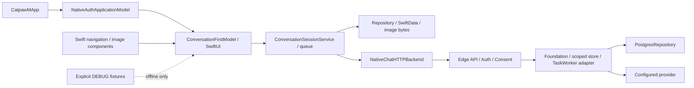

# 项目架构、目录与分支审查

2026-10-13；静态源码/依赖/引用审查，加Git与GitHub管理操作。不是产品验收或功能重构。主源码固定 `42a4504`；审查开始51项文档/规则WIP已备份，当前在短期 `docs/restart-design-integration` 继续收齐。[目录角色](../development/repository-layout.json)、[分支规范](../development/branch-management.md)、[实际分支记录](../status/branch-inventory-2026-10-13.json)。

## 结论与优先问题

主方向SwiftUI＋现有Supabase可继续。问题集中在维护/来源/历史身份混杂、发布候选未齐版，以及文档和分支治理没有跟上代码交付。现在应先把这些边界固定，再随功能片调整内部模块；不先造新的App、第二套状态库或大批空包。

| 优先级 | 已核实问题 | 处理与退出门槛 |
|---|---|---|
| P1 | 源码main42a4504、手机a905b47 build16、本地服务v14/P0、部署APIv19/tick7分别独立 | 每个候选记录source/tree/package/deployment/证据；对齐后同版18A/12U/3CP才签收。当前模型仍0次本轮验收 |
| P1 | GitHub默认旧prepare分支；main上51项WIP；合入后短分支残留 | 已改默认main、启用自动清理、删8远端/4本地已整合分支；WIP带入临时docs分支，没有全量提交或丢弃 |
| P1 | 服务端README指向不存在的catpaw-worker；本地也没有catpaw-tick入口 | 维护入口实际为catpaw-api＋_shared。tick源码仅存在部署快照；本轮纠正指针，不虚构已对齐部署工程 |
| P1 | API/tick快照的14个共享文件不同，且维护v14/P0与其不一致 | 来源快照不可改写；逐模块选基线、整合受控差异，再验证API/tick两入口与同task恢复。未满足前不复制一份_shared覆盖两个包 |
| P2 | 3个iOS工程并列，主工程还编译旧AppModel/RootView/OpenMuseDemo与新会话实现 | 角色固定：ios-conversation为唯一维护宿主，另外两个冻结。生产入口确为CatpawMApp→NativeAuthApplicationModel→ConversationFirstModel；旧场景是否可达先测再按片剥离 |
| P2 | Domain/CoreContracts906行混合多个历史功能，主View568行、Model489行承担多职责 | 下一次对应功能片按会话/账号/任务与UI状态拆职责；更新Xcode引用并保留原storage/wire/身份。行数是定位线索，不是强制拆包指标 |
| P2 | 根design/research与docs/design/research同时存在；历史/新AF/FINAL/CGUI多合同 | 根目录是保留输入，公开维护仅docs；live状态只master-plan，机器合同映射保持一份。现有35项hash输入不搬移或改写，新增记录不再双写 |
| P2 | services/facade/offline、edge维护、vendored patch、部署快照看似重复 | 区分合成历史、维护代码、固定上游和部署证据。禁止按同名文件或相似内容机械去重 |
| P2 | 多个ignored build位置与QA报告脚本容易混入发布、改写旧结果 | 组件.build放运行产物，local-audit放私有资料；现有研究缓存/QA来源路径保留。新QA用独立目录，不刷新冻结报告冒充最新 |
| P2 | GitHub当前私有套餐不执行保护规则，本地也原无hooks | 已建立本地CLI规则和分层AGENTS；服务器未强制保护，记录能力限制，不升级、不改公开、不宣称生效 |

P1/P2指整合风险优先级，未据静态审查断言新的真实运行故障。部署版本差异本身不证明故障；合成/静态结果不证明真实路由、SQL并发或持续执行。

## 目录结构与职责

```text
apps/ios-conversation/   唯一维护宿主：App / Features / Domain / Providers / Persistence
packages/               已接入的Swift组件：navigation、image-composer
services/edge/          后端维护、离线测试、不可改写的部署来源
vendor/openmuse/        固定commit/MIT原件
scripts/               仓库级来源、结构、合同与敏感检查
qa/                    独立QA历史报告/工具，不能自动刷新成当前证据
docs/                  product / design / research / architecture / planning / acceptance / status
docs/archive/          历史资料入口，原件位置/hash保留
local-audit/            ignored私有截图、设备记录、交接/本轮备份
```

[机器布局表](../development/repository-layout.json)明确active/frozen/source/history/input角色。冻结apps/ios、apps/ios-openmuse-demo和services/facade/offline继续保留；不为目录美观破坏现有来源校验。根design/research已有输入也保留，未来公开资料只进入docs。没有物理挪动源码目录、改bundle/签名、改网络/模型或导入新框架。

## 当前代码链与领域边界



图表示代码的接线职责，不表示上述真实用户路径已经验收。领域对象由服务端同scope事务、revision、lease与effect回执维护；客户端本地库负责草稿、阅读/恢复投影和未提交输入。流终态、按钮点击、卡片呈现与真实完成分开。既有CoreContracts和历史服务对象逐步适配，不新造独立执行状态机。

当前TaskWorker已受控vendored复用；模型、Auth、store适配由cat维护。CopilotKit/AG-UI是候选互通/呈现协议，不替代持久任务/审批权威。六类原生卡与表图/计算器沿同工作对象和版本接入；本地交互不产生模型请求，明确跟进才提交，未知结果按原operation核对。

## 两个未合入分支的决策

| 候选 | 固定来源/差异 | 本轮决定 |
|---|---|---|
| Grok CatCompanion | 38c44457；3个独有提交、落后4；新增CatCompanion、Docs、根Package.swift并改README/gitignore | 保留参考。AppStore内存确认直接显示执行，没有模型/系统回执；不能把整个分支merge为生产App。产品输入已在[固定AppStore源码](https://github.com/Yankj/mimi/blob/38c44457cb3f360beed9ee0dab5ab87b001db0c9/CatCompanion/Core/Stores/AppStore.swift)中细分 |
| proactive-goal-kernel | 8e34859a；4个独有提交、落后13；21个文件涉及内核/屏障/存储/合成与PG候选测试 | 保留可复用机制，先做与当前Store/wire的适配审查。源码明确execution_layer=synthetic_test_double并拒绝生产repository；没有HTTP/model/poller/migration，不能取消守卫当上线实现 |

内核的版本CAS、权限重核、待决失效、tombstone与unknown保守处理值得用于S03/S05。restore-dispatch-barrier要求数据库备份之外的新鲜authority；当前没有该外部实现，不能用同库表或静态env替代。其purchase/send_report等合成操作不是本轮工具授权范围。原合成测试报告不能继承为本次PG/云证据。

## 整合顺序与验收

1. 本轮完成目录角色、真实入口、更正README、默认分支/已合入分支清理、WIP保全与基础规则。检查命令见分支规范；结果仅静态/治理。
2. 临时docs分支按AF基础合同、FINAL/CGUI补充、调研来源、handoff/维护四组收齐；每组固定清单，跨组引用一起核对后PR进入main。持续WIP先保留，不以本轮review替其他作者签收全部文档。
3. 原路由正常入口验收仍是S01门槛；等待人类Touch ID时可做明确离线适配。包16的原批准不覆盖后续候选安装/图片/扩大真实样本。
4. S03先画现有领域类型→API事件→PG字段/worker端口映射，再选取合成内核可用机制，补真实待决/计划/成果闭环；必要时拆Model/View，保持同用户路径回归。
5. 后端来源整合成明确的新维护候选，补对应tick入口、SQL/租户/重复恢复检查；真实部署按具体资源/操作范围执行。云电脑仍Proposed、新增计算预算0，不买新资源。
6. S04–S07随功能片完成记忆、触发、原生动作、可交互UI与同版总验收。不要把后端源目录重排或再造主App作为这些功能的前置大工程。

## 规则落点与证据限制

根[AGENTS](../../AGENTS.md)保持目标/授权，子目录AGENTS约束App、包与后端；布局JSON＋[结构检查](../../scripts/check-repository-layout.py)检查真实路径和边界；分支文档＋[Git guard](../../scripts/check-git-policy.py)落实本机防误操作；PR模板只保留问题、行为、证据与范围。

本轮没有发模型请求、写生产DB、部署或安装手机；没有改业务实现。GitHub管理页/API读回默认main、自动删head及剩余3分支。规则服务器不可执行已在页面和403回执核对，本机hook不能防住全部远端写途径。私有完整历史bundle、51项WIP与原规则/配置在本机local-audit，含私人上下文不发布。后续文件继续写入时，本日期快照不代表原子冻结。
