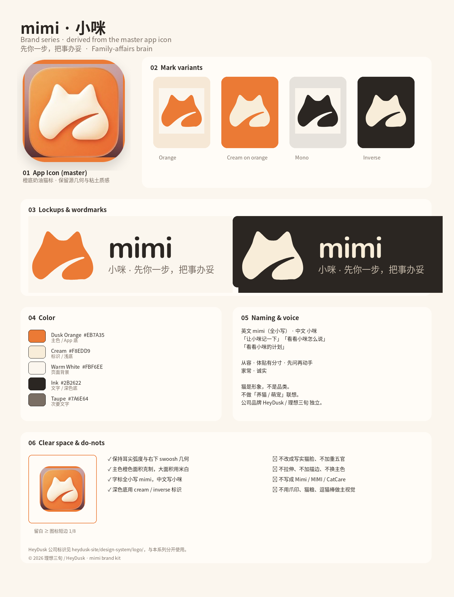
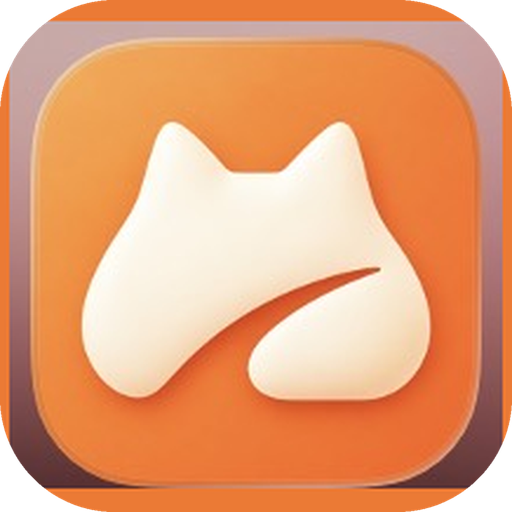

# mimi 品牌手册 / Brand kit

> 先你一步，把事办妥 · A step ahead. Things handled.

本系列的主标识来自用户确认保留的 **橙底奶油猫标 App 图标**（见 [`png/source-logo.jpg`](png/source-logo.jpg)）。所有平面标识、字标与组合标都从这枚图标的几何与配色衍生，不另起猫脸。

公司品牌 **HeyDusk / 理想三旬** 有独立标识系统（见 `heydusk-site/design-system/logo/`），与本手册分开使用。

## 命名

| 场景 | 写法 | 说明 |
|---|---|---|
| 英文 | **mimi** | 全部小写，包括句首和标题（`mimi is working`）。不写 Mimi / MIMI。 |
| 中文 | **小咪** | 与中文直接相连，不加空格：「让小咪记一下」「看看小咪怎么说」「看看小咪的计划」。 |
| 中英并列 | mimi · 小咪 | 只用于标题、官网 title、App Store 名称等需要两种语言的场合。 |
| App 名称 | 中文系统「小咪」，英文系统「mimi」 | `CFBundleDisplayName` |
| 公司 | 理想三旬 / HeyDusk | mimi 是 HeyDusk 的产品，官网 https://mimi.heydusk.com ；公司站 https://heydusk.com 。 |

小咪是一个你可以对话的「家里人」，不是一只宠物，也不是宠物服务。不要写「养猫」「萌宠」「铲屎官」；不要用爪印、猫粮、逗猫棒做主视觉。猫只是形象，不是品类。

内部标识（`catpaw-api`、`CATPAW_*`、`catpaw.family.v1`、`CatpawM.xcodeproj`、scheme `cat` 等）不改，见 [internal-identifiers.md](../internal-identifiers.md)。

## 语气

- **从容**：先说结论，再说为什么。一句话能说完不写两句。
- **体贴而有分寸**：提醒克制，不催、不吓、不用感叹号轰炸。
- **先问再动手**：任何修改都写成待确认，「要我加进日历吗？」而不是「已为你安排」。
- **家常**：像家里一个靠谱的人在说话。用「孩子」「我们家」，不用「用户」「数据实体」。
- **诚实**：不知道就说不知道；不夸大能力。

| ✅ | ❌ |
|---|---|
| 小咪记下了：周五带水彩笔。要提前一天提醒你吗？ | 已智能为您创建待办事项！ |
| 让小咪记一下 / 看看小咪怎么说 | AI 助手已为您处理完毕 |
| 我不确定是周四还是周五，帮我确认一下？ | （直接猜一个日期写入日历） |

## 色彩

从主图标取样：

| 名称 | Hex | 用途 |
|---|---|---|
| 暮橙 Dusk Orange | `#EB7A35` | 品牌主色、App 图标底、强调 |
| 暮橙亮 | `#F49344` | 图标渐变顶部 |
| 暮橙深 | `#E86D34` | 图标渐变底部 |
| 奶油 Cream | `#F8EDD9` | 标识本体、浅色图标底 |
| 米白 Warm White | `#FBF6EE` | 页面背景 |
| 墨 Ink | `#2B2622` | 文字、线条、深色背景 |
| 灰褐 Taupe | `#7A6E64` | 次要文字 |

橙色面积保持在画面约 20% 以内，大面积用米白与墨色，整体温暖、安静。

## 标识

| 文件 | 用途 |
|---|---|
| [`app-icon.svg`](app-icon.svg) / [`png/app-icon-1024.png`](png/app-icon-1024.png) | **主标识**：橙底 + 奶油猫标（源图保真 PNG；SVG 为同几何矢量版） |
| [`mark.svg`](mark.svg) / [`png/mark-512.png`](png/mark-512.png) | 平面猫标（橙），用于导航、页脚、Favicon 衍生 |
| [`mark-cream.svg`](mark-cream.svg) | 奶油色平面标（置于橙色底） |
| [`mark-mono.svg`](mark-mono.svg) / [`mark-inverse.svg`](mark-inverse.svg) | 单色 / 反白 |
| [`favicon.svg`](favicon.svg) | 网站 Favicon |
| [`wordmark.svg`](wordmark.svg) / [`wordmark-dark.svg`](wordmark-dark.svg) | 字标：小写 `mimi` |
| [`wordmark-zh.svg`](wordmark-zh.svg) / [`wordmark-bilingual.svg`](wordmark-bilingual.svg) | 中文「小咪」与双语「mimi · 小咪」 |
| [`lockup.svg`](lockup.svg) / [`lockup-dark.svg`](lockup-dark.svg) | 平面标 + 字标 + 口号横版组合 |
| [`png/brand-sheet.png`](png/brand-sheet.png) | 品牌系列总览 |

### 使用规则

- 保留耳尖弧度与右下 swoosh（爪 / m）几何，不改成写实猫脸、不加重五官。
- 字标与标识周围留白 ≥ 图标短边的 1/8；不拉伸、不描边、不加额外阴影（主图标自带粘土阴影除外）。
- 不把字标改成大写；不写成 CatCare / Catpaw。
- 深色底用 cream / inverse；浅色底用橙色平面标或完整 App 图标。
- App 内毛绒 3D 形象（`apps/ios-conversation/Resources/Mascot`）继续作表情状态；本目录标识用于图标、官网和对外物料。
- **App Store / Xcode `AppIcon` 资源尚未替换**，需在 Mac 上用 Xcode 验证后再换。

## 两个官网

| 站点 | 仓库 | 域名 | 角色 |
|---|---|---|---|
| 公司站 | `Yankj/heydusk-site` | heydusk.com | 独立公司官网；产品卡片外链到 mimi |
| 产品站 | `Yankj/mimi` → `apps/website/` | mimi.heydusk.com | 小咪产品营销站，独立部署 |

