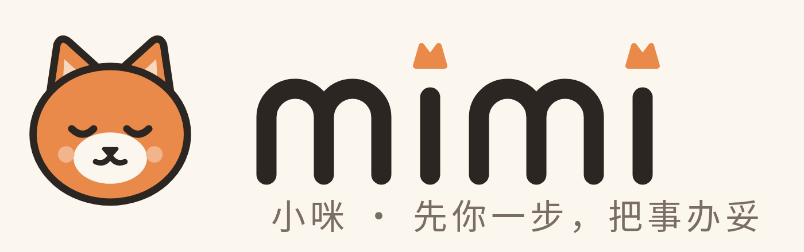

# mimi 品牌手册 / Brand kit

> 先你一步，把事办妥 · A step ahead. Things handled.

## 命名

| 场景 | 写法 | 说明 |
|---|---|---|
| 英文 | **mimi** | 全部小写，包括句首和标题（`mimi is working`）。不写 Mimi / MIMI。 |
| 中文 | **小咪** | 与中文直接相连，不加空格：「让小咪记一下」「看看小咪怎么说」「看看小咪的计划」。 |
| 中英并列 | mimi 小咪 | 只用于标题、官网 title、App Store 名称等需要两种语言的场合。 |
| App 名称 | 中文系统「小咪」，英文系统「mimi」 | `CFBundleDisplayName`，见 `apps/ios-conversation/Resources/*.lproj/InfoPlist.strings`。 |
| 公司 | 理想三旬 / HeyDusk | mimi 是 HeyDusk 的产品，官网 https://mimi.heydusk.com 。 |

小咪是一个你可以对话的「家里人」，不是一只宠物，也不是宠物服务。不要写「养猫」「萌宠」「铲屎官」之类的用语；不要用爪印、猫粮、逗猫棒做主视觉。猫只是形象，不是品类。

内部标识（`catpaw-api`、`CATPAW_*`、bundle id 等）不改，见 [internal-identifiers.md](../internal-identifiers.md)。

## 语气

- **从容**：先说结论，再说为什么。一句话能说完不写两句。
- **体贴而有分寸**：提醒克制，不催、不吓、不用感叹号轰炸。「明早 8:10 出门刚好」优于「⚠️ 快迟到了！」
- **先问再动手**：任何修改都写成待确认，「要我加进日历吗？」而不是「已为你安排」。
- **家常**：像家里一个靠谱的人在说话。用「孩子」「我们家」，不用「用户」「数据实体」。
- **诚实**：不知道就说不知道，没做完就说没做完；不夸大能力。

| ✅ | ❌ |
|---|---|
| 小咪记下了：周五带水彩笔。要提前一天提醒你吗？ | 已智能为您创建待办事项！ |
| 这张通知里有两件事，我整理成两张卡片，你看一下。 | AI 识别完成，正在为您处理 |
| 我不确定是周四还是周五，帮我确认一下？ | （直接猜一个日期写入日历） |

## 色彩

| 名称 | Hex | 用途 |
|---|---|---|
| 暮橙 Dusk Orange | `#E9894A` | 品牌主色、形象、强调按钮 |
| 杏色 Apricot | `#F6D9BF` | 柔和底色、标签、内耳 |
| 米白 Cream | `#FBF6EE` | 页面背景、浅色图标底 |
| 墨 Ink | `#2B2622` | 文字、线条、深色背景 |
| 灰褐 Taupe | `#7A6E64` | 次要文字 |
| 腮红 Blush | `#F2B48A` | 点缀，只用于形象 |
| 鼠尾草 Sage | `#9DB39A` | 「已办妥」状态，少量使用 |

橙色面积保持在画面 20% 以内，大面积用米白与墨色，整体温暖、安静。

## 标识

| 文件 | 用途 |
|---|---|
| [`app-icon.svg`](app-icon.svg) / [`png/app-icon-1024.png`](png/app-icon-1024.png) | App 图标风格标识（米白底 + 小咪头像） |
| [`mascot.svg`](mascot.svg) / [`png/mascot-512.png`](png/mascot-512.png) | 形象：闭眼微笑、安静的小橘猫 |
| [`wordmark.svg`](wordmark.svg) / [`png/wordmark.png`](png/wordmark.png) | 字标：小写 mimi，两个 i 的点是小猫耳朵 |
| [`wordmark-dark.svg`](wordmark-dark.svg) / [`png/wordmark-dark.png`](png/wordmark-dark.png) | 深色背景字标 |
| [`lockup.svg`](lockup.svg) / [`png/lockup.png`](png/lockup.png) | 形象 + 字标 + 中文口号组合 |

使用规则：字标周围留出至少一个 i 的高度的空白；不拉伸、不描边、不加阴影；不把字标改成大写。PNG 由 SVG 用无头 Chrome 导出。

现有 App 内的毛绒小猫 3D 形象（`apps/ios-conversation/Resources/Mascot`）继续作为 App 内表情状态使用；本目录的扁平形象用于图标、官网和对外物料。App 图标资源（`Assets.xcassets/AppIcon`）尚未替换，需要在 Mac 上用 Xcode 验证后再换。
