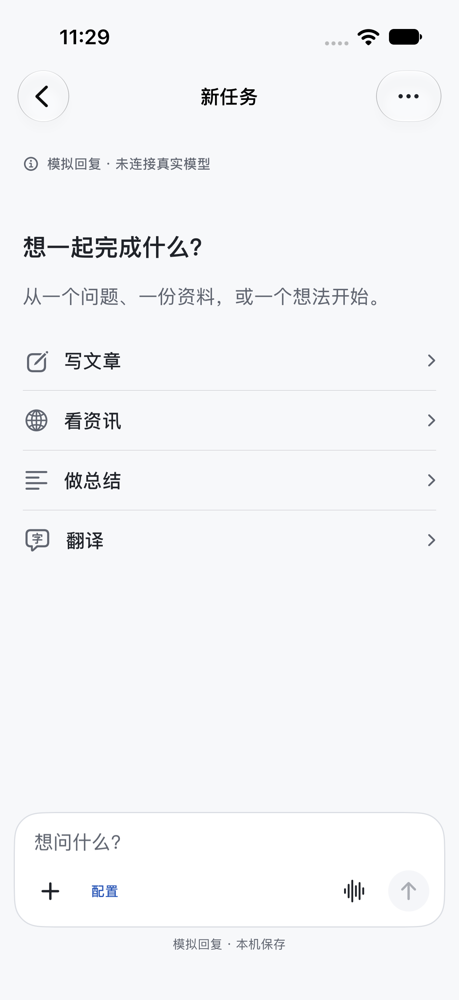
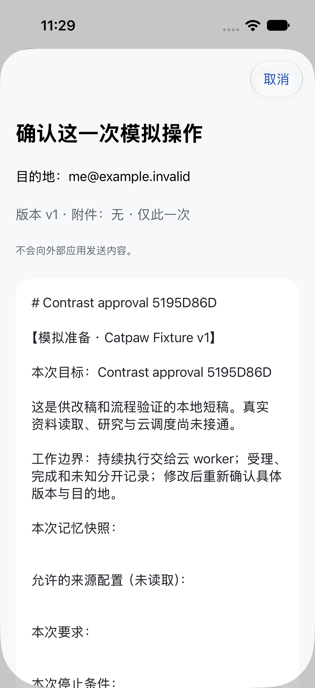
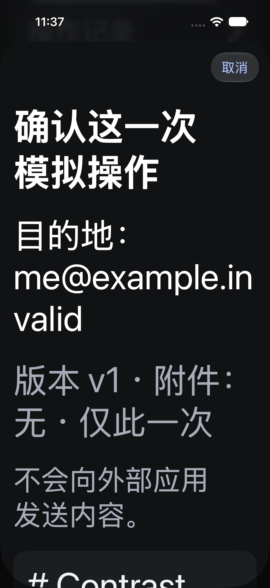

# 原生交互与设计约束

当前配色与UI细节见[R4.1参考修订](codex-color-detail-r4-1.md)、[语义参数](codex-color-detail-r4-1.json)和[新版样机](prototypes/catpaw-codex-color-r4-1/index.html)：中性阅读面、局部紫色动作、辅助字与决定区清楚可读。原R4保留对照，以下连续机制仍适用。

连续机制评审见[UX-1 R4原生交互／动效](native-interaction-motion-r4.md)、[视觉方向与参数](interaction-motion-r4.json)及[独立交互样机](prototypes/catpaw-motion-study-r4/index.html)。采用 taste-skill 的 App 专用 `imagegen-frontend-mobile` 生成[对话](prototypes/catpaw-motion-study-r4/assets/mobile-conversation-concept-r4.png)与[审批](prototypes/catpaw-motion-study-r4/assets/mobile-approval-concept-r4.png)方向图；样机单独验证跟手／可打断／分档／回源／锚点。R3的[42项状态场景](interaction-scenarios-r3.json)与[R2日期视觉输入](taste-visual-motion-r2.md)保留；新方向不修改A1、冻结tokens或领域合同。实时状态与原生未验项只见master-plan，合成图和网页不能关闭产品验收。

本轮[产品与视觉交互评审R1](product-experience-review-2026-10-13.md)已经写回FINAL-1、UX-1与既有验收：一句体验承诺、合理默认值、当前待决层级、修改草稿、成果复制/分享与克制反馈。评审是设计依据，原生通过状态只见[master-plan](../status/master-plan.md)。

对话内新交互：[CGUI-1规格](conversation-generative-ui-spec.md)、[10项细分验收](../acceptance/conversation-generative-ui-acceptance.md)，固定原生表图／确定试算与显式同工作跟进；来源见[UI/onboarding核读](../research/copilotkit-conversation-ui-onboarding-review-2026-10-13.md)。

终版整合：[FINAL-1规格](../product/catpaw-final-product-spec.md)、[流中决定／审批恢复／成果／跟进可点按提案](prototypes/catpaw-final/index.html)、[FQ质量验收](../acceptance/catpaw-final-product-acceptance.md)。提案内容人工构造，没有模型或系统动作；保留A1、UX-1与原生验收门槛。

2026-10-13重启设计入口：[iPhone对标规格UX-1](ios-codex-experience-spec.md)、[前期截图与观察对照](ios-codex-reference-review-2026-10-13.md)、[可点按布局提案](prototypes/catpaw-ios-ux/index.html)、[AF-U01–12验收](../acceptance/ios-codex-experience-acceptance.md)。当前结果只在主计划；以下保留历史设计身份。

当前交互裁决与验收以 [主交付计划](../status/master-plan.md) 为唯一索引：conversation-first替代散装Demo/手建委托；外围r4暂停，A1正式图标选择保留。当前原生owner独立开发，未冻结源码/图标不在本轮复制；图标选择/接入声明与实际iOS资产编译/真机呈现分开记账。

以下约束、tokens及截图属于v1/r3历史实现。新主屏以一条自然对话、消息输入、服务端任务/审批/产物投影为中心，不能把旧委托表单或截图作为新体验通过证明。

保留侧栏、NavigationStack 和原生返回。助理首页以一个主动作开工，待确认优先于新建区域；最新成果显示标题、版本、已读状态，跟进和记忆为轻量行。聊天采用用户轻气泡、助理正文直接阅读，`safeAreaInset` 输入区随系统键盘抬升。持续委托页面依次呈现状态/控制、确认、进展、成果、工作约定。

阅读器动作常规两列、辅助字号单列，完整换行，hash 可折叠查看；CSV 使用原生 Grid 并横向滚动全部源列。审批必须展示本次正文、版本/hash、目的地和一次性语义；确认后若回执 unknown，就读回核验。暂停、撤权、结束播放和结束任务是不同控制。

[design-tokens.json](design-tokens.json) 与 [icon-semantics.json](icon-semantics.json) 保留交付设计定义。黑白主动作、蓝色操作、独立状态色；系统字体 title2/headline/body/subheadline/caption，自然换行；页面 inset 20、section gap 28、卡片 radius 20、控件 14、composer 24、touch 最小 44pt、阅读宽度上限 680pt。普通图标采用 monochrome / medium，并随 ScaledMetric 缩放；状态兼用文字与符号。

## 精选合成截图

这 3 张是已交付 v1 的最终生产源码测试附件原像素；内容为 fixture，目的地是 `example.invalid`，没有真实外发。不是OpenMuse r3截图。逐图测试归属与 hash 见 [manifest](../assets/ios-v1/manifest.json)。

独立冻结OpenMuse r3的恢复/审批/unknown/来源页面在 [r3精选图](openmuse-r3.md)，其测试和未验边界单独记账。

| 浅色输入 | 浅色审批 | 最大辅助字号深色审批 |
|---|---|---|
|  |  |  |

历史普通字号 8 组实际组件取色全部 ≥4.5，最低 4.929；最大字号 7 组有效采样全部 ≥4.5，最低 5.501。最大字号浅色结束按钮部分在屏幕外被排除。此处没有打包原始取色/设备日志；结果来源为 v1 集成验收报告，原材料由交付资产保留。设计 token 计算不能替代实际系统样式或完整无障碍验证。

最终视觉修正后仅 3 个指定场景重跑，不扩称完整 28 项回归。VoiceOver 实际朗读顺序、Reduce Motion 系统开关、多尺寸/iPad/英文及 iOS17 runtime 仍待验。记录见 [iOS v1 验收](../acceptance/ios-v1.md)。
