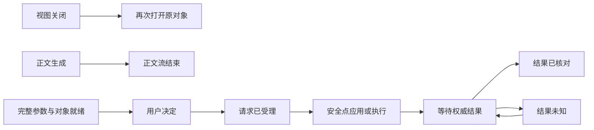

# UX-1 R3：完整任务中的交互场景

2026-10-13。R3 是 [UX-1](ios-codex-experience-spec.md) 的交互实施附录；视觉沿用 [R2](taste-visual-motion-r2.md) 与冻结 tokens，产品行为、对象权威、算法和作用域沿用 AF-1／FINAL-1／[CGUI-1](conversation-generative-ui-spec.md)。不建立第二份产品规格，不新增总验收项，不改变运行 Goal。当前进度只在 [master-plan](../status/master-plan.md)。

交付以 [可操作 R3 Demo](prototypes/catpaw-interaction-r3/index.html) 为主，配套 [机器场景表](interaction-scenarios-r3.json) 和日期合成证据。14 个入口包含 R2 的 8 个场景与新增的抽屉、过程、Agent 卡、Intelligence UI、浮层、HIL。原 [R2 Demo](prototypes/catpaw-taste/index.html) 保留作版本对照。

## 1. 本轮交互决定

**界面的每一步，都要让人知道正在发生什么、自己能做什么、关闭之后怎样回来。** 正文负责表达；一个稳定摘要说明当前工作；一个当前待决区域承载需要用户参与的事；过程按需展开；成果沿原对象查收和修改。

以现有 vanilla Demo 扩展真实可操作的手势和状态，成本小于先做一批孤立位图再反推交互。保持系统字体、A1 与单列对话；不增加品牌插画或替换图标资产。静态截图只用于保存布局及版本。最终 iPhone 的 Sheet、返回、键盘、分享、触觉与辅助技术由原生组件兑现，网页不仿造系统授权。

采用 taste-skill 的原生适配、有限动效、完整状态原则，以及 [redesign-existing-projects](https://github.com/leonxlnx/taste-skill) 的审计与小步升级方法。Web 营销页的字体替换、滚动劫持、巨幅标题和纹理不进入手机对话。当前 Apple API 支持 [Sheet detents](https://developer.apple.com/documentation/swiftui/view/presentationdetents(_:)?changes=latest_major)；产品的高度、草稿与状态规则是本项目决定。Apple [生成式 AI 指南](https://developer.apple.com/design/human-interface-guidelines/generative-ai?changes=lat__5) 支持明确能力、诚实状态和可理解的失败下一步。本轮页面抓取部分仅返回 JS 提示，不宣称逐段核读全部 HIG。

## 2. 三条互不代替的状态线

视图关闭只影响 presentation。正文流结束只影响输出。`accepted`、`applied`、`effect succeeded` 和 `result delivered` 分别表达受理、要求生效、效果成功、成果交付；需要哪个事实就读取哪个对象。演示里的回放按钮只注入人工状态。

## 3. 抽屉：位置稳定，拖动直接

根对话提供菜单按钮与左边缘开抽屉。展开宽度 `min(320pt, 86%)`，对话保持原阅读位置，遮罩是关闭入口。拖动期间位移直接跟手；松开按进度/速度确定展开或回弹。网页阈值为 45%／700px/s，属于评审参数；原生沿现有 `SidebarGesturePolicy` 调校，不重新造一套系统返回手势。

只在根对话启用开抽屉；详情页左边缘交给系统返回。输入框、横向表格、系统选择器与已呈现浮层排除在识别区之外。纵向滚动优先，横向意图明确后才接管。拖动取消恢复原状态，关闭后焦点回菜单按钮。搜索由主动点选输入框唤起键盘；打开菜单不自动抢输入焦点。VO 用户用具名按钮打开和关闭，不依赖手势。

切换对话前保存各自的聊天草稿、修改草稿与阅读位置；新对话不继承另一个工作的卡片局部状态。Demo 可用“回放切换再返回”→菜单→“上一份草稿”检查；刷新仍重置，原生冷启动持久化由应用服务处理。

## 4. 流式过程：有依据的摘要，安静地更新

默认显示一行当前过程，如“已核对第 2 份资料的日期与主题”。展开后列出有事件依据的步骤、输入/输出摘要、受阻原因与可查看资料；不展示模型隐藏推理，不生成“思考了多久”或虚假的百分比。未取得事件时写“等待响应”，不要假装在读取资料。

正文按段追加，卡片和编辑器保持稳定身份。用户在底部才跟随新增内容；正在读上方时显示“回到最新”，不把人拖回底部。过程更新不逐 token 动画或逐 token 朗读；VO 只在可操作决定、状态实质变化或新成果时合并播报。可见过程更新的真实时间、源对象、seq 由事件事实提供；Demo 不编造时间戳。

“停止文字生成”停止当前输出，不代表取消持久工作。“暂停工作”先显示已申请，权威安全点确认后才显示已暂停；已发出的效果不能借暂停回滚。断线先核对原 turn/run，保留已读正文与草稿；流结束后仍保留待决和工作状态。

## 5. 浮层：一个呈现入口，关闭可恢复

| 内容 | 首选形式 | 关闭与返回 |
|---|---|---|
| 消息次级操作 | 原生 contextMenu／短操作菜单 | 点击外部即关，不提交 |
| 资料摘要、字段说明 | Sheet 内详情或内联展开 | 同一 Sheet 内返回列表，保留阅读位置 |
| 精确审批、待决表单 | Sheet，正文可滚，操作区固定 | 关闭≠拒绝；入口继续保留 |
| 长报告、完整编辑器 | NavigationStack 详情／large Sheet | 返回原锚点；草稿先保存 |
| 放弃草稿、结束跟进、忘记记忆 | 具体的原生确认 | 取消回编辑态；确认只影响具名对象 |
| 错误／结果未知 | 原对象内状态，必要时详情 | 明确下一步，避免瞬时 Toast 承载重要结果 |

唯一 presenter 用带对象身份的 route 驱动；资料详情可在当前 Sheet 内走一层导航，不叠第二个遮罩。快速开—关—开取消旧关闭回调，新浮层不被旧动画销毁。Sheet 拖动把内容带回去，正文滚动不误触关闭；网页从 handle 拖动超过 120px／700px/s 关闭，原生采用系统 detents 与滚动协调。网页没有模拟中档吸附；原生短阅读允许 medium/large，审批和长表单默认 large，辅助大字／键盘出现时用 large，避免操作区被挤走。

所有编辑字段按 `scope + objectID + revision + fieldID` 保存本地草稿。关闭按钮、遮罩、Esc、下拖都保存草稿；**放弃草稿是独立且确认的动作**。保存后的内容才作为本地已保存版本展示。用户批准的是已保存的精确版本，编辑草稿不偷偷混入批准预览。返回后恢复焦点；原控件已消失则聚焦对应卡片摘要或页标题。

审批进行中仍可关闭查看层；原操作保留并可找回。阻止交互式关闭只用于无法安全保稿的明确临时情况，必须给出退出路径；不能拿阻止关闭代替持久化。系统键盘、安全区、焦点圈与系统分享使用平台行为，网页占位不能签收。

## 6. 对话内 Agent 卡与 Intelligence UI

六类领域卡不变：choice／form／plan／approval／artifact／comparison。卡片只向类型化应用服务发出意图；View 不创建账号、网络准入或任务权威。受控 renderer 使用稳定 block/card ID 和完整参数门；schema 未完整、对象未就绪或版本过期时展示只读说明和占位，不开放提交。未支持 registry 或超界数据退回可读正文和原成果入口。

当前 form 优先呈现；已回答 choice 收成摘要，plan 默认可展开，approval 保持独立的精确后果，artifact 用可打开的成果入口。局部表单以 field ID 更新，正文或旧事件不能卸载输入节点、覆盖用户已编辑字段或移动光标。可选字段标注选填；无效字段旁给修正原因并聚焦首个错误。提交后从“已受理”到“安全点已生效”，不直接画完成绿勾。

Intelligence UI 在 conversation 中嵌入 table／bar／line／calculator／explanation。完整表只允许表自身横滑；预览显示总行数和主要列，筛选/排序针对完整数据。点选图形在可读文本中显示原值、单位、版本和依据；不依赖 hover 或颜色。Demo 甲/乙条图显示加权分数，连线图显示同版本原始维度分数，轴标题明确不同指标；类别连线不暗示时间趋势。原始表始终可查，选择条件无数据时显示缺口。

固定计算沿用 `weighted_comparison_v1` 和 `duration_budget_v1`。输入、参数、筛选、图点、表图切换全在本地；无效参数不保留可提交的旧结果。新数据版本默认保留旧数据与条件，用户明确读取新版本后才重置局部状态；跨 scope 不复用。实产需要复用旧条件时先校验新数据约束，提示哪些条件可复用。网页仅演示“读新版本并重置”，不声称已实现持久版本迁移。

按钮文案区分：本地“筛选／试算／重置”，明确跟进“按这些条件继续”，真实写入“审阅本次动作”。Demo 的明确继续带参数进入同工作修改草稿，仍须显式提交；真实跟进携带同对象与 revision，经新 turn 或安全点受理。执行效果仍走精确审批和回执。模拟刷新清空，不作为 CG-A07 持久化证据。

## 7. Human in the loop：做决定，并能回来

多个待决按对象列出并标清作用；回答报告侧重点不会批准日程。当前最关键事项优先，其他事项在同区域可访问；同对象多入口共用状态，不能重复计数。

精确审批同时呈现动作、目标、内容、版本、影响和恢复方式。关闭保持待决；稍后明确收起并可从原消息／活动找回；拒绝只拒绝本次操作；修改生成新版本并重新批准。外部更新时旧确认立即失效，保留编辑草稿。过期不能用旧批准继续，重新准备后重新审阅。

提交按钮受当前状态/版本保护，重复点按只关联同一次操作。处理态、未知、部分效果、成功但交付失败分别表达真实事实。未知只核对原 operation，不提供盲目重试写入。部分效果列出已成功、未执行或未知的具体子项，仅对确认未执行部分另行准备精确新审批；成功但交付失败只重新读取原回执/成果。Demo 可回放未知与交付恢复；**部分效果复合对象**在本附录/机器场景表固定，真实多效果事务及去重必须在领域服务验证。

## 8. 场景覆盖清单

I 编号是设计审阅索引，复用原 AF-U／CG-A 验收，不增加 release 总门槛。`可操作`是合成 Demo 中已有路径；`原生说明`是系统或后端才能证明的行为。机器表给出逐项映射、入口、退出与保留内容。

| 索引 | 场景及必须确认的行为 | 交付形式 |
|---|---|---|
| I01–06 | 抽屉按钮开关、边缘拖开、短拖回弹、左拖关闭、搜索清空/无结果、切换保稿与返回冲突 | Demo；返回冲突/取消事件另有原生说明 |
| I07–12 | 过程展开收起、正文追加、等待决定、停止文字、暂停申请/安全点、断线核对/流结束 | Demo |
| I13–18 | Sheet 开关/遮罩/Esc、下拖回弹/关闭、编辑保稿、放弃取消/确认、同层详情返回、连续开合/菜单 | Demo；原生 detents 说明 |
| I19–24 | 卡片未就绪、就绪输入、正文中保稿、旧事件、字段错误、受理→生效→成果 | Demo；真实事件/VO/持久验证待开发 |
| I25–30 | 全表筛选排序、条/线/表切换和点选、两套确定试算、无效值/零权重、本地与明确跟进、新版本与降级 | Demo；真实数据链与 p95 待开发 |
| I31–36 | 多待决、关闭/稍后/拒绝、修改/版本失效、过期重审、重复确认/未知核对、成功但交付失败/部分效果 | Demo；部分效果为原生说明 |
| I37–42 | 成果来源/冲突保稿、两份修改草稿、跟进草稿/暂停/结束、记忆更正/忘记、离线/首次权限、可访问与系统恢复 | Demo；冷启动/系统权限/VO/触觉为原生说明 |

首选审阅顺序：过程→流中卡→Intelligence UI→HIL→浮层→抽屉；再用既有成果／跟进／离线场景检查返回。只在屏框外提供人工状态注入，App 内不暴露 fixture 或技术参数调试按钮。

## 9. Swift 实施取舍与成本

成本为当前源码静态核读后的相对判断，不是工期承诺。无需为像素复刻网页自建系统控件。

| 单元 | 原生落点 | 成本与先后 |
|---|---|---|
| 抽屉 | 复用 `packages/ios-navigation` 的 Host／Model／GestureBridge；沿既有排除区、根页策略 | 低；先验证当前宿主草稿/返回，不重造侧栏 |
| Sheet、菜单与键盘 | SwiftUI `.sheet(item:)`、detents、contextMenu、confirmationDialog、FocusState；现有队列 Sheet 继续复用 | 低–中；统一呈现入口与草稿对象，系统掌管动效 |
| 过程及稳定卡片 | 现有 ConversationFirstView／typed session events，增只读过程 projection 和稳定 renderer | 中；卡片局部 reducer 与正文缓冲，避免整条消息重建 |
| Intelligence UI | CGUI 受控 registry＋固定计算内核；Swift Charts 或等价原生呈现，保留表格文本替代 | 中；先固定数据和算法，再接真实输出；不加 WebView 执行脚本 |
| HIL 与持久恢复 | 现有 AgentContracts／ConversationSessionContracts／scoped backend；统一 operation/revision/result identity | 高；难点是权威/幂等/重连，不是动画。UI 先接服务状态，不做内存假执行 |
| 结果及主动跟进 | 原成果对象/版本、跟进约定、记忆服务，保留明确同工作修改 | 中–高；数据与审批先行，系统分享/通知在具体权限路径验 |

新增产品类型仅是内部建议：`PresentationRoute(objectRef, mode)`、`ComponentLocalState(scope, revision, fieldValues, selection)`、`ProcessProjection(sourceEventRefs, current, history)`。先映射现有类型，再补必要端口，不能借此改写冻结 HTTP。界面状态 reducer 不发出领域效果；领域回执也不由动画结束回调创造。

动效延续 R2：按下 120ms，内容进入 240ms，抽屉目标 280ms，网页关闭 220ms、遮罩 180ms，仅 transform/opacity；直接操控时不额外缓动。原生导航/Sheet 时序用系统值，不硬写网页时长。减弱动态取消空间移动和缩放，但仍给静态状态变化；触觉仅明确提交/权威成功各至多一次，无 token 触觉、未知不成功触觉。中档吸附、键盘避让、触觉、系统玻璃和帧率不以网页截图代替。

## 10. 设计交付与原生放行

Demo 与截图能够确认层级、文案、可操作状态和局部保稿。原生需在同候选确认 375/390/430 尺寸、大字号、Dark、VoiceOver、Reduce Motion／Transparency、键盘、安全区、手势冲突、前后台/冷启动、真实流、pending持久对象、权威回执与系统分享。真实压力下长文/表图流畅度按原 FQ/CG 测量，不推断浏览器帧率就是 iPhone 性能。

本附录接 AF-U02–12 与 CG-A01/02/04–09；CG-A03/10 仍要求真实闭环。18A／12U／3CP／9FQ／10CG、7 天日用与具名 BP 对照仍全保留。先 W10→W11→W12 验原路由，再按 CP-01 贯通；新计算预算 0，不新增账号或资源。R3 未启动 Goal、模型、SQL、安装、部署或发布。
