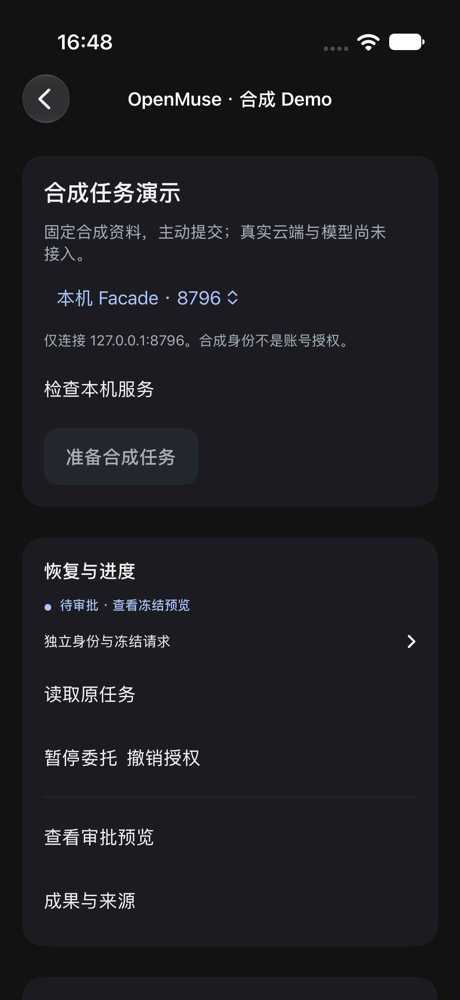
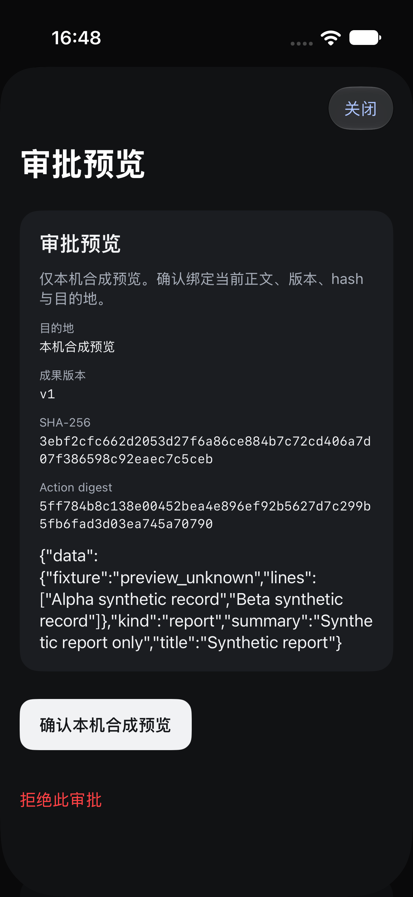
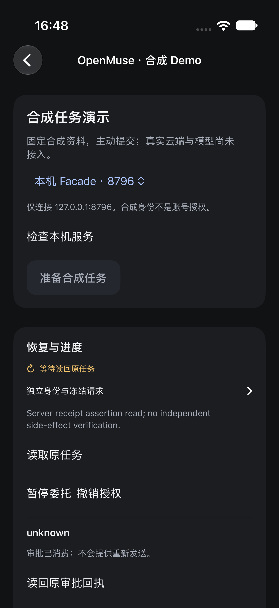
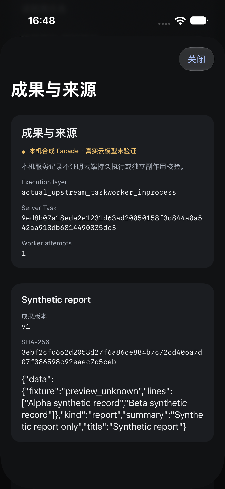

# r3 原生合成客户端精选图

以下4张是同一最终r3源码原生façade UI用例的实际PNG，包含冻结恢复、具体版本审批、unknown原回执及来源。内容为Alpha/Beta合成记录、本机预览、业务hash和Task身份，没有用户真实资料。无重绘/裁切/像素修改；设备身份不写入仓库。逐图hash与测试归属在 [manifest](../assets/openmuse-r3/manifest.json)。

| 原任务恢复 | 版本绑定审批 |
|---|---|
|  |  |

| unknown原回执 | 原生成果来源 |
|---|---|
|  |  |

截图显示的实际执行层标签只表示固定Worker合成执行，不表示真实模型/Intelligence/云后台。审批只确认本次本机合成预览；unknown不能重新发，核验只是原本机效果记录。图中来源页Worker attempts=1属于截图时间点，最终服务记录为2次，不能混为两次业务请求。

这些新页面沿用 [设计tokens](design-tokens.json) 与v1组件约束。r3只验中文、深色、该Simulator下两条链；没有借v1大字号、对比度、英文或完整无障碍结果给新页补验收。当前边界见 [r3验收](../acceptance/openmuse-r3.md)。
