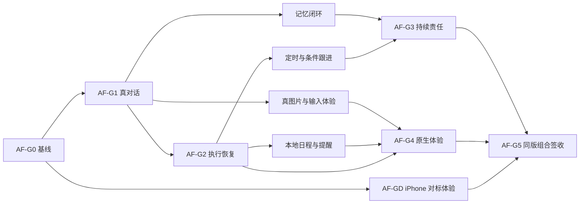

# AF-1 新交付计划与可验收 Goal

版本：AF-1-G2-UX1，2026-10-13。本文是当前 [AF-1 spec](../../product/agent-foundation-spec.md) 和 [S00–S08 切片](../../status/delivery-slices.json) 的详细执行合同，不维护另一份实时进度。当前结果、负责人和阻塞只更新 [master-plan](../../status/master-plan.md)。功能细则见 [spec-details](spec-details.md)，执行脚本见 [acceptance-scenarios](acceptance-scenarios.md)，对应关系见 [contract.json](contract.json)。

## 1. 总 Goal：交付可日常使用的通用主动 Agent 底座

**AF-G5 的可验收表述：在同一版 Swift 优先的 iPhone App 和对应服务端上，用户从正常对话入口提出目标，Agent 能形成可修改计划、调用已登记工具、在需要时等待决定、在离开 App 后继续已受理的云端工作，并把可核对成果交回原会话；用户能管理记忆、时间/条件跟进和本地日程动作。全部 AF-A01–18、AF-U01–12 与 CP-01–03 同版通过，源码、包、部署和证据对应，才关闭本 Goal。**

通用性由同一套 Goal/Task/Approval/Effect/Artifact/Memory/Trigger 组合三类工作证明。三条路径不能各写一套特殊处理来演示成功。普通问答仍直接回答；用户无需到独立表单手建委托。

AF-1 的主动能力下限是：服务端定时/条件任务不依赖手机或 Mac 在线，成果进入持久收件箱；已知时间的本地提醒可从系统入口返回原事项。云端未知变化发生时的即时 APNs 推送另列 AF-P，不把本地定时提醒当成云端推送证据。云电脑、语音、多 Specialist、任意 MCP 接入和第三方账户登录不属于 AF-1 的完成条件。

## 2. 分阶段 Goal 与退出规则

| Goal | 用户可看到的交付 | 必须通过的验收 | 退出条件 |
|---|---|---|---|
| AF-G0：可追溯开发基线 | 主维护入口、已接手候选、构建与验收入口能对应 | AF-A01 的来源/构建准备；AF-A18 的完整性/敏感检查 | 来源 hash 和本次差异清楚，离线构建/检查有结果；只关闭“基线准备”，不提前关闭 AF-A01 的最终包/手机验证 |
| AF-G1：真实对话可用 | 允许后能回答、连续追问、重开；等待许可有入口 | AF-A02–05；AF-A17 的输入与确认主动作 | 现有路由真实回答、terminal、落盘、5s/30s 后台与重开一致；只有算术短标记通过不能关闭此 Goal |
| AF-G2：可恢复执行闭环 | 自然目标→计划→实际步骤→审批→成果→恢复/停止 | AF-A07–10；CP-01 的任务与成果部分 | 真实读取工具、实际成果、可重开审批、同任务重启及 unknown 核对通过；模型文本“完成”不算成果回执 |
| AF-G3：记忆与持续责任 | 记住/更正/忘记；无人提问也按约定跟进 | AF-A11–13；CP-02 | 两个实际 due、条件变化/静默/退避/暂停与记忆删除屏障通过；手点“运行”与本机前台 tick 不能代替服务端调度 |
| AF-G4：原生完整体验 | 真图片、原生卡、日程和提醒、可用导航与阅读 | AF-A06、14–17；CP-03 | 真像素回执、一个真实 EventKit 对象、系统提醒返回、六类卡与真机输入/可访问性通过 |
| AF-GD：Codex iPhone 对标体验 | 主对话、输入/图片、侧栏、任务/审批、成果、记忆/跟进采用一致原生交互 | AF-U01–12 全部（AF-A17必需细分） | 同版原生App在实际iPhone完成规定路径、视觉与可访问性记录；HTML仅用于设计评审 |
| AF-G5：通用底座签收 | 三类工作使用同一底座并可连续完成 | AF-A01–18、AF-U01–12 全部；CP-01–03 全部 | 同一发布候选的必需证据齐备、无阻断缺陷、用户可重复完成三条路径；附完整限制和交付 manifest |

AF-G0–G4及AF-GD是可独立验收的阶段成果，不能替代 AF-G5。某子 Goal 通过后可继续下一片，也可以交给用户使用已证实的能力。全局 Goal 不用“完成百分比”表达局部测试计数。

扩展 Goal：AF-C 对应已有 AF-C01–03，云电脑公开网页/文件执行器在托管、预算、区域和范围确认后启动；AF-P 对应远端变化推送，需 APNs 服务与设备链路；AF-V 对应语音。这些扩展必须分别制定范围和验收，不自动改变 AF-1 必需项。

## 3. 依赖与实施顺序

以下是 S00–S08 的可独立展示工作单元；每个单元从用户入口到实际结果贯通。它们细化已有切片，不产生第二套切片状态。

| 单元 / 所属片 | 演示终点 | 直接阻塞 | 验收归属 |
|---|---|---|---|
| W00 / S00 | 来源与新包准备清楚；选定源码可以构建 | 无 | AF-A01 的准备、AF-A18 |
| W10 / S01 | 关闭许可后找回、允许/拒绝有确定反馈，原意图不重复提交 | W00 | AF-A02 |
| W11 / S01 | 正常入口真实回答、追问、持久化、重开 | W10 | AF-A03 |
| W12 / S01 | 同 turn 真流式，后台/弱网/重开只读续接 | W11 | AF-A04、AF-A05 |
| W20 / S02 | 新合成图经预览/许可送真实视觉路由，回执与恢复一致 | W11、W12 | AF-A06 |
| W30 / S03 | 自然委托形成持久计划；补充和修改回同任务 | W11 | AF-A07 |
| W31 / S03 | 读取给定公开来源，真实成果回原对话/收件箱 | W30 | AF-A08、CP-01 的执行部分 |
| W32 / S03 | 精确动作审批能找回，参数改动使旧批准失效 | W30 | AF-A09 |
| W33 / S03 | 真实数据库双执行者/重启/撤权/未知写结果安全收尾 | W31、W32 | AF-A10 |
| W40 / S04 | 保存、更正、删除记忆影响新会话，迟到 job 不复活 | W11 | AF-A11 |
| W50 / S05 | 手机/Mac 离线跨两次 due，同 trigger 产生可核对 run | W33 | AF-A12 |
| W51 / S05 | 公开来源基线→变化→成果；重复/无变化/错误有界处理 | W50 | AF-A13、CP-02 |
| W60 / S06 | 精确确认后写一个系统日程，拒绝和 unknown 可核对 | W32 | AF-A14 |
| W61 / S06 | 已知时间本地提醒实际出现，点击返回同事项 | W60 | AF-A15、CP-03 |
| W70 / S07 | 六类原生卡动作、阅读和侧栏贯通；过期卡安全降级 | W20、W31、W32、W40、W51、W61 | AF-A16、AF-A17 |
| W71 / S07 | 固定候选版本后完整组合验收与交付来源核对 | W12、W33、W40、W51、W61、W70 | AF-A01、AF-A18、CP-01–03 与必需项回归 |

W50/W51 的真实执行依赖确定且获准的独立服务端调度；产品配置、存储契约、去重与离线测试可先完成。设备不可用只阻塞 W60/W61 的真机阶段。模型未确认不阻塞其余合同分析与合成测试，但 W11 没有真实通过时不扩大真实模型实验。

### 设计从首片开始

AF-GD贯穿S01–S07，由W70/W71汇总关闭，不等功能全部完成才美化。设计顺序为：前期截图/观察审计→四组主界面及状态的可点按提案→将用户反馈版本化→SwiftUI逐片实施→同版AF-U01–12验收。依据、具体布局和动作以[UX-1设计规格](../../design/ios-codex-experience-spec.md)、[参考对照](../../design/ios-codex-reference-review-2026-10-13.md)和[UX验收](../../acceptance/ios-codex-experience-acceptance.md)为准。

产品设计评审与原生产品验收分别记录；新页面开工前必须知道布局、状态和返回路径，既有许可/模型修复可继续。

## 4. 每个工作单元怎样交付

开工输入：固定源码/候选 hash、上游合同、所改状态和验收断言。先给出受影响界面与失败恢复路径；关键类型不清楚时先完成映射表，不同时替换认证、存储、provider、worker 和 UI。

完成输出：用户可见行为、同版源码差异、实际测试结果和证据层、未验项、下一单元的入口。实现作者负责局部检查，放行检查由集成负责人复核，最终三条路径由正常产品入口操作。规划不会自行向其他任务发消息或启动并行 agent。

每个单元的 DoD 是“行为成立＋适用负向路径成立＋证据可定位＋当前状态已更新”。测试源码存在、组件计数和漂亮截图均不满足 DoD。单元太大时继续拆用户路径；一个单元应能在一次独立开发上下文中实现和验证。

## 5. 节奏、速度与失败处理

当前关键路径是 W10→W11→W12。handoff 的 getter 编译阻塞与许可候选分别验证；旧 build15 的许可失败是排查输入，不能推断现有模型路由已失败。优先形成许可受理→原 POST→provider→terminal→存储→UI 的证据链。

首个真实探针限定为一轮短文本及成功后的追问。未知结果立即停止新增发送并只读核原 ID；明确许可/协议/provider 错误停止该实验，记录失败段后修复。既有路由实际失败后再讨论切换，不自行付费 fallback。

不再先承诺“一周完成全部”。W11/W12 得到真实等待和故障分布后，为每个工作单元记录实际工时、测试耗时和阻塞时间，再做滚动估算。滚动承诺以一个可演示单元为单位；没有具体行为/证据变化，不用“快完成了”报告进度。

阶段性规模上限：个人使用、一个已配置模型路由、给定公开 URL 读取/轻量文本成果、一个 EventKit 写能力、两种 trigger、六类原生卡。浏览器沙箱、第三方登录、复杂空间编辑器、自动多 Agent 和通用工具商店另立扩展 Goal。

## 6. 放行判定

- PASS：全部规定断言成立且证据达到相应环境层；同版新改动影响该断言时重验。
- FAIL：行为或门槛不满足；记录具体输入、实际结果、失败段，不用重新发消息掩盖未知结果。
- NOT_RUN：还未执行；写明下一次入口，不能从历史测试继承。
- BLOCKED：缺少外部条件；说明缺哪项、哪些独立工作仍可做。

没有证据等于未验。AF-G5 不允许用“风险接受”悄悄把必需项改成可选；若要调整范围/体验门槛，先形成明确 spec 变更和 Goal 名称，保留旧失败记录。

最终交付包含 release manifest、源码位置、对应包、部署身份、三条完整路径记录、各 AF-A / AF-U 的证据索引和实际限制。用户可以核对和复现，不必依赖开发者口头解释。

本轮资源边界：用户已选现有Supabase先完善底座，新增云电脑计算预算0；以后托管执行器/沙箱的可持续资源来源再确认，不购买付费资源或把试用赠额视为长期免费。
