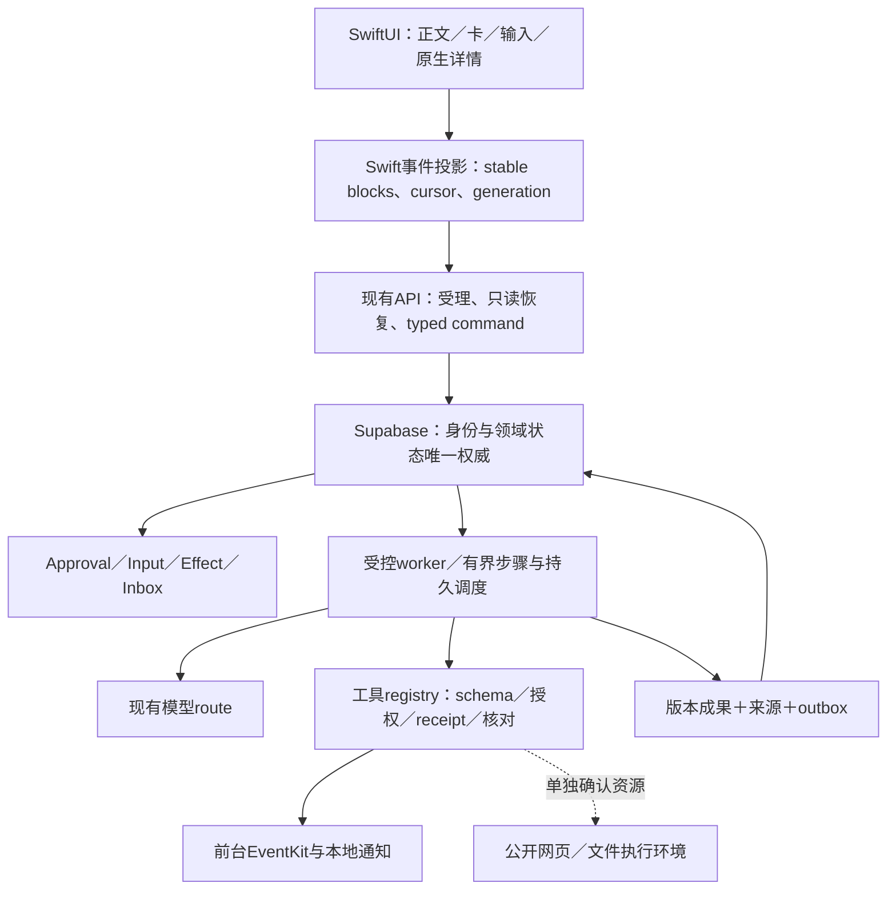

# cat 终版产品、体验与技术设计

版本：FINAL-1，2026-10-13，产品设计修订R1。综合用户指定的 Grok 分支、现有 AF-1／UX-1、手机观察与四仓源码核读；[本次产品评审](../design/product-experience-review-2026-10-13.md)记录体验取舍。本文固定产品设计和质量标准，不宣称已经实现或优于竞品。当前执行基础仍为 [AF-1-G3-UX1](../planning/AF-1/goal.md)，实时状态只在 [master-plan](../status/master-plan.md)。[终版验收](../acceptance/catpaw-final-product-acceptance.md)定义质量与对照证据。

## 1. 产品定位与终版 Goal

**一个以 iPhone 为主入口、能持续承担用户托付、让用户随时理解和引导工作的个人 Agent。用户用对话交代事情，用原生交互作决定，用成果验收工作；离开 App 后已受理工作继续，回来接同一事项。**

**体验承诺：把你交代的事变成可用成果；需要你时说清楚，回来时接得上。** 主要使用者是需要读资料、形成判断并跟进事情的个人，常在手机上短暂交代、途中调整、稍后查收。产品应让人感到从容、清楚、可靠。首个价值路径是三份公开资料生成有来源的一页报告，再在同成果上改稿；时间/变化跟进与日程随后复用同一工作循环，全部必需验收仍保留。

用户主要理解“对话、正在做的事、成果”。Goal/Task/Run/Effect等对象服务实现与恢复；六种卡是按情境出现的交互，不作为六个首页功能。普通问题直接回答，可由默认值解决的输出形式/排版/非关键细节不反复澄清；只有缺失信息会改变正确性、执行范围或真实后果时才阻断询问。已提供的信息与已确认偏好优先复用，未确认推测不能当事实。

通用底座支持多场景组合；首个发布范围仍是公开资料交付、时间／公开变化跟进和本地日程，不退回单场景 Demo。陪伴感来自记住已确认偏好、主动守约、反馈明确和语言温暖；不以拟人动画或频繁打扰衡量。

| Goal | 可验收定义 | 完成门槛 |
|---|---|---|
| FINAL-G1 日常可信体验 | 在手机正常入口完成提问、流中交互、修改计划、审批、离开／恢复、成果查收、记忆和主动跟进 | 原 AF-A01–18＋AF-U01–12＋CP-01–03 同候选全通过；FQ-01–09及其CG-A01–10细分全通过；7天真实日用记录 |
| FINAL-G2 可证明的竞争优势 | 在指定任务与具体版本上，相比 Codex mobile／dots、xAI Grok Bot、Meta Muse，减少操作负担并提高关键路径完成质量 | BP-01–08 对照记录；每个具名产品满足比较规则，未测试项不写优于 |
| FINAL-G3 终版产品总 Goal | 交付 FINAL-G1 的实际产品，并用 FINAL-G2 的证据支持限定范围的优势声明 | G1/G2 同发布候选成立；来源、包、服务、证据可追溯，无必需阻断缺陷 |

AF-G5 是 FINAL-G1 的基础放行门，基础完成不自动关闭 FINAL-G2/G3。FINAL-1 细化现有能力，不授权新供应商、付费资源、登录连接器或任意生成代码。比较资源不足时明确限制优势声明，不能用“体验更好”的主观判断代替验证。

## 2. 如何综合两套设计

Grok 固定分支为 [`38c44457…`](https://github.com/Yankj/cat-m/tree/38c44457cb3f360beed9ee0dab5ab87b001db0c9)，17文件身份见[manifest](../research/grok-companion-source-manifest-2026-10-13.json)，采纳决策见[核读报告](../research/grok-companion-integration-review-2026-10-13.md)。

| 输入 | 终版采用 | 终版修正 |
|---|---|---|
| Grok：可解释主动、可见记忆、可遗忘、勿扰和日志 | 每次触达有“什么变了／为什么值得看／下一步”；逐条记忆来源与更正；跟进可暂停 | 开关必须控制实际调度／触达；确认后等真实回执，内存日志不能显示已执行 |
| Grok：今日首页、四 Tab、暖橙深色 | 温暖文案、轻卡和明确动作的意图 | 保留 conversation-first；今日／待决内容进侧栏活动与轻摘要；沿用A1及成对semantic tokens，不整套替换皮肤 |
| 本地：对话、持久工作、审批、成果、记忆、跟进 | 一个工作身份贯通所有入口；版本与故障恢复作为产品行为 | 将抽象六卡合同细化到流中可操作、暂停点、参数更改、过期、未知和结果交付 |
| 四仓：执行、版本编辑、审批恢复、受控渲染 | 逐模块移植 schema、状态算法和故障用例 | 不整仓混合；Swift保持主交互，Supabase为领域权威，runtime/SDK 采纳先证明收益 |

分支 [AssistantView](https://github.com/Yankj/cat-m/blob/38c44457cb3f360beed9ee0dab5ab87b001db0c9/CatCompanion/Features/Assistant/AssistantView.swift) 返回固定文本，[AppStore](https://github.com/Yankj/cat-m/blob/38c44457cb3f360beed9ee0dab5ab87b001db0c9/CatCompanion/Core/Stores/AppStore.swift) 只修改内存；它是设计骨架，不是更完整的执行底座。文档中的竞品强弱排名、4–6周估算和未验证云能力不进入终版承诺。

## 3. 竞争方向：形成完整手机工作循环

官方资料已经确认这些产品具有移动、后台或审批能力，不能以“它们没有”作为定位：Codex支持手机发起、引导和审批；dots承担长期工作和主动研究；Grok Bot手机可对话、审批、查成果及管理routine，但当前编辑routine指令／计划仍需桌面；Muse是移动个人Agent并具备记忆和敏感动作确认。[Codex mobile](https://openai.com/index/work-with-codex-from-anywhere/)、[dots](https://openai.com/index/introducing-dots/)、[Grok mobile](https://docs.x.ai/grok-bot/mobile)、[Muse](https://about.fb.com/news/2026/09/introducing-muse-personal-ai-agent/)。

cat 的优势目标是：**已开放的能力在手机上有完整闭环；用户少切页面、少重复解释、少处理无意义确认，随时能找回工作与决定。** 这是一项待实测的产品假设。首版不争夺最高模型智力、所有连接器或完整云电脑能力。

具体目标包括：手机内创建和修改跟进约定；流式回复中出现可行动卡而非等整段文字结束；计划、审批、成果和修改围绕同工作；来源／记忆使用／主动原因可查；掉线、拒绝、过期和结果未知仍有明确下一步。先证明绝对质量，再做同任务配对，避免更多按钮造成更多负担。

## 4. 信息架构、布局与视觉

默认恢复当前对话，左侧抽屉先搜索/新对话，再按需出现的“需要你／有新成果”与最近对话；“活动”统一待决/未读/运行入口，“资料与管理”可展开工作列表、成果、跟进、记忆，设置固定底部。无需要注意的事项时不放空计数占位。首屏保留正文和一个合一输入器；无永久四 Tab。活动页支持“需要你／有新成果／执行中／历史”，同工作多入口共享计数和已读事实。现有领域对象与全局入口保留，仅收紧显示层级。

导航栏：菜单、当前助理／会话名、创建对话；技术诊断进入设置。文本、任务和卡片组成单列阅读流，助手普通回复直接排版；工具活动默认一行折叠，待决与成果入口留在外部。每项工作主流中保留一个稳定摘要，常规计划的全部步骤进入详情；当前待决一处突出，回答后压缩成决定摘要，完成由成果入口接续。更新同卡，不按每个事件插入大卡。每个区块一个最相关主动作，修改/暂停等必要控制仍可发现。任务详情顺序是目标与状态→待我决定→当前步骤→成果→工作约定。

第一次使用直接可写草稿，最多两条真实可用示例只填输入器；不先推功能巡游或索取日历/通知权限。既有Auth/模型配置为云端发送必需时，在发送环节说明最短设置路径并保留输入，不能承诺未登录可用云端。模型许可、设备权限分别按相应动作出现；既有用户不强制重走引导。回来恢复原位置，仅对真实变化提供紧凑摘要，不生成无依据的新消息。

温暖感采用短句和语境反馈：“计划已更新，接下来按新范围继续”“结果已保存，等你查看”；失败说明发生在哪一步及可做什么。不使用“已替你完成”掩盖未收到回执，不将风险／置信度包装成未经校准的百分比。

视觉沿用 UX-1：中性成对浅深色、17pt系统body、主内容20pt、卡内16pt、composer24pt／卡20pt圆角、44pt操作。品牌A1保留；状态色只表达注意／成功／错误，不给每个能力换一种强色。需要注意的事项以结构、文字和图标共同突出。详细尺寸、对比、键盘、大字号与减弱动态仍以 [UX-1](../design/ios-codex-experience-spec.md) 为准。

详情采用 NavigationStack；队列、轻量选择和审批预览采用sheet。主决定动作在安全区，正文可滚动，大字号纵排。关闭、返回、切会话和向上阅读保留草稿与位置；不可见的按钮、hover-only操作和整页横滚不放行。

## 5. 流式对话中的可交互 UI

### 5.1 稳定内容块与两层状态

一个回复是有稳定 ID 的内容块序列：正文、折叠工具活动、受控卡、成果引用与来源。文本可继续增量，卡按对象版本更新；更新一张卡不拆掉整条消息或夺走焦点。旧sequence／旧scope／旧对象的迟到事件拒绝投射。

渲染状态和任务状态分开。内部投影可使用下列阶段；它们不直接新增冻结 wire 状态，实施须先映射现有 API 或版本化扩展。

| 渲染阶段 | 显示 | 可交互条件 |
|---|---|---|
| 生成中 | 摘要／稳定骨架，避免半张表单抖动 | 不能提交不完整参数 |
| 数据读取中 | 已知标题＋读取提示 | 不用缓存旧对象授权新动作 |
| 可操作 | 完整字段、来源／版本、明确下一步 | schema、对象、能力与权限就绪即可操作；不必等同turn所有说明文字结束 |
| 提交中 | 保留用户输入和按钮反馈 | 同命令防双击，允许继续阅读 |
| 已受理／等待／完成 | 来自服务端事实 | 卡显示决定与工作下一步，模型流结束不等于工作完成 |
| 冲突／过期／未知／读取失败 | 保留上下文，解释差异 | 冲突重读保草稿；未知只核对；已成功但刷新失败只重读 |

### 5.2 六类卡承担明确职责

| 卡 | 首层信息与交互 | 交付事实 |
|---|---|---|
| choice | 一个具体缺失问题、2–4个选项及自定义输入 | 持久回答推进同任务，不只回一句聊天文本 |
| form | 少量必要字段、单位／时区／验证错误 | 完整typed决定受理后才继续；字段冲突保输入 |
| plan | 目标、当前一步、等待原因、查看／修改要求／暂停 | 修改产生revision；已发生效果留历史，不虚构百分比 |
| approval | 动作、处理方、目标、关键参数、影响和期限 | 批准／拒绝写同记录；过期重审；成功由真实effect决定 |
| artifact | 标题、摘要、版本、来源、打开／继续修改 | 内容已持久化；临时链接重取；同对象两入口可读 |
| comparison | 相同口径、有来源的比较，可选方案 | 决定绑定对比版本并修改同计划，不能改变审批范围 |

公共卡ID／schemaVersion／objectID／revision／actionID沿用AF-1。模型在编译registry范围选择呈现；字段校验、业务决定、执行授权与系统权限仍各有权威。未知卡降级可读正文并回原事项。

### 5.3 可交互回答：表、图与确定试算

[CGUI-1](../design/conversation-generative-ui-spec.md)将OpenIntelligentUI的注册式呈现用于普通解释和工作成果：原生table、bar/line与两个固定计算内核，组合在正文或六类卡中。它们是presentation，继续绑定同数据／来源／版本，不新增领域卡或执行权威。排序、选点、调权重和参数在本地即时响应，零新增模型调用；明确点“用此方案继续”才提交原会话／工作的新turn或安全点修改。日历、记忆、计划写继续走原typed command、审批及真实回执。

至少一条真实模型→完整结构→原生交互→持久跟进→同工作继续路径必须通过；同工作不要求同SSE run。算法、payload边界、历史恢复与原生布局详见[10项必需细分验收](../acceptance/conversation-generative-ui-acceptance.md)，纳入FINAL-G1而不替代基础18A／12U／3CP。不能只验工作卡却遗漏解释／成果里的交互回答。

### 5.4 用户可以随时引导

普通连续提问仍走明确队列。对当前工作的修改从“修改要求／补充条件”进入，composer显示所关联工作和变更摘要；用户可改目标、来源、截止时间或输出方式。服务端确认新revision后，在安全checkpoint接续未执行步骤；待审批参数改变则旧批准失效。正在发生的副作用不能声称被撤回。

“停止生成”“暂停待发”“暂停跟进”“取消工作”使用不同动作及说明。没有真正的中途执行控制时显示“待安全点应用”，不把排队文字显示成已影响正在运行的工具。

修改模式必须显式显示关联工作名、修改摘要和退出入口；普通聊天草稿与修改草稿分别保存。退出不提交/取消工作，回到原聊天草稿；没有选择工作时不把普通新问题隐式变成修改。提交后先反馈“修改已受理／待安全点应用”，只有实际应用的revision可显示已更新；同事项有多个待决时依依赖展示最先需决定的一项，并提供其余数量与入口，不隐藏阻断。

## 6. Human in the loop：参与决定而不承担调度

模型处理许可、目标／持续跟进约定、缺失信息和具体写审批分开。范围内的已授权读取不重复打断；缺信息尽量用一次choice/form问清关键字段；外部或设备写仍绑定明确目标、参数、版本、期限与真实权限，不按模型自报low-risk自动批准。

决定记录位于服务端，原消息、任务详情和等待我都是入口。手机离线时保存待答／待审批，不等待前台组件挂载。问答可修改输入，审批可先修改参数再审；sheet关闭是稍后处理，拒绝是持久决定。首版不照搬“高风险一定双确认”增加机械弹窗；系统权限和业务批准分别解释。

执行账本区分未批准、已批准、已消费、结果已存、续聊已交付。已消费无结果进入unknown，不盲重做；结果已存但续聊失败只恢复同回执交付。拒绝后不能换toolCallID绕过同轮决定；任务保留清楚的暂停／修改／结束入口。权限撤销和用户切换时旧回调不能污染新scope。

## 7. 主动性：守约、解释、克制

主动有三种可核对来源：已受理工作需要用户／已完成；用户设定的时间到期；明确关注的公开来源满足变化条件。首版不扫描屏幕、全相册、邮件、位置或陌生账户，也不为了“主动”无依据每天生成内容。

创建跟进时用对话或form固定目标、来源、触发／时区、频率、预算、静默、停止条件和允许动作；手机内可读、改、暂停、结束。真正周期执行由服务端持久due与lease处理；手机只展示和执行适用设备动作。BGTaskScheduler不充当精确长期云调度器。

每条主动结果显示：发生了什么、相对上次什么变了、依据／时间、为什么现在呈现、下一步。只在变化、成果、待决或实际失败时生成一项收件箱记录；同变化／due去重，无变化静默。静默时段推迟提醒但保留成果；暂停阻止新due，不混同删除既有成果。

时间触发正常条件下到期120s内受理，预算内完成或有明确终止；条件变化在下一个约定检查窗口识别。单次恢复attempt和跨次失败分别计，持续失败退避／暂停可查。模型生成的紧急标签不越过用户静默策略。

当前触达层：持久App收件箱＋已知时间本地通知。云端未知变化的即时锁屏推送需要APNs独立签收，不能借本地通知宣称已有；这会列入竞争对照限制。云电脑继续为资源确认后的扩展，不影响已确认能力开发。

## 8. 记忆与信任

显式“记住”进入确认记录；隐式抽取只作为候选，来源、范围与时间可见。回复／任务详情可展开“使用了哪些已确认记忆”，不在每条普通回复塞满提示。更正不改写来源；删除屏障阻止迟到job复活。正在运行工作使用的旧快照有说明与重新计划入口。

主动内容不能用记忆中的推测当事实。失败、能力未接通、旧验证结果和真实已完成分别说明；设置展示实际可用工具、处理方、撤销许可、版本和受控动作日志。界面上的“已确认”与“已执行”来自不同真实记录。

## 9. 技术设计与复用边界

图表示目标职责，不证明已部署。当前host为现有ios-conversation工程；不会另起CatCompanion第二个App/Store。Swift负责输入与原生renderer、本地意图和阅读锚点，统一 reducer 投影服务端事实；本地缓存不是执行授权或调度权威。

Supabase延续Auth/Postgres：事务受理意图和工作、CAS计划/成果、精确审批/effect、持久due/lease/checkpoint、提交成果与Inbox/outbox。API分命令受理与snapshot/event读取；SSE完整帧按sequence合并，JSON replay按Content-Type处理。数据库提交后才发布成功；断流和EOF不算完成。

后台路径优先评估现有项目的Cron唤起有界Edge步骤，长工作在checkpoint后交还持久due；不运行无期限Edge循环。官方当前列出Free单worker墙钟150s／CPU每请求2s，Cron基于pg_cron，可调用SQL或HTTP。这是选型限制，不能证明现有项目已启用Cron、有足够配额或达到AF-A12；启用／部署前核对已有套餐、资源与零新增预算。[Edge限制](https://supabase.com/docs/guides/functions/limits)、[Cron](https://supabase.com/docs/guides/cron)。

OpenMuse现有受控worker继续保留；OpenDots移植版本与异步控制算法；OpenBot借审批消费/结果/续聊及PG due合同；OpenIntelligentUI借registry/schema与生命周期。Node／Bun／Python模板不整包进入Edge；AG-UI只作为adapter互通候选，不替换冻结HTTP。模型route先验现有配置，不引入额外Jev路由或付费fallback。

本轮[onboarding核读](../research/copilotkit-conversation-ui-onboarding-review-2026-10-13.md)确认第二链接是CLI接入提示，未展示完整run配置与资源价格。采用逐步接入方法；原生GenUI直接沿既有事件与成果投影实现。CopilotKit SDK／Intelligence与开放HTML/JS viewer须各自证明兼容、收益和资源条件，不成为本版启动依赖。

本地持久化复用现有Repository＋SwiftDataPersistence与账号分区，草稿／本地意图／必要缓存沿现有接口扩展，不建第二套AppStore或数据库。新增字段和迁移保留旧数据，兼容设计后实施；这是目标职责，不宣称当前所有草稿已有冷启动持久化。EventKit真实对象引用和动作账本关联，同operation核对再恢复；设备不在线显示等待设备。新增APNs、持续执行资源和电脑provider需要具体方案／证据与既有授权边界。

## 10. 实施顺序与终版放行

1. **先贯通真实对话。** 许可、原operation、provider、terminal、存储与恢复；当前最多2次短文本探针先做功能验证，不能宣称p95性能。
2. **交一条完整可操作工作。** 原生计划/缺失问题/修改→真实读取→审批/回执→可读成果；同时做D30布局和流中交互，不把六卡留到末尾。
3. **守住持续责任。** 记忆来源、更正、删除；离线due与变化、静默/暂停/退避；本地日程与提醒回原事项。
4. **达到日用质量。** 全18/12/3基础用例＋9项FQ及10项CG细分，性能样本、故障矩阵和7天日用记录；修正布局或反馈后回归相关路径。
5. **证明限定优势。** 固定竞品版本和相同任务跑BP配对，记录完成质量、操作负担、等待与解释；满足规则才对该范围写优于。

实际estimate根据前两片已测等待/故障和工时滚动更新，不继承分支4–6周或旧一周承诺。原生体验与能力各自需要真实证据，设计预览只用于评审。源码、包、API、工具、数据与设备证据同候选；有必需FAIL就保留，不用替换供应商或更多页面掩盖。
