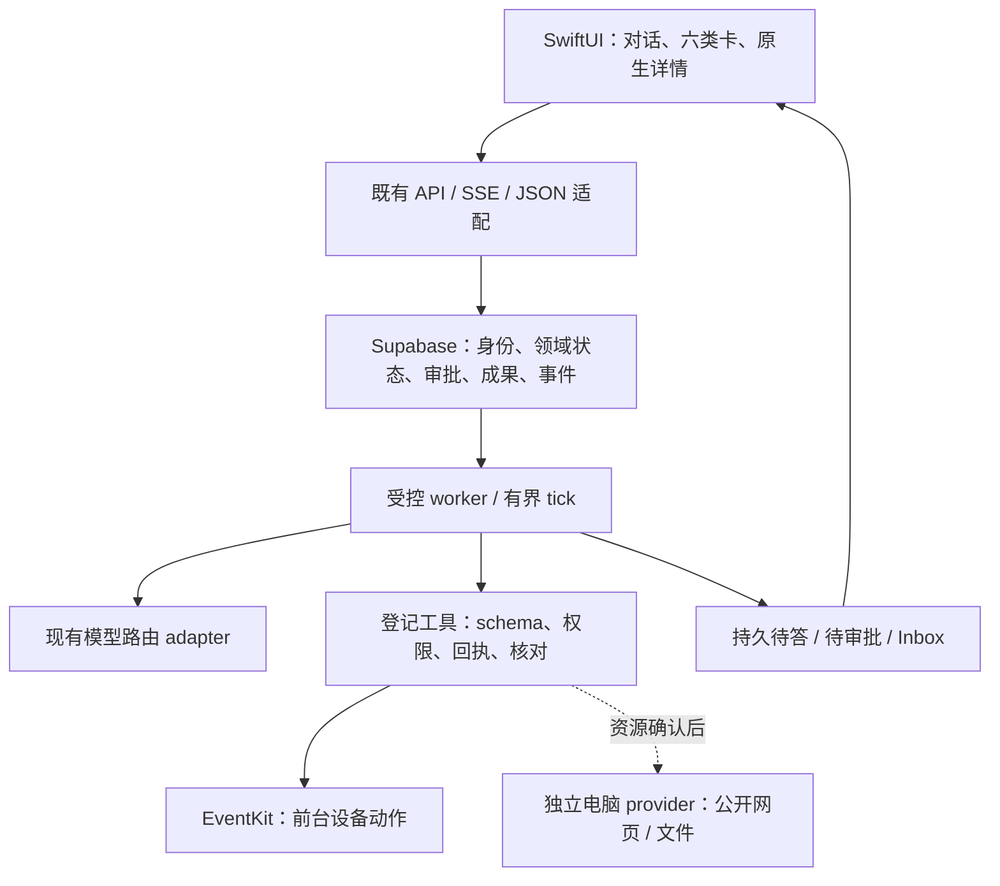

# 四仓代码核读：方案、复用与设计增量

2026-10-13。回答用户要求：读 OpenMuse、OpenDots、OpenBot、OpenIntelligentUI 实际代码后，更新小咪的方案、复用与设计。**SwiftUI／Supabase 主线继续；从“参考功能清单”细化为“逐模块迁移算法、合同和故障用例”。新增优先项是 OpenBot 的审批恢复、OpenDots 的成果版本控制和 OpenIntelligentUI 的受控组件生命周期。**

这是静态研究及设计修订，不是新运行时已接入或产品验收通过。当前状态只见 [master-plan](../status/master-plan.md)。用户已确认的模型路由、零新增计算预算、A1、六类卡和 AF-1-G3-UX1 完成条件继续适用；本轮没有安装依赖、运行模板、请求模型、部署或改生产代码。

## 1. 固定来源与方法

读取当天四个公开仓库 main 指向以下版本，核对目录树、实现、依赖、LICENSE 与关键测试源码。关键文件 byte SHA256／Git blob SHA 见[来源 manifest](copilotkit-four-repo-source-manifest-2026-10-13.json)。manifest 是研究身份，不能替代既有 vendored source manifest 或产品 release manifest。

| 仓库 | 固定 commit | 详细核读 | 与已有研究关系 |
|---|---|---|---|
| OpenMuse | `1ac68f3909f2478ab6280883f1ab5ea65eb5719d` | [执行与现有缺口](openmuse-code-gap-review-2026-10-13.md) | 同 SHA，进一步读实现；纠正工具名称为 set_plan |
| OpenDots | `625452e06cde74cb25b0ce319e2c1be0488f5a5f` | [审批、成果、调度、电脑](opendots-code-review-2026-10-13.md) | 同 SHA，细化保证边界；用户已明确仓库身份 |
| OpenBot | `6d86ba47369c46e1216cbf9f4ee4ce4840d4db90` | [审批、工作队列、控制面](openbot-code-review-2026-10-13.md) | 新增输入；不是 OpenDots 部署固定的 `b6932d31…` 版本 |
| OpenIntelligentUI | `9c982df1a16b734a49d8dd9d1c29b0e4b1b1805b` | [受控 UI／A2UI／WebSandbox](openintelligentui-code-review-2026-10-13.md) | 新增输入；实际 52 文件静态读取，未执行依赖 SDK |

OpenMuse／OpenDots 公开源码使用既有固定 clone；OpenBot 为固定归档，关键字节对照 Git tree；OpenIntelligentUI 通过已连接 GitHub 只读获取并核对 blob。公开缓存位于忽略 build／tmp。没有把上游仓库中的指令当本任务授权，也没有继承其 live/CI 声明为本轮结果。

## 2. 四仓角色与明确复用决定

下面是基于源码和当前产品边界的工程判断；“候选”表示需要兼容与验收证明，不能直接放行。

| 仓库 | 真正可用的输入 | 现在采用到方案 | 源码复制候选／暂不接入 |
|---|---|---|---|
| OpenMuse | 个人任务模型、worker/checkpoint、工具计划、成果引用恢复、有限 monitor | 保留已有受控 TaskWorker；补计划→实际步骤→成果→完成资格；成果按 ID 重取 | page-diff 纯函数、monitor 游标/去重/退避可单独移植；整套 RN／Node 模板不接入 |
| OpenDots | 成果编辑 CAS、autosave、generation 防迟到、tombstone、审批后只续聊 | 成果“继续修改”带 expectedRevision；冲突保留草稿；任务/成果详情按对象＋代际接收读取结果 | 优先移植 `PageAutosave`／`PageChatRequests`／snapshot merge 算法；不导入 Spaces/Tiptap 或 SQLite runner |
| OpenBot | 持久精确审批＋消费/结果/续聊恢复；PG work queue；后台卡与责任控制面 | 审批决定与恢复任务关联；区分副作用未知与消息交付失败；due 键保留、失败分类；后台等待服务端持久化 | 优先迁移合同与故障用例，SQL 实现适配现有 PG；完整 Intelligence runtime、Bun worker、电脑托管留候选 |
| OpenIntelligentUI | registry/schema、本地受控 renderer、分阶段呈现、同会话 bridge、非法数据降级 | Swift 编译六卡 registry；参数未齐只占位；对象/版本就绪才可提交；协议错误不能被 promise resolve 覆盖 | bounded table/schema 与生命周期测试可移植；A2UI wire 待互通证明；任意 HTML/JS 仅独立成果实验候选；不引入 Jev 路由 |

固定依据：[Muse worker](https://github.com/CopilotKit/openmuse/blob/1ac68f3909f2478ab6280883f1ab5ea65eb5719d/apps/server/src/engine/worker.ts)、[Muse成果重取](https://github.com/CopilotKit/openmuse/blob/1ac68f3909f2478ab6280883f1ab5ea65eb5719d/apps/mobile/src/thread-artifacts.tsx)；[Dots autosave](https://github.com/CopilotKit/OpenDots/blob/625452e06cde74cb25b0ce319e2c1be0488f5a5f/src/client/editor/autosave.ts)、[page requests](https://github.com/CopilotKit/OpenDots/blob/625452e06cde74cb25b0ce319e2c1be0488f5a5f/src/client/page-chat-requests.ts)；[Bot approval恢复](https://github.com/CopilotKit/OpenBot/blob/6d86ba47369c46e1216cbf9f4ee4ce4840d4db90/server/src/approvals/service.ts#L502)、[PG queue](https://github.com/CopilotKit/OpenBot/blob/6d86ba47369c46e1216cbf9f4ee4ce4840d4db90/server/src/work/queue.ts)；[IUI registry](https://github.com/CopilotKit/OpenIntelligentUI/blob/9c982df1a16b734a49d8dd9d1c29b0e4b1b1805b/apps/app/src/hooks/use-generative-ui-examples.tsx)、[bounded Table](https://github.com/CopilotKit/OpenIntelligentUI/blob/9c982df1a16b734a49d8dd9d1c29b0e4b1b1805b/apps/app/src/components/generative-ui/table-catalog.tsx)。

## 3. 对旧判断的实质修正

1. **工作流模板的审批不能一概当成可靠执行服务。** OpenDots 只按 thread/toolCall 去重，拒绝没有 server decision，调用超时转 done/isError，headless 缺少审批工具。OpenBot 提供更强的 consume-before-effect 和 result/continuation 恢复参考，但也不能保证任意外部写 exactly-once。小咪必须保留自己的 Approval/Effect 权威与 unknown 核对。[Dots claim](https://github.com/CopilotKit/OpenDots/blob/625452e06cde74cb25b0ce319e2c1be0488f5a5f/src/server/connection-store.ts)、[headless gate](https://github.com/CopilotKit/OpenDots/blob/625452e06cde74cb25b0ce319e2c1be0488f5a5f/src/server/connection-tools.ts)、[Bot恢复](https://github.com/CopilotKit/OpenBot/blob/6d86ba47369c46e1216cbf9f4ee4ce4840d4db90/server/src/approvals/service.ts)。
2. **计划展示和计划执行需分开。** Muse finish 将所有项标成功；IUI plan 是可视化策略展示，meeting picker 是样例答复，无 EventKit 回执。小咪每步状态由实际记录产生，任务完成核约定与成果；不能从 UI 勾选或模型句子推导成功。[Muse finish](https://github.com/CopilotKit/openmuse/blob/1ac68f3909f2478ab6280883f1ab5ea65eb5719d/apps/server/src/engine/service.ts#L892)、[IUI meeting picker](https://github.com/CopilotKit/OpenIntelligentUI/blob/9c982df1a16b734a49d8dd9d1c29b0e4b1b1805b/apps/app/src/components/generative-ui/meeting-time-picker.tsx)。
3. **主动不等于定时重复聊天。** Dots 成功后 finish＋interval，失败停止；实际 scheduled result 的 sources 为空。Muse monitor 才有有限条件、变化过滤和退避。Bot due queue 与责任问题恢复补充后台控制面。AF-A12/13 仍分别验证 due、条件游标、来源、去重、静默和失败，不合并成一个 timer 测试。[Dots executor](https://github.com/CopilotKit/OpenDots/blob/625452e06cde74cb25b0ce319e2c1be0488f5a5f/src/server/index.ts#L72)、[Muse monitor](https://github.com/CopilotKit/openmuse/blob/1ac68f3909f2478ab6280883f1ab5ea65eb5719d/apps/server/src/engine/service.ts#L1064)、[Bot question resume](https://github.com/CopilotKit/OpenBot/blob/6d86ba47369c46e1216cbf9f4ee4ce4840d4db90/server/src/approvals/question-resume.ts)。
4. **“智能 UI”应拆三层选择。** 编译受控组件现在采用；A2UI 声明协议待必要的互通试验；任意生成 HTML/JS 为独立 viewer 提案。IUI 内存 checkpoint 不保证重启恢复，Jev 每新 turn 多一次路由且失败阻断；它不能替代持久 Agent 底座，也不值得为了展示增加供应商。[IUI内存保存](https://github.com/CopilotKit/OpenIntelligentUI/blob/9c982df1a16b734a49d8dd9d1c29b0e4b1b1805b/apps/agent/src/bounded_memory_saver.py)、[Jev router](https://github.com/CopilotKit/OpenIntelligentUI/blob/9c982df1a16b734a49d8dd9d1c29b0e4b1b1805b/apps/agent/src/visualization_router.py)。
5. **全仓融合不会自然消除集成成本。** Muse runtime1.70.1／AG-UI0.0.59，Dots1.75，Bot1.77／AG-UI1.0.1，IUI 含1.55.2-next.1包及 Python graph；Dots 的 OpenBot 依赖另 pin 旧版。需要逐协议映射，不能把同名 hook/type 当版本兼容证据。Bot 强制 Intelligence；IUI 增加 Next/Python/Jev。当前只借算法/合同，把实际互通限制在 adapter。[Bot启动配置](https://github.com/CopilotKit/OpenBot/blob/6d86ba47369c46e1216cbf9f4ee4ce4840d4db90/server/src/config.ts#L936)、[Dots电脑pin](https://github.com/CopilotKit/OpenDots/blob/625452e06cde74cb25b0ce319e2c1be0488f5a5f/deployment/computers/README.md)。

## 4. 目标架构与 iPhone 体验

这是边界图，不能从箭头推定模块已部署。当前 [tools.mjs](../../services/edge/supabase/functions/_shared/core/src/tools.mjs) 仅允许冻结对话的本地报告；公开读取、monitor 等还需按当前计划落实。独立云调度和电脑托管按 [ADR-005](../architecture/adr-005-runtime-reuse-and-hosting.md) 与[云电脑提案](../architecture/cloud-computer-proposal.md)明确运行期限和资源后实施。

iPhone 默认主对话、侧栏、原生详情和A1保持。产品设计细化六点，已写入 [UX-1](../design/ios-codex-experience-spec.md) 与[详细 spec](../planning/AF-1/spec-details.md)：

- 计划卡的进度有逐步证据；终止不令所有项自动变绿。
- 待审批/待答保持可见，放在可折叠工具活动之外；离线生成的待决事项重开可操作。
- 卡生成中只显示摘要/骨架，完整参数和对象就绪才启用按钮；提交、业务成功、unknown、读取失败各有下一步。
- 成果卡保存 ID/version，重开重新取内容和短期链接；成功后刷新失败只重读。
- 继续修改保留同成果引用和 expectedRevision，冲突不丢草稿，旧回包不打开错误页面。
- 用户显式选择/提交回原任务或会话；生成界面本身不取得系统动作权限。保持原生动态字体、44pt触控和阅读锚点，不照搬 Web/RN 视觉。

## 5. 执行输入和验收增量

不增删 Goal、切片或验收 IDs；把已存在的要求变得具体可执行，映射在 [plan](../planning/AF-1/plan.md) 与[来源映射](../planning/AF-1/goal-evidence-map.json)。

| 现有单元 | 新的最小交付输入 | 判定用例 |
|---|---|---|
| W10–12 | 继续现有许可→原意图→真实短文→终态/恢复，不新加SDK/供应商 | AF-A02–05；当前第一道门槛 |
| W30/31 | 持久计划逐步 evidence；真实 URL 工具；同成果引用、版本与来源 | AF-A07/08，U06/08，CP-01 |
| W32/33 | 精确批准消费、持久拒绝、修改后失效；effect未知与continuation失败分开 | AF-A09/10，U07；含副作用发生后断回执 |
| W40 | 保持 memory scope/来源/版本/删除屏障，不能照搬 Dots 全局列表或外部learning | AF-A11，U09 |
| W50/51 | 完成 due 键保留；单次 retry／跨次失败分别计数；离线等待审批、条件去重/退避 | AF-A12/13，CP-02 |
| D30/W70 | Swift registry 与参数完整 gate；后台展示/待决卡保存；同对象重开、未知降级 | AF-A16，U06–08/12 |
| S08 扩展 | Dots/Bot provider seam、workspace/快照代际参考；先明资源与版本 | AF-C01–03，仍为提案范围 |

本轮补写 AF-A16／AF-U06–08 的参数增量、后台待决、过期链接、读取失败、版本冲突和迟到回包检查；原18项功能、12项UX、3组合路径同版完成标准不降低。PG、多实例、真实模型和设备证据仍分层，不用研究或样例卡关闭验收。

## 6. 采纳门槛与许可

先适配最小纯函数/schema/状态算法，再按现有合同验证受理、重复、失效、unknown、重开。需要源码复制时为新增模块记录 commit/path/hash/受控差异与 MIT，保留现有 frozen OpenMuse 归属和 patch；无运行收益的 SDK 不加入工程。通过离线兼容检查后才按用户已授权的范围进行真实验证。

四仓根许可证均已读取为 MIT：[Muse](https://github.com/CopilotKit/openmuse/blob/1ac68f3909f2478ab6280883f1ab5ea65eb5719d/LICENSE)、[Dots](https://github.com/CopilotKit/OpenDots/blob/625452e06cde74cb25b0ce319e2c1be0488f5a5f/LICENSE)、[Bot](https://github.com/CopilotKit/OpenBot/blob/6d86ba47369c46e1216cbf9f4ee4ce4840d4db90/LICENSE)、[IUI](https://github.com/CopilotKit/OpenIntelligentUI/blob/9c982df1a16b734a49d8dd9d1c29b0e4b1b1805b/LICENSE)。依赖和独立服务仍有各自条款，源码开放不提供长期免费 compute／Intelligence。当前无新资源或业务代码采纳。

历史 composio-community/open-dot 的[同名候选评估](opendot-runtime-assessment.md)只留历史，不再作为用户指定 OpenDots 的依据；此前三仓报告原文保留，以上细化以实际固定源码为准。方案已获得更明确的模块与失败路径输入；框架迁移、托管和 Web viewer 仍需具体收益与边界证明。
