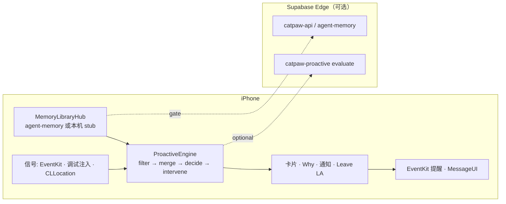

# cat 主动式个人助理：架构（NoBug B 核对）

> 作业：cat 主动式个人助理（iOS Swift Demo）
> 仓库：`github.com/Yankj/cat-m`，分支 `feat/ios-mvp-integration-v2`
> **本文核对到冻结 tip `f8e86d8`**（2026-10-16 18:30 北京时间）
> iOS：`apps/ios-conversation/cat.xcodeproj` · 服务端：`services/edge`
> 演示场景：**会议出发助理（leave_at）** — 不含电话/购物链

### 状态标记

| 标记 | 含义 |
|---|---|
| **[已实现]** | tip `f8e86d8` 有可演示代码 |
| **[部分]** | 有代码但依赖权限 / 模拟器限制 / 后端 gate |
| **[设计]** | 方案在文档，本切片未落地 |

面试与录屏请按标记讲，勿把 [设计] 说成已做完。

---

## 0. 一页纸总览

### 0.1 设计主张

1. **宁可沉默，不可说错** — 去重账本 + 时间窗过滤；误报贵于漏报。 **[已实现]** 端上 ledger / 0–180 分钟窗
2. **端上抓时机，云端可兜底** — 日历 / 定位 / lead 在端；`catpaw-proactive` evaluate 可选。 **[部分]** 远端 evaluate 有客户端，本地规则始终可独立介入
3. **写操作可确认、可解释、可撤销** — Why 面板 + taken 证据 + undo。 **[已实现]**
4. **记忆是一等公民** — lead 必须是 Settings › 记忆 里可删条目，禁止 UserDefaults 冒充 MemoryRef。 **[已实现]**

### 0.2 B 切片数据流

```
EventKit / 调试注入
        ↓
ProactiveEngine.handle
  · leadTime() ← MemoryLibraryHub（useMemory 开才用记忆）
  · travelETA() ← CLLocation When-In-Use 或显式「模拟起点」
  · leave_at = start − lead − travel（未用 ETA 则仅 lead）
        ↓
建议卡 + 本地通知 + catLeave Live Activity
        ↓
用户动作：创建提醒 (EventKit) / 告诉参会人 (MessageUI) / 稍后 / 不用了
```

### 0.3 总体架构（完整愿景 vs B）



| 模块 | B 状态 |
|---|---|
| ProactiveEngine + 调试注入 | [已实现] |
| MemoryLibrary create/load/forget | [已实现] |
| MapKit ETA + 真实/模拟原点 | [已实现] |
| MessageUI notify | [部分] 模拟器 unavailable |
| Leave Live Activity | [已实现] |
| CLMonitor / 围栏 | [设计] |
| Widget 品牌抛光 | [设计] / 出镜非必须 |
| 电话 · 购物 device_call 链 | [部分] 代码有，**演示脚本外** |
| prod migration 已应用 | [设计] 仓库有 SQL，**未**要求 prod 已推 |

---

## 1. 触发与 leave_at  **[已实现]**

- **采集**：`scanCalendar`（EventKit）或调试「注入望京 SOHO」。
- **过滤**：开始于 (0, 180] 分钟；`signal_hash` 去重。
- **lead**：正则匹配记忆内容「提前 N 分钟」；`snapshot.useMemory == false` 或条目删除 → 默认 lead，**无 MemoryRef**。
- **travel**：`MKDirections` transit → automobile → walking；`>180` 分钟视为无效 → 未用到 ETA。
- **原点红线**：仅 When-In-Use 真点或调试「模拟起点 X」；**禁止**静默上海坐标。
- **leave_at**：`start - lead - (usedETA ? travel : 0)`。

---

## 2. 记忆  **[已实现] / gate [部分]**

- 协议 `MemoryLibraryBackend`：`load / update / forget / create / setUseMemory`…
- 优先 `AgentMemoryLibraryBackend`（`POST /items`）。
- Gate 未开通：诚实提示，并 `install` **本机 MemoryLibraryStub** 到同一 Hub，Settings › 记忆 可删。
- **不是** UserDefaults `leadPreferenceKey`（已删除）。

---

## 3. 执行与证据  **[已实现]**

| 动作 | 行为 |
|---|---|
| 创建提醒 | EventKit；idempotent；undo 删提醒并停 LA |
| 告诉参会人 | MessageUI；仅 `.sent` → done；unavailable/cancel/error **不** done，taken 留证 |
| 撤销 | 停 LA；**保留**「已发送短信」证据 |
| 参会人 | EKEvent attendees → 草稿文案 / tel 收件人；`pendingAttendees` 持久化 |

---

## 4. 触达  **[已实现]**

- 应用内建议卡 + Why
- 本地通知（预调度路径 [部分]）
- `catLeaveAttributes` Live Activity（与对话 turn LA 隔离）；倒计时 `Text(date, style: .timer)`；stop 扫描 `Activity.activities`

---

## 5. 服务端  **[部分]**

- `services/edge`：`catpaw-api`、`catpaw-proactive`、`_shared/agent-memory`
- 契约与 migration **在仓库**；**生产是否已 `db push` / 开 gate 不作为本切片验收前提**
- 客户端远端 `evaluate` 失败时本地规则仍可 intervene

---

## 6. 安全与隐私（B 相关）

- 定位：`NSLocationWhenInUseUsageDescription`；调试页可主动请求
- 短信：只起草，用户点发送
- 无本切片向评委索取 prod 密钥或强制 migration

---

## 7. 已知限制

1. 模拟器无法 MessageUI → 必须展示「不标完成」。
2. agent-memory 未开通 → 本机 stub（界面写明）。
3. MapKit 在无网络 / 无定位时 ETA 为空文案必须是「未用到 ETA」。
4. 电话/购物、Widget、CLMonitor 不在 B 录屏脚本。
5. reply-chrome 已合入 `12160c8`，勿再改 chrome。

